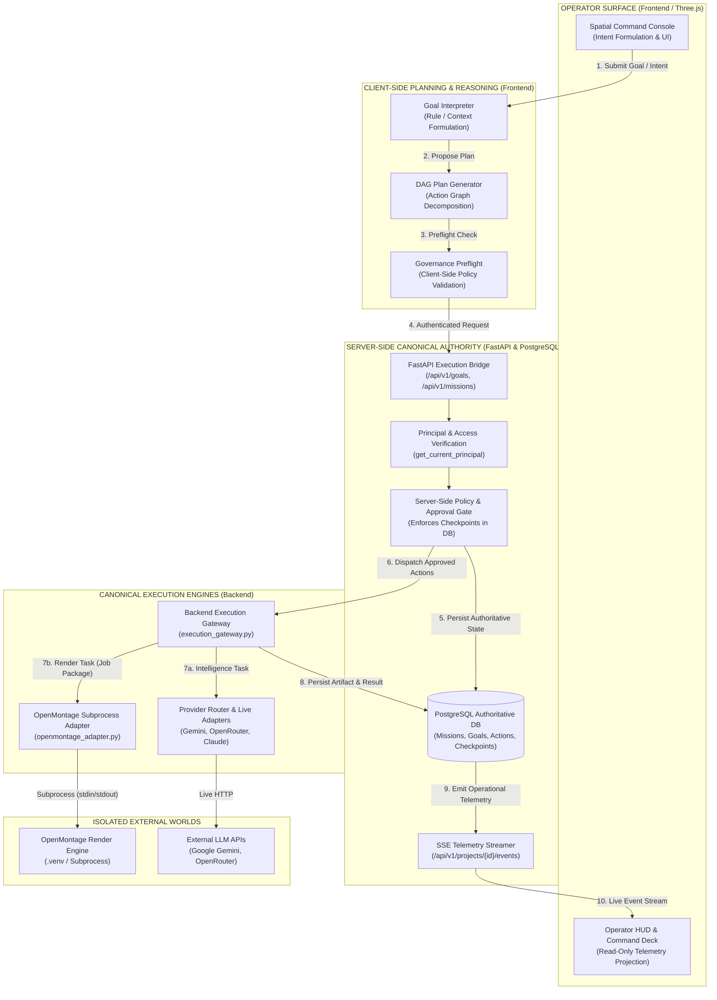
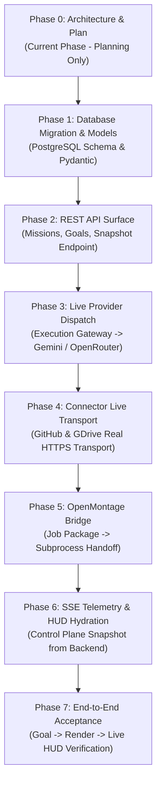

# ARYAOS V1 — STAGE 25, PHASE 0
# REAL UNIFIED EXECUTION BRIDGE: ARCHITECTURE & IMPLEMENTATION PLAN

**Document Version:** 1.0.0  
**Date:** 2026-10-04  
**Status:** COMPLETE & FROZEN — PLANNING ONLY (ZERO CODE MODIFICATIONS)  
**Target:** Bridge Stage 04–24 TypeScript Intelligence System to the Python FastAPI / PostgreSQL / OpenMontage Backend  

---

## 1. Verified Current-State Architecture

Following the Whole-Architecture Alignment Audit, a line-by-line inspection of both backend and frontend repositories was conducted. Below are the verified facts, exact source files, and concrete implementation mechanics.

### 1.1 Frontend Architecture (Stages 04–24)
- **Goal Orchestration & DAG Planning:**
  - File: [`frontend/src/services/goalOrchestrator.ts`](file:///Users/venkatakishorenasina/Documents/arya-os-v1/frontend/src/services/goalOrchestrator.ts#L82)
  - `createAndExecuteGoal()` generates a plan using [`planGenerator.ts`](file:///Users/venkatakishorenasina/Documents/arya-os-v1/frontend/src/services/planGenerator.ts). It executes action DAGs concurrently up to `maxConcurrentActions: 2`.
  - State is tracked in an in-memory `Map<string, Goal>`.
- **Provider Routing & Execution Boundary:**
  - Files: [`frontend/src/services/executionGateway.ts`](file:///Users/venkatakishorenasina/Documents/arya-os-v1/frontend/src/services/executionGateway.ts#L36), [`frontend/src/services/providerExecutionAdapter.ts`](file:///Users/venkatakishorenasina/Documents/arya-os-v1/frontend/src/services/providerExecutionAdapter.ts#L64-L125)
  - **VERIFIED FACT:** The frontend provider adapters for Google Gemini, OpenRouter, and Anthropic Claude **do not make network requests**. Lines 65–81 and 113–124 of `providerExecutionAdapter.ts` construct and return hardcoded string templates (e.g., `"# Architectural Research Synthesis..."`).
- **External Connector Fabric:**
  - Files: [`frontend/src/services/connectorFabric.ts`](file:///Users/venkatakishorenasina/Documents/arya-os-v1/frontend/src/services/connectorFabric.ts), [`frontend/src/services/connectorTransportRegistry.ts`](file:///Users/venkatakishorenasina/Documents/arya-os-v1/frontend/src/services/connectorTransportRegistry.ts#L25-L95)
  - **VERIFIED FACT:** Default registered transport is `MockConnectorTransport`, which serves canned GitHub issues (`aryaos/core #101, #102`) and Google Drive files from in-memory Maps. Zero live HTTP calls are dispatched.
- **Mission Management:**
  - File: [`frontend/src/services/missionManager.ts`](file:///Users/venkatakishorenasina/Documents/arya-os-v1/frontend/src/services/missionManager.ts#L46)
  - **VERIFIED FACT:** `createMission()` is **never called anywhere in the user interface or runtime workflow**. It is invoked exclusively within test files (`MissionControlStage12.test.tsx`, `ControlPlaneIntegrationStage24.test.tsx`). In a clean browser session, `missionManager.listMissions()` returns `[]`.
- **Persistence & Durability:**
  - File: [`frontend/src/services/executionPersistence.ts`](file:///Users/venkatakishorenasina/Documents/arya-os-v1/frontend/src/services/executionPersistence.ts#L75)
  - **VERIFIED FACT:** Autonomy state is serialized to JSON and stored in browser `window.localStorage.setItem('arya_persisted_orchestration_envelope', ...)`. It has an in-memory fallback. It does not communicate with PostgreSQL.
- **Operator HUD & Command Deck (Stage 24):**
  - Files: [`frontend/src/services/controlPlaneSnapshotService.ts`](file:///Users/venkatakishorenasina/Documents/arya-os-v1/frontend/src/services/controlPlaneSnapshotService.ts#L80-L92), [`frontend/src/components/control-plane/OperatorHUD.tsx`](file:///Users/venkatakishorenasina/Documents/arya-os-v1/frontend/src/components/control-plane/OperatorHUD.tsx)
  - **VERIFIED FACT:** `controlPlaneSnapshotService` reads exclusively from client-side singletons (`missionManager`, `policyRegistry`, `recoveryControlPlane`, `operationalTruthService`, `executionPersistence`). It is completely blind to backend database tables or server workers.

### 1.2 Python FastAPI Backend Architecture
- **API Entrypoint & Routers:**
  - File: [`backend/app/main.py`](file:///Users/venkatakishorenasina/Documents/arya-os-v1/backend/app/main.py#L133-L148)
  - Mounted routers: `approvals`, `feature_flags`, `lineage`, `workflow_runs`, `agents`, `workflows`, `creator`, `research`, `publishing`, `analytics`, `learning`, `production`, `health`.
  - All sensitive routers are protected by `Depends(get_current_principal)`.
- **Relational Schema & Migrations:**
  - Files: [`backend/app/models/production.py`](file:///Users/venkatakishorenasina/Documents/arya-os-v1/backend/app/models/production.py), [`backend/app/models/core.py`](file:///Users/venkatakishorenasina/Documents/arya-os-v1/backend/app/models/core.py), [`backend/app/models/approval.py`](file:///Users/venkatakishorenasina/Documents/arya-os-v1/backend/app/models/approval.py)
  - 7 Alembic migrations applied in `alembic/versions/`.
  - Existing tables: `projects`, `workflow_runs`, `production_sequences`, `production_shots`, `production_jobs`, `approval_checkpoints`, `artifacts`, `generation_attempts`, `provider_usage_logs`, `system_logs`, `learning_feedback`.
  - **VERIFIED FACT:** There are **zero tables, schemas, or models for `Mission`, `Goal`, `ActionNode`, or `GovernanceDecision`** in the backend.
- **Provider Infrastructure:**
  - Files: [`backend/app/providers/gemini.py`](file:///Users/venkatakishorenasina/Documents/arya-os-v1/backend/app/providers/gemini.py#L38), [`backend/app/providers/openrouter.py`](file:///Users/venkatakishorenasina/Documents/arya-os-v1/backend/app/providers/openrouter.py#L44), [`backend/app/providers/router.py`](file:///Users/venkatakishorenasina/Documents/arya-os-v1/backend/app/providers/router.py#L53)
  - **VERIFIED FACT:** The backend contains **fully implemented HTTP clients** using `httpx.AsyncClient` that make live calls to Google Gemini (`generativelanguage.googleapis.com`) and OpenRouter (`openrouter.ai/api/v1/chat/completions`) with cost tracking and error handling.
- **OpenMontage Subprocess Execution Adapter:**
  - File: [`backend/app/services/openmontage_adapter.py`](file:///Users/venkatakishorenasina/Documents/arya-os-v1/backend/app/services/openmontage_adapter.py#L96-L125)
  - Executes OpenMontage in an isolated child process via `asyncio.create_subprocess_exec` using OpenMontage's own `.venv/bin/python3`. Passes sanitized tool payloads over `stdin` and parses JSON from `stdout`.
- **Backend Execution Gateway:**
  - File: [`backend/app/services/execution_gateway.py`](file:///Users/venkatakishorenasina/Documents/arya-os-v1/backend/app/services/execution_gateway.py#L50)
  - Translates `AryaJobPackageSchema` into OpenMontage tool inputs (`diagram_gen`, `code_snippet`, media tools) and updates `production_jobs` state (`QUEUED -> SUBMITTED -> RUNNING -> COMPLETED`).
- **Server-Sent Events (SSE) Stream:**
  - File: [`backend/app/api/routers/production.py`](file:///Users/venkatakishorenasina/Documents/arya-os-v1/backend/app/api/routers/production.py#L495-L532)
  - Real-time SSE endpoint at `GET /api/v1/projects/{project_id}/events` with subscriber queues, 15-second heartbeats, and typed `TelemetryEvent` emission.

---

## 2. Evidence-Backed Frontend/Backend Gap Matrix

| Domain | Frontend Implementation (Stages 04–24) | Backend Implementation (`backend/`) | Verified Architectural Disconnect |
| :--- | :--- | :--- | :--- |
| **Missions** | `missionManager.ts` (DAGs, priorities, constraints) | No `Mission` model or table exists | Missions exist only in frontend test memory; zero persistence or server execution. |
| **Autonomous Goals** | `goalOrchestrator.ts` (Goal lifecycle, Action DAG) | `workflow_runs.py` (Video pipeline only) | Frontend goals never register a database record; runs strictly in browser memory. |
| **Provider Execution** | `providerExecutionAdapter.ts` (canned strings) | `backend/app/providers/` (live httpx clients) | Frontend intelligence produces static mock output; backend live adapters are ignored. |
| **OpenMontage Execution** | Completely missing from Stage 04–24 service graph | `openmontage_adapter.py` & `execution_gateway.py` | OpenMontage is never invoked from a user goal in the Spatial Console. |
| **Approvals** | `approvalService.ts` in browser `localStorage` | `approval_checkpoints` table in PostgreSQL | Approving in Operator HUD does not unblock backend jobs or persist to database. |
| **Telemetry & Observability** | `controlPlaneSnapshotService.ts` reads JS heap | SSE stream at `/api/v1/projects/{id}/events` | Operator HUD displays in-memory simulation; backend SSE events are unconsumed. |
| **Durability** | `window.localStorage` (1 envelope key) | PostgreSQL with 7 Alembic migrations | Cache clearing wipes all frontend autonomy history, causal traces, and recovery rules. |

---

## 3. System Ownership & Authority Diagram



### Architectural Authority Rules:
1. **Client-Side:** Forms intents, plans DAG proposals, displays projections, and captures human decisions. **Never exercises autonomous execution authority.**
2. **Server-Side (FastAPI + PostgreSQL):** Authoritative owner of state, database records, human approval checkpoints, and execution dispatches.
3. **Execution Gateway (`execution_gateway.py`):** Canonical boundary for all provider tasks and media generation.
4. **OpenMontage:** Pure execution engine for rendering media from an `AryaJobPackage`. Operates in isolated subprocess.
5. **Operator HUD:** Read-only projection hydrated from PostgreSQL and live SSE telemetry.

---

## 4. Proposed API and Data Contracts

To bridge frontend intelligence to the backend without rewriting existing routers, we define the minimal necessary REST contracts under `/api/v1`:

### 4.1 Mission Management (`/api/v1/missions`)
- **`POST /api/v1/projects/{project_id}/missions`**: Create a durable mission.
  - **Request Schema (`MissionCreate`):**
    ```json
    {
      "title": "string",
      "objective": "string",
      "priority": "LOW | NORMAL | HIGH | CRITICAL",
      "deadline": "ISO8601 | null",
      "goals": [
        { "goal_id": "string", "objective": "string", "order": 1, "is_mandatory": true }
      ],
      "constraints": [ { "type": "string", "rule": "string" } ],
      "completion_criteria": { "minimum_success_rate": 0.8, "require_human_signoff": false }
    }
    ```
  - **Response Schema (`MissionResponse`):** Returns full mission entity with `id` (UUID), `status: "PLANNED"`, `created_at`, `updated_at`.
  - **Authorization:** `verify_project_access` (authenticated principal).
  - **Idempotency:** Client passes `X-Idempotency-Key` header; server validates duplicate submission.

- **`GET /api/v1/projects/{project_id}/missions`**: List all durable missions for project.
- **`GET /api/v1/missions/{mission_id}`**: Fetch single mission with goal progress.
- **`PATCH /api/v1/missions/{mission_id}/status`**: Pause, resume, or cancel mission.

### 4.2 Autonomous Goal & DAG Tracking (`/api/v1/goals`)
- **`POST /api/v1/projects/{project_id}/goals`**: Submit an autonomous goal with planned DAG.
  - **Request Schema (`GoalSubmitRequest`):**
    ```json
    {
      "mission_id": "UUID | null",
      "objective": "string",
      "context_memory_ids": ["string"],
      "plan": {
        "version": 1,
        "actions": [
          {
            "client_action_id": "act-01",
            "title": "string",
            "action_type": "RESEARCH | SYNTHESIS | JOB_PACKAGE | EXTERNAL_ACTION | DECISION",
            "required_capability": "REASONING | RESEARCH | IMAGE_GENERATION | VIDEO_GENERATION | GITHUB_ISSUE_READ",
            "dependencies": [],
            "risk_level": "LOW | MEDIUM | HIGH | CRITICAL",
            "inputs": { "prompt": "string", "parameters": {} }
          }
        ]
      }
    }
    ```
  - **Response Schema (`GoalResponse`):** Returns persisted goal with server UUIDs, status (`READY` or `AWAITING_APPROVAL`), and action nodes.
  - **Behavior:** Persists goal and action nodes in a single database transaction. If any action has `risk_level == "HIGH"` or `"CRITICAL"`, creates an `ApprovalCheckpoint` in `approval_checkpoints`.

- **`GET /api/v1/goals/{goal_id}`**: Fetch goal status, action graph, and current outputs.
- **`POST /api/v1/goals/{goal_id}/actions/{action_id}/execute`**: Dispatch a ready action node to the server Execution Gateway.

### 4.3 Control Plane Snapshot Bridge (`/api/v1/control-plane/snapshot`)
- **`GET /api/v1/projects/{project_id}/control-plane/snapshot`**:
  - Aggregates server-authoritative state across `missions`, `autonomous_goals`, `production_jobs`, `approval_checkpoints`, and system health into the exact schema expected by Stage 24 (`ControlPlaneSnapshot`).
  - Allows `controlPlaneSnapshotService.ts` to hydrate its initial snapshot from PostgreSQL rather than memory fallbacks.

---

## 5. PostgreSQL and Event-Model Design

### 5.1 Minimal Relational Schema (Alembic Migration: `h8c9d0e1f2a3_autonomous_execution_bridge.py`)
To prevent duplicate tables, we anchor all new execution concepts to the existing `projects` table and link them to `production_jobs` and `approval_checkpoints`:

```sql
-- 1. Missions Table
CREATE TABLE missions (
    id UUID PRIMARY KEY,
    project_id UUID NOT NULL REFERENCES projects(id) ON DELETE CASCADE,
    title VARCHAR(255) NOT NULL,
    objective TEXT NOT NULL,
    priority VARCHAR(20) NOT NULL DEFAULT 'NORMAL',
    status VARCHAR(50) NOT NULL DEFAULT 'PLANNED',
    deadline TIMESTAMPTZ NULL,
    progress_json JSONB NOT NULL DEFAULT '{"total_goals":0,"completed_goals":0,"percentage":0}',
    completion_criteria_json JSONB NOT NULL DEFAULT '{}',
    execution_policy_json JSONB NOT NULL DEFAULT '{}',
    created_at TIMESTAMPTZ NOT NULL DEFAULT NOW(),
    updated_at TIMESTAMPTZ NOT NULL DEFAULT NOW()
);
CREATE INDEX ix_missions_project_status ON missions(project_id, status);

-- 2. Autonomous Goals Table
CREATE TABLE autonomous_goals (
    id UUID PRIMARY KEY,
    mission_id UUID NULL REFERENCES missions(id) ON DELETE SET NULL,
    project_id UUID NOT NULL REFERENCES projects(id) ON DELETE CASCADE,
    objective TEXT NOT NULL,
    status VARCHAR(50) NOT NULL DEFAULT 'DRAFT',
    current_plan_version INT NOT NULL DEFAULT 1,
    plan_dag_json JSONB NOT NULL,
    final_summary TEXT NULL,
    failure_reason TEXT NULL,
    created_at TIMESTAMPTZ NOT NULL DEFAULT NOW(),
    updated_at TIMESTAMPTZ NOT NULL DEFAULT NOW()
);
CREATE INDEX ix_autonomous_goals_project_status ON autonomous_goals(project_id, status);
CREATE INDEX ix_autonomous_goals_mission ON autonomous_goals(mission_id);

-- 3. Autonomous Action Nodes Table
CREATE TABLE autonomous_action_nodes (
    id UUID PRIMARY KEY,
    goal_id UUID NOT NULL REFERENCES autonomous_goals(id) ON DELETE CASCADE,
    client_action_id VARCHAR(100) NOT NULL,
    title VARCHAR(255) NOT NULL,
    action_type VARCHAR(50) NOT NULL,
    required_capability VARCHAR(100) NOT NULL,
    status VARCHAR(50) NOT NULL DEFAULT 'PENDING',
    risk_level VARCHAR(20) NOT NULL DEFAULT 'LOW',
    inputs_json JSONB NOT NULL DEFAULT '{}',
    outputs_json JSONB NULL,
    error TEXT NULL,
    cost_usd NUMERIC(10, 4) NOT NULL DEFAULT 0.0,
    duration_seconds FLOAT NULL,
    production_job_id UUID NULL REFERENCES production_jobs(id) ON DELETE SET NULL,
    approval_checkpoint_id UUID NULL REFERENCES approval_checkpoints(id) ON DELETE SET NULL,
    created_at TIMESTAMPTZ NOT NULL DEFAULT NOW(),
    updated_at TIMESTAMPTZ NOT NULL DEFAULT NOW()
);
CREATE INDEX ix_autonomous_actions_goal_status ON autonomous_action_nodes(goal_id, status);

-- 4. Governance Decisions Table
CREATE TABLE governance_decisions (
    id UUID PRIMARY KEY,
    project_id UUID NOT NULL REFERENCES projects(id) ON DELETE CASCADE,
    goal_id UUID NULL REFERENCES autonomous_goals(id) ON DELETE CASCADE,
    action_node_id UUID NULL REFERENCES autonomous_action_nodes(id) ON DELETE CASCADE,
    verdict VARCHAR(50) NOT NULL, -- APPROVED | REJECTED | FLAGGED
    risk_level VARCHAR(20) NOT NULL,
    policy_ids JSONB NOT NULL DEFAULT '[]',
    reasons JSONB NOT NULL DEFAULT '[]',
    created_at TIMESTAMPTZ NOT NULL DEFAULT NOW()
);
CREATE INDEX ix_governance_decisions_project ON governance_decisions(project_id);
```

### 5.2 Real-Time SSE Telemetry Expansion
The existing endpoint `GET /api/v1/projects/{project_id}/events` in [`production.py`](file:///Users/venkatakishorenasina/Documents/arya-os-v1/backend/app/api/routers/production.py#L496) is expanded by updating `TelemetryEvent.event_type` to support autonomy events:
- `"GOAL_CREATED"`, `"GOAL_STARTED"`, `"GOAL_AWAITING_APPROVAL"`, `"GOAL_PROGRESS"`, `"GOAL_COMPLETED"`, `"GOAL_FAILED"`
- `"ACTION_DISPATCHED"`, `"ACTION_COMPLETED"`, `"ACTION_FAILED"`
- `"MISSION_CREATED"`, `"MISSION_PROGRESS"`, `"MISSION_COMPLETED"`, `"MISSION_FAILED"`
- `"GOVERNANCE_DECISION_RECORDED"`

**Reconnection & Deduplication Contract:**
- Each SSE event includes an incrementing `event_id` and ISO-8601 `timestamp`.
- Client includes `Last-Event-ID` header on reconnect; server replays events from database if client disconnected within 60 seconds.
- Reconnection does not alter authoritative state; state is read directly from PostgreSQL via `GET /control-plane/snapshot`.

---

## 6. Provider and OpenMontage Integration Boundaries

### 6.1 Live Provider Execution Boundary
- **Secret Isolation:** Provider API keys (`GEMINI_API_KEY`, `OPENROUTER_API_KEY`, `ANTHROPIC_API_KEY`) reside **strictly in backend environment variables**. The frontend never sees or handles raw credentials.
- **Provider Dispatch:**
  - When an `ActionNode` requires reasoning or research, the backend execution gateway calls `backend/app/providers/router.py::call_with_fallback()`.
  - It invokes `backend/app/providers/gemini.py` or `backend/app/providers/openrouter.py`.
  - Result is normalized, token usage is billed to `provider_usage_logs`, and output is recorded in `autonomous_action_nodes.outputs_json`.

### 6.2 OpenMontage Media Production Boundary
- **Clean Subprocess Separation:**
  - When an `ActionNode` has `action_type: "JOB_PACKAGE"` (media rendering), it generates a validated `AryaJobPackageSchema`.
  - It creates a corresponding `production_jobs` row in PostgreSQL.
  - The backend `execution_gateway.py` invokes `openmontage_adapter.py`.
  - OpenMontage executes in its separate virtualenv, renders the asset (PNG/MP4), and writes it to `backend/storage/artifacts/`.
  - Artifact is validated via `artifact_validator.py` and served via `GET /api/v1/artifacts/{filename}`.
  - **Zero OpenMontage code is imported into the AryaOS process.**

---

## 7. Security and Failure-Handling Design

### 7.1 Security Invariants
1. **No Client-Side Authorization Bypass:** A frontend-supplied `isApproved: true` flag is strictly ignored. The server checks the `approval_checkpoints` table for a record with `action == "APPROVE"` and `decided_at IS NOT NULL`.
2. **Constant-Time Principal Authentication:** Every request to `/api/v1/` verifies the Bearer token using `hmac.compare_digest` against `ARYA_API_KEY`.
3. **Secret Redaction:** Any input payload or prompt stored in PostgreSQL is pre-sanitized using regex redacting `Bearer [REDACTED_TOKEN]`, `sk-[REDACTED_KEY]`, and `ghp_[REDACTED_TOKEN]`.
4. **Path Traversal Immunity:** Artifact downloads and OpenMontage tool executions use strict regex whitelists preventing directory traversal.

### 7.2 Failure Handling & Idempotency
1. **Idempotency Keys:** Every goal and action submission accepts an `idempotency_key`. If the same key is submitted twice within 24 hours, the existing row is returned without re-executing.
2. **Bounded Retries & No Retry Storms:** Maximum automatic retries for transient provider failures is capped at `3`. After 3 failures, action transitions to `FAILED`, and recovery control plane evaluates fallback.
3. **Preservation of UNKNOWN:** If an external provider or OpenMontage subprocess times out or crashes unexpectedly, the action state is set to `UNKNOWN_PENDING_RECONCILIATION`. It is **never coerced to SUCCESS**.
4. **Worker Crash Recovery:** On backend boot, `lifespan()` scans for `EXECUTING` goals without recent heartbeats (> 120s) and transitions them to `RECOVERY_REQUIRED`.

---

## 8. Incremental Implementation Phases

Stage 25 is subdivided into 7 strictly ordered, independently verifiable phases:



### Phase Details:

- **Phase 0: Architecture, System Mapping & Execution Bridge Plan (CURRENT)**
  - Deliverable: This comprehensive plan document.
  - Verification: Read-only inspection; zero code modifications.

- **Phase 1: PostgreSQL Schema, Alembic Migration & Domain Models**
  - Create Alembic migration `h8c9d0e1f2a3_autonomous_execution_bridge.py`.
  - Add SQLAlchemy models: `Mission`, `AutonomousGoal`, `AutonomousActionNode`, `GovernanceDecision`.
  - Add Pydantic schemas in `backend/app/schemas/execution_bridge.py`.
  - Verification: Run migration up/down cleanly against test PostgreSQL.

- **Phase 2: FastAPI REST API Surface for Missions & Goals**
  - Implement `backend/app/api/routers/missions.py` and `backend/app/api/routers/goals.py`.
  - Add `GET /api/v1/projects/{project_id}/control-plane/snapshot`.
  - Verification: Pytest suite with `httpx.AsyncClient` testing CRUD operations and idempotency.

- **Phase 3: Server-Side Governed Execution Gateway & Real Provider Dispatch**
  - Connect `autonomous_action_nodes` execution to `backend/app/services/execution_gateway.py`.
  - Wire to `backend/app/providers/gemini.py` and `openrouter.py`.
  - Replace frontend `providerExecutionAdapter.ts` canned string output with HTTP calls to backend endpoint.
  - Verification: Real API test verifying live token generation and error handling.

- **Phase 4: Connector Fabric Live Transport & Ephemeral Credential Security**
  - Implement real HTTPS transport in `frontend/src/services/connectorTransportRegistry.ts` (proxied through backend to avoid CORS and protect tokens).
  - Add backend connector proxy endpoints `/api/v1/connectors/github` and `/api/v1/connectors/gdrive`.
  - Verification: Integration tests against live GitHub/Drive APIs (with test credentials) and mocked transport.

- **Phase 5: OpenMontage Job Package Subprocess Handoff**
  - Wire frontend goal DAGs containing media generation actions to submit `AryaJobPackage` to backend `execution_gateway.py`.
  - Backend executes tool via `openmontage_adapter.py` and returns verified artifact URL.
  - Verification: End-to-end execution of `diagram_gen` tool producing a real PNG artifact in `storage/artifacts/`.

- **Phase 6: Real-Time SSE Telemetry & Operator HUD Hydration**
  - Wire `frontend/src/services/controlPlaneSnapshotService.ts` to fetch initial state from `/api/v1/projects/{id}/control-plane/snapshot` and listen to `/api/v1/projects/{id}/events`.
  - Operator HUD displays live database state with zero reliance on `localStorage`.
  - Verification: UI tests verifying HUD updates when backend emits SSE events.

- **Phase 7: End-to-End Acceptance & Stage Freeze**
  - Execute full end-to-end integration test: User submits goal in Spatial Console -> Persisted in DB -> Provider generates script -> OpenMontage renders diagram -> Telemetry emitted -> Operator HUD shows verified success.
  - Full test suite execution (frontend + backend).
  - Verification of Stage 03 Blender SHA-256 and GLB baselines.

---

## 9. Exact Acceptance Criteria and Test Strategy

### 9.1 Phase-by-Phase Acceptance Criteria
1. **Phase 1 Acceptance:** Migration applies and rolls back cleanly in PostgreSQL. Models pass foreign key and cascade deletion tests.
2. **Phase 2 Acceptance:** All endpoints return 200/201 with valid JWT/Bearer auth. 401 on missing auth. Duplicate submissions return cached result.
3. **Phase 3 Acceptance:** Real LLM call produces dynamic, non-canned response. Tokens and costs recorded in `provider_usage_logs`.
4. **Phase 4 Acceptance:** Connectors execute real HTTPS requests without exposing tokens in logs or responses.
5. **Phase 5 Acceptance:** `AryaJobPackage` handoff creates an artifact file on disk verified by SHA-256 and magic byte inspection.
6. **Phase 6 Acceptance:** Terminating browser session and reopening restores exact state from PostgreSQL. SSE reconnects automatically.
7. **Phase 7 Acceptance:** Full system passes the canonical Golden Path test without manual database edits or mock overrides.

### 9.2 The Canonical Acceptance Test Specification
**Test Name:** `test_e2e_autonomous_goal_to_render_and_hud`
1. Authenticate as operator with `Bearer test-api-key`.
2. Submit Goal: `"Create architecture diagram for memory environment"`.
3. Assert Goal created in PostgreSQL with status `READY`.
4. Assert Action 1 (`REASONING`) executes via Gemini adapter and produces diagram spec.
5. Assert Action 2 (`JOB_PACKAGE`) submits package to OpenMontage adapter.
6. Assert OpenMontage executes `diagram_gen` in subprocess and produces `artifact_*.png`.
7. Assert SSE stream emits `JOB_STARTED`, `JOB_COMPLETED`, and `ARTIFACT_READY`.
8. Assert Operator HUD receives events and displays completed node with verified artifact preview.
9. Assert zero unhandled exceptions, zero secret leaks in logs, and exact preservation of Blender SHA-256.

---

## 10. Risks, Unresolved Questions, and Assumptions

### 10.1 Risks & Mitigation
- **Risk 1: Provider Rate Limits & Costs**
  - *Mitigation:* Centralized cost ceilings in `backend/app/providers/router.py` prevent runaway spend. Fallback to cheap/free models (e.g. `gemini-2.0-flash-lite`).
- **Risk 2: OpenMontage Subprocess Latency**
  - *Mitigation:* Heavy render jobs run asynchronously in background tasks or Celery; progress reported via SSE.
- **Risk 3: Frontend Test Suite Invalidation**
  - *Mitigation:* Existing unit tests (1,766 tests) will continue to pass because in-memory mocks remain available for offline unit test execution (`executionMode: 'TEST'`). The live bridge is activated in `'REAL'` mode.

### 10.2 Assumptions
- OpenMontage repository exists at `/Users/venkatakishorenasina/Documents/OpenMontage` and has a working Python virtual environment.
- PostgreSQL and Redis containers defined in `docker-compose.yml` are accessible.
- Valid API keys for Google Gemini and OpenRouter are available in environment or `.env`.

---

## 11. Explicit List of Files Expected to Change

### Backend Files to Add / Modify:
- **Add:** `alembic/versions/h8c9d0e1f2a3_autonomous_execution_bridge.py` (New migration)
- **Add:** `backend/app/models/execution_bridge.py` (`Mission`, `AutonomousGoal`, `AutonomousActionNode`)
- **Add:** `backend/app/schemas/execution_bridge.py` (Pydantic request/response schemas)
- **Add:** `backend/app/api/routers/missions.py` (Mission REST router)
- **Add:** `backend/app/api/routers/goals.py` (Goal REST router)
- **Add:** `backend/app/services/goal_execution_service.py` (Server-side goal orchestrator)
- **Modify:** `backend/app/main.py` (Include new routers)
- **Modify:** `backend/app/schemas/production.py` (Expand `TelemetryEvent.event_type`)
- **Modify:** `backend/app/services/execution_gateway.py` (Link action nodes to production jobs)

### Frontend Files to Add / Modify:
- **Add:** `frontend/src/api/executionBridgeApi.ts` (Client for `/api/v1/missions` and `/api/v1/goals`)
- **Modify:** `frontend/src/services/providerExecutionAdapter.ts` (Call `executionBridgeApi` in `'REAL'` mode)
- **Modify:** `frontend/src/services/executionPersistence.ts` (Synchronize with backend REST API)
- **Modify:** `frontend/src/services/controlPlaneSnapshotService.ts` (Hydrate from REST snapshot & SSE stream)
- **Modify:** `frontend/src/components/spatial/SpatialCommandConsole.tsx` (Add Mission creation trigger)

---

## 12. Recommended First Implementation Phase

### **AUTHORIZE STAGE 25, PHASE 1: DATABASE MIGRATION & DOMAIN MODELS**
**Objective of Phase 1:**
1. Generate and apply Alembic migration `h8c9d0e1f2a3_autonomous_execution_bridge.py` in PostgreSQL.
2. Implement SQLAlchemy models in `backend/app/models/execution_bridge.py`.
3. Implement Pydantic schemas in `backend/app/schemas/execution_bridge.py`.
4. Add backend unit tests verifying table constraints, foreign keys, and JSONB serialization.

**Why Phase 1 First?**
Establishing the durable database schema is the single prerequisite for all downstream execution, provider routing, and telemetry hydration. It introduces zero risk to the frontend, touches zero UI components, and establishes the foundational substrate upon which real execution will run.

---

## Final Recommendation: **GO FOR PHASE 1 IMPLEMENTATION**
- **Phase 9.2 (UI Polish):** **NO-GO / DEFERRED INDEFINITELY.**
- **Stage 25, Phase 0 (Planning):** **COMPLETE & READY FOR REVIEW.**
- **Stage 25, Phase 1 (Schema & Models):** **RECOMMENDED FOR AUTHORIZATION.**
