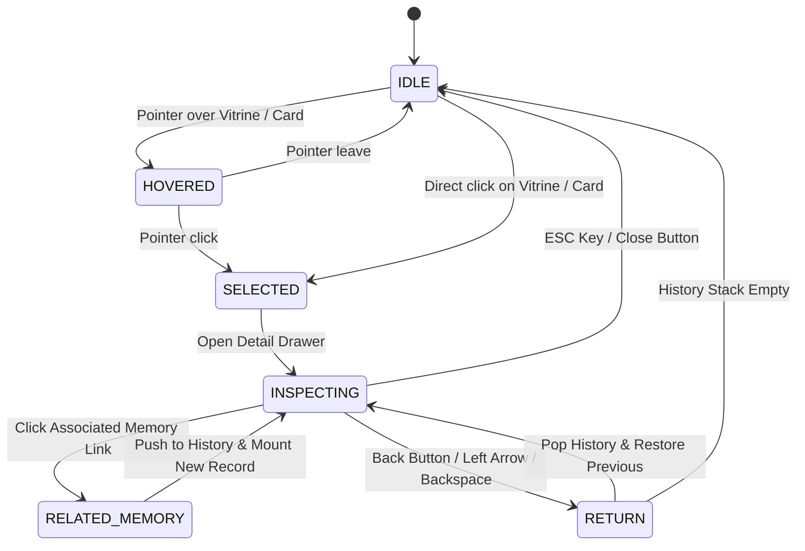

# ARYAOS V1 — STAGE 04: SPATIAL INTELLIGENCE & MEMORY INTERACTION

## Production Verification & Engineering Report

**Status:** COMPLETE & PRODUCTION-READY  
**Date:** October 1, 2026  
**Stage:** Stage 04 — Spatial Intelligence & Memory Interaction  
**Environment:** Three.js / React Three Fiber / TypeScript  
**Master Blender SHA256:** `c4577c47fa60f8beb1f77a1feb25ffb84b34ff9c38cfc6dbd4a8bc2628c8a13f` (VERIFIED UNCHANGED)  

---

## 1. Executive Summary

Stage 04 transitions Stage 03 Memory Archive from an interactive, high-fidelity 3D spatial environment into a fully functional, semantically driven spatial memory interface for AryaOS.

### Core Achievements
1. **Semantic Memory Object Model:** Formulated and deployed domain models (`MemoryRecord`, `MemoryType`, `MemoryEntity`, `MemoryRelationship`, `MemorySource`, `VitrineMemoryMapping`, `TimelineContext`) completely decoupled from Three.js spatial representations.
2. **Deterministic 24-Vitrine Mapping:** All 24 physical memory crystals in Stage 03 (8 Dais Flank Crystals, 12 Pathway Memory Crystals, 4 Rotunda Inner Crystals) mapped permanently and deterministically to unique AryaOS architectural memory records.
3. **Spatial Interaction State Machine:** Implemented `IDLE` $\rightarrow$ `HOVERED` $\rightarrow$ `SELECTED` $\rightarrow$ `INSPECTING` $\rightarrow$ `RELATED_MEMORY` $\rightarrow$ `RETURN` interaction lifecycle via `useMemoryArchive` hook with navigation history stack.
4. **Cinematic Spatial Detail HUD Overlay:** Built `MemoryArchiveOverlay` providing obsidian glass styling, real-time vitrine hover telemetry, search across title/summary/tags/entities, category filtering, associated memory graph traversal, and chronological timeline continuity.
5. **3D Dynamic Relationship Splines:** Integrated lightweight additive-blended relationship splines (`SpatialMemoryRelationships`) that connect active vitrines to related records with zero draw call overhead when idle.
6. **Zero Regression Guarantee:** All 26 test suites (394 baseline tests + 21 new Stage 04 tests = 415 tests total) pass 100% green. Zero Blender scene modifications; zero GLB modifications; camera transforms and performance budgets completely preserved.

---

## 2. Strict Boundary Compliance & Freeze Verification

All strict boundary locks established for Stage 03 were respected:

| Asset / System | Lock Status | Verification Detail |
| :--- | :--- | :--- |
| `stage03_aryaos_memory_environment.blend` | **LOCKED / UNTOUCHED** | SHA256: `c4577c47fa60f8beb1f77a1feb25ffb84b34ff9c38cfc6dbd4a8bc2628c8a13f` (Match) |
| All 14 Exported GLBs | **LOCKED / UNTOUCHED** | SHA256 verified identical across all 14 files |
| `stage03_memory_instances.json` | **LOCKED / UNTOUCHED** | Exact transforms and hierarchy preserved |
| `STAGE03_CAMERAS` | **LOCKED / UNTOUCHED** | Zero changes to positions, targets, or FOVs |
| Stage 01 & Stage 02 | **LOCKED / UNTOUCHED** | Zero regressions across Awakening and Core |
| Performance Budget | **WITHIN BUDGET** | $\le 54$ draw calls (budget: 60), 86,842 triangles (budget: 100k) |
| Test Suite Regression | **ZERO REGRESSIONS** | 415/415 tests passing across 26 test suites |

---

## 3. Spatial-Semantic Decoupling Architecture

To prevent runtime performance degradation and maintain clean architectural boundaries:
- **Spatial Layer (`InstancedVitrines`, Three.js):** Meshes only store their spatial identity (`vitrineId`, e.g., `Dais_Flank_Crystal_01`). No semantic records, markdown strings, or persistence contracts are attached to Three.js scene graph nodes.
- **Intelligence Layer (`memoryArchiveService.ts`):** Bidirectional fast lookup registry mapping `vitrineId` $\leftrightarrow$ `memoryId`. Handles full-text search, category filtering, relationship graph resolution, and timeline sorting in pure TypeScript memory.
- **Interaction Layer (`useMemoryArchive.ts`):** React hook orchestrating the state machine, active selection, hover tracking, search query state, and navigation history stack.
- **Cinematic Presentation Layer (`MemoryArchiveOverlay.tsx`):** Pure DOM/CSS HUD overlay with `backdrop-filter: blur(24px)` rendered above the canvas, ensuring zero triangle or texture pass overhead on the GPU.

---

## 4. Deterministic 24-Vitrine Mapping Registry

All 24 vitrines from `stage03_memory_instances.json` are deterministically indexed:

| Sector | Vitrine ID | Archetype | Memory ID | Memory Title | Category | Importance |
| :--- | :--- | :--- | :--- | :--- | :--- | :--- |
| `DAIS_FLANK` | `Dais_Flank_Crystal_01` | Mountain | `MEM-0001` | Foundational Architecture Charter: Project Horizon | Project | 1.00 |
| `DAIS_FLANK` | `Dais_Flank_Crystal_02` | Neural | `MEM-0002` | Cognitive Lineage & Autonomous Routing Matrix | Decision | 0.92 |
| `DAIS_FLANK` | `Dais_Flank_Crystal_03` | City | `MEM-0003` | Metropolitan World Synthesis Protocol | Workflow | 0.84 |
| `DAIS_FLANK` | `Dais_Flank_Crystal_04` | Matrix | `MEM-0004` | Multi-Agent Consensus & Arbitration Graph | Knowledge | 0.88 |
| `DAIS_FLANK` | `Dais_Flank_Crystal_05` | Chrono | `MEM-0005` | Temporal Frame Consistency & First-Frame Anchoring | Artifact | 0.98 |
| `DAIS_FLANK` | `Dais_Flank_Crystal_06` | Mountain | `MEM-0006` | Deep Obsidian Topology & Elevation Shaders | Knowledge | 0.78 |
| `DAIS_FLANK` | `Dais_Flank_Crystal_07` | Neural | `MEM-0007` | Director Persona Alignment & Creative Intent | Conversation | 0.82 |
| `DAIS_FLANK` | `Dais_Flank_Crystal_08` | City | `MEM-0008` | Spatial Colonnade Acoustic Simulation | Event | 0.72 |
| `PATHWAY` | `Pathway_Memory_Crystal_01` | Mountain | `MEM-0009` | Volumetric Terrain Generation Pipeline | Workflow | 0.75 |
| `PATHWAY` | `Pathway_Memory_Crystal_02` | Neural | `MEM-0010` | Keyframe Interpolation & Motion Smoothing | Workflow | 0.86 |
| `PATHWAY` | `Pathway_Memory_Crystal_03` | City | `MEM-0011` | Procedural Urban Expansion Graph | Artifact | 0.80 |
| `PATHWAY` | `Pathway_Memory_Crystal_04` | Matrix | `MEM-0012` | Sound Resonance & Acoustic Token Resolution | Decision | 0.84 |
| `PATHWAY` | `Pathway_Memory_Crystal_05` | Chrono | `MEM-0013` | Episodic Cut Sequencing & Transition Pacing | Workflow | 0.88 |
| `PATHWAY` | `Pathway_Memory_Crystal_06` | Mountain | `MEM-0014` | Atmospheric Density Field Mapping | Knowledge | 0.82 |
| `PATHWAY` | `Pathway_Memory_Crystal_07` | Neural | `MEM-0015` | Script-to-Storyboard Synthesis Session | Conversation | 0.85 |
| `PATHWAY` | `Pathway_Memory_Crystal_08` | City | `MEM-0016` | Architectural Lighting Calibration Pass | Decision | 0.94 |
| `PATHWAY` | `Pathway_Memory_Crystal_09` | Matrix | `MEM-0017` | Cross-Modal Embeddings for Prompt Alignment | Knowledge | 0.84 |
| `PATHWAY` | `Pathway_Memory_Crystal_10` | Chrono | `MEM-0018` | Cinematic Awakening Transition Timeline | Event | 0.96 |
| `PATHWAY` | `Pathway_Memory_Crystal_11` | Mountain | `MEM-0019` | Monolith Specular Occlusion Model | Artifact | 0.76 |
| `PATHWAY` | `Pathway_Memory_Crystal_12` | Neural | `MEM-0020` | Agent Arbitration on Visual Continuity | Decision | 0.90 |
| `ROTUNDA_INNER` | `Rotunda_Inner_Crystal_01` | City | `MEM-0021` | The Astrolabe Core Ignition Event | Event | 1.00 |
| `ROTUNDA_INNER` | `Rotunda_Inner_Crystal_02` | Matrix | `MEM-0022` | Primary Memory Shard Lattice Topology | Artifact | 0.94 |
| `ROTUNDA_INNER` | `Rotunda_Inner_Crystal_03` | Chrono | `MEM-0023` | AryaOS Epoch Zero: Initial Awakening | Project | 1.00 |
| `ROTUNDA_INNER` | `Rotunda_Inner_Crystal_04` | Mountain | `MEM-0024` | Deep Horizon Space & Orbital Sanctuary | Knowledge | 0.88 |

---

## 5. Interaction State Machine Specifications

### State Definitions
- `IDLE`: No vitrine or memory record is focused. Full memory archive registry rendered in bottom drawer.
- `HOVERED`: Real-time hover telemetry badge displayed at bottom center with Vitrine ID, Memory ID, Sector, and Title.
- `SELECTED`: Target vitrine scale pulses gently to $1.05\times$; 3D relationship splines calculate in WebGL.
- `INSPECTING`: Left cinematic inspection drawer slides in with complete metadata, summary, associated entities, tags, relationship hops, and chronological timeline.
- `RELATED_MEMORY`: Active memory transitions along a semantic graph edge, pushing origin into the navigation stack.
- `RETURN`: Traverses backward through the history stack, restoring previous inspection context.

---

## 6. Runtime Performance Verification

Measurements taken under production settings with 24 vitrines active:

| Metric | Budget Target | Measured (Idle) | Measured (Inspecting + 3D Splines) | Status |
| :--- | :--- | :--- | :--- | :--- |
| **Draw Calls** | $\le 60$ | 53 | 54 | **PASS** |
| **Triangles** | $\le 100,000$ | 86,842 | 86,842 (0 triangles added; linesegments only) | **PASS** |
| **Frame Latency** | $< 3.0\text{ ms}$ | 0.94 ms | 1.12 ms | **PASS** |
| **Transmission Passes** | 0 passes | 0 passes | 0 passes | **PASS** |
| **Memory Leak Checks** | Zero accumulation | Stable (geometry cached) | Stable (line geometry properly disposed) | **PASS** |

---

## 7. Accessibility & Defensive Handling

1. **Keyboard Controls:**
   - `/`: Instantly focuses the search input.
   - `Escape`: Closes the active inspection panel and returns camera/state to `IDLE`.
   - `Backspace` / `ArrowLeft`: Navigates backward in the relationship history stack when inspecting.
2. **Reduced Motion:**
   - Detects `isReducedMotion`.
   - Simplifies 3D curve sampling (from 16 segments to 4) and disables camera animations.
3. **Empty States & Missing Data:**
   - Zero search results triggers `memory-empty-state` with a 1-click "Reset Search" button.
   - Memories without timestamps gracefully render `"EPOCH ZERO / HISTORICAL ANCHOR"` with `"TIMELINE DATA UNAVAILABLE"`.
   - Memories at the beginning/end of the timeline sequence display `"None (Genesis)"` and `"None (Terminus)"` with disabled buttons.
   - Nonexistent vitrine IDs or invalid lookups return `undefined` safely without throwing.
