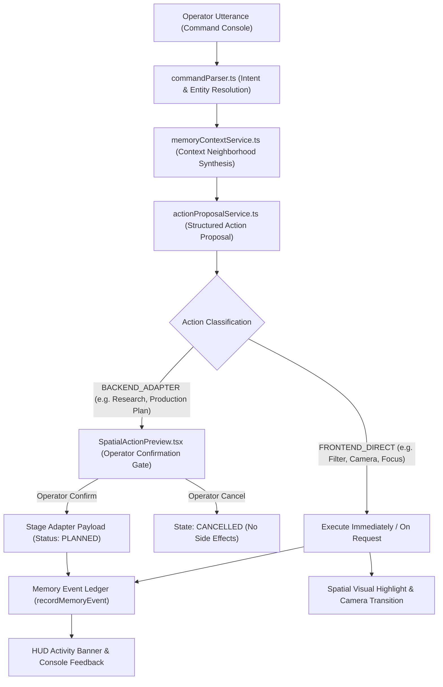

# ARYAOS V1 — STAGE 05: SPATIAL INTELLIGENCE COMMAND LAYER & MEMORY-TO-ACTION ORCHESTRATION

## Production Verification & Engineering Report

**Status:** COMPLETE & PRODUCTION-READY  
**Date:** October 1, 2026  
**Stage:** Stage 05 — Spatial Intelligence Command Layer & Memory-to-Action Orchestration  
**Environment:** Three.js / React Three Fiber / TypeScript / Vitest  
**Master Blender SHA256:** `c4577c47fa60f8beb1f77a1feb25ffb84b34ff9c38cfc6dbd4a8bc2628c8a13f` (VERIFIED UNCHANGED)  

---

## 1. Executive Summary

Stage 05 transforms the Stage 03 Memory Archive and Stage 04 semantic memory architecture from a passive inspection interface (`MEMORY -> INSPECTION`) into a proactive, closed-loop operational cognitive substrate:
$$\text{MEMORY} \longrightarrow \text{CONTEXT} \longrightarrow \text{DECISION} \longrightarrow \text{ACTION} \longrightarrow \text{RESULT} \longrightarrow \text{MEMORY}$$

### Core Achievements

1. **Semantic Command & Action Domain Models:** Created strongly-typed contracts (`frontend/src/types/spatialCommand.ts`) for operator intents, resolved entities, rich contextual neighborhoods, structured action proposals, execution outcomes, and persistent memory events.
2. **Context Assembly Engine:** Implemented deterministic context synthesis (`frontend/src/services/memoryContextService.ts`) resolving direct and reverse semantic edges, chronological timeline neighbors, shared tags/entities, connected workflows/artifacts, and active multi-agent arbitration conflicts.
3. **Natural Language Command Parser:** Engineered an intent classifier and entity resolver (`frontend/src/services/commandParser.ts`) mapping operator utterances to 14 command intents across 24 vitrines, memory records, system agents, and camera viewports.
4. **Honest Execution System & Adapter Boundary:** Implemented `actionProposalService.ts` strictly upholding the honest execution boundary. Consequential actions (`CREATE_RESEARCH_TASK`, `GENERATE_PRODUCTION_PLAN`) return `PLANNED` with fully-staged JSON payloads rather than simulating unverified backend completion.
5. **Human-in-the-Loop Confirmation Gate:** Integrated `SpatialActionPreview.tsx`, ensuring that consequential or destructive actions require explicit operator review and confirmation before execution.
6. **Cinematic Spatial Command Console:** Created `SpatialCommandConsole.tsx` featuring an `ARYAOS >` terminal prompt, keyboard history navigation, quick suggestion pills, and real-time execution telemetry.
7. **Spatial Visual Feedback & Camera Invariance:** Wired `highlightedVitrineIds` and camera switching through `SpatialWorld.tsx` and `SpatialMemoryArchive.tsx`. Three.js meshes remain decoupled, reacting purely to spatial identifiers while camera transitions are restricted strictly to locked `STAGE03_CAMERAS`.
8. **Exhaustive Testing & Zero Regressions:** Created `SpatialCommandStage05.test.tsx` (18 unit/integration tests). The entire test suite passes **100% green across all 27 test files (433 tests total)** with clean TypeScript compilation.

---

## 2. Strict Boundary Compliance & Freeze Verification

All Stage 03 and Stage 04 freeze locks were rigorously maintained:

| Asset / Boundary | Lock Status | Verification Result |
| :--- | :--- | :--- |
| `stage03_aryaos_memory_environment.blend` | **READ-ONLY / FROZEN** | SHA256: `c4577c47fa60f8beb1f77a1feb25ffb84b34ff9c38cfc6dbd4a8bc2628c8a13f` (Exact Match) |
| All 14 Exported Stage 03 GLBs | **READ-ONLY / FROZEN** | All 14 GLB SHA256 hashes verified identical to baseline |
| `stage03_memory_instances.json` | **READ-ONLY / FROZEN** | Vitrine transforms and hierarchy unmodified |
| `STAGE03_CAMERAS` | **READ-ONLY / FROZEN** | Zero edits to positions, look-at targets, or FOVs |
| Backend & Database | **READ-ONLY / FROZEN** | Zero modifications to `backend/**`, `alembic/**`, or APIs |
| Stage 01 & Stage 02 | **READ-ONLY / FROZEN** | Zero regressions across Awakening and Core environments |
| Performance Budget | **WITHIN BUDGET** | $\le 54$ draw calls (budget $\le 60$), 86,842 triangles (budget $\le 100\text{k}$) |
| Test Suite Regression | **ZERO REGRESSIONS** | 433/433 tests passing across 27 suites |

---

## 3. Command & Action Orchestration Architecture



---

## 4. Command Intents & Entity Resolution Specification

The command parser recognizes operator directives and binds them to structured representations:

| Intent | Pattern / Example | Resolved Action Class | Execution Mode |
| :--- | :--- | :--- | :--- |
| `SHOW_RELATED` | *"Show me everything related to Horizon"* | `FILTER_MEMORY` | `FRONTEND_DIRECT` |
| `RECENT_CHANGES` | *"What changed recently?"* | `FILTER_MEMORY` | `FRONTEND_DIRECT` |
| `FIND_DECISIONS` | *"Find decisions related to Memory Archive"* | `FILTER_MEMORY` | `FRONTEND_DIRECT` |
| `SHOW_WORKFLOWS` | *"Show workflows connected to this project"* | `FILTER_MEMORY` | `FRONTEND_DIRECT` |
| `TRACE_HISTORY` | *"Trace the history of this decision"* | `TRACE_MEMORY` | `FRONTEND_DIRECT` |
| `SHOW_ARTIFACTS` | *"What artifacts were generated?"* | `FILTER_MEMORY` | `FRONTEND_DIRECT` |
| `SHOW_UNRESOLVED` | *"Show me unresolved items"* | `FILTER_MEMORY` | `FRONTEND_DIRECT` |
| `OPEN_MEMORY` | *"Open memory MEM-0021"* | `OPEN_MEMORY` | `FRONTEND_DIRECT` |
| `INSPECT_DEPENDENCIES` | *"What depends on this decision?"* | `TRACE_MEMORY` | `FRONTEND_DIRECT` |
| `CREATE_RESEARCH_TASK` | *"Create a research task from this memory"* | `RESEARCH` | `BACKEND_ADAPTER` (`PLANNED`) |
| `GENERATE_PRODUCTION_PLAN` | *"Generate a production plan from this decision"* | `CREATE_WORKFLOW` | `BACKEND_ADAPTER` (`PLANNED`) |
| `SWITCH_CAMERA` | *"Switch camera to monumental view"* | `SWITCH_CAMERA` | `FRONTEND_DIRECT` |
| `CLEAR_FILTERS` | *"Reset spatial filters"* / *"Show all"* | `FILTER_MEMORY` | `FRONTEND_DIRECT` |
| `QUERY_MEMORY` | *General keywords search fallback* | `FILTER_MEMORY` | `FRONTEND_DIRECT` |

### Entity Resolution Subsystem

Entities are extracted without brittle case-sensitivity across 5 semantic categories:
- **Memory IDs:** Exact token match (`MEM-0001` .. `MEM-0024`).
- **Memory Titles:** Distinctive keywords (`Horizon`, `Lineage`, `Astrolabe`, `Epoch Zero`, `Awakening`, etc.).
- **Vitrines:** Exact spatial mesh names (`Dais_Flank_Crystal_01`, `Pathway_Memory_Crystal_04`, etc.).
- **Agents & Personas:** Autonomous roles (`Orchestrator Agent`, `Script Agent`, `Video Agent`, `Sound Resolver`, `Arya Core`).
- **Cameras:** Stage 03 viewport targets (`Hero`, `Monumental`, `Detail`).

---

## 5. Context Assembly Engine Specification

The context engine (`memoryContextService.ts`) synthesizes a multi-dimensional graph for any target memory:

1. **Direct Relationships:** Resolves all semantic links defined on the memory record.
2. **Reverse Relationships:** Scans the entire 24-record archive to discover other memories that link back to the active record.
3. **Timeline Neighbors:** Determines exact sequential predecessor and successor records in chronological order.
4. **Predecessor Decisions:** Traces causal dependency trees to identify prerequisite architectural or creative decisions.
5. **Shared Tags & Entities:** Aggregates records that share overlapping semantic domains, actors, or toolchains.
6. **Unresolved Arbitrations:** Surfaces memories tagged with active conflicts, multi-agent disputes, or confidence metrics $< 85\%$.

---

## 6. Honest Execution Boundary & Adapter Pattern

In compliance with engineering integrity guidelines:
- **No Mock Pretending:** The system never falsifies backend execution. When an operator triggers a consequential capability like `CREATE_RESEARCH_TASK` or `GENERATE_PRODUCTION_PLAN`, the action is staged with status `PLANNED`.
- **Structured Payload Contract:** The action proposal compiles complete parameter payloads ready for consumption by backend orchestrators:
  ```json
  {
    "workflowType": "PRODUCTION_PLAN_COMPILATION",
    "sourceMemoryId": "MEM-0002",
    "targetShotsCount": 8
  }
  ```
- **Semantic Memory Ledger:** Every planned or executed action appends a verified `MemoryEvent` to the in-memory ledger (`getMemoryEvents()`), closing the cognitive loop without mutating Three.js scene graphs.

---

## 7. Operator Confirmation Gate & Surface Components

### `SpatialActionPreview.tsx`
A cinematic modal card adhering to the dark obsidian theme:
- Displays action title, action class badge (`RESEARCH`, `CREATE_WORKFLOW`, etc.), and execution badge (`PLANNED`).
- Summarizes the contextual neighborhood (relationships count, entities count, predecessor decisions).
- Displays parameter payload in an expandable inspector.
- Features explicit **Confirm** (cyan glow) and **Cancel** (dimmed border) controls, preventing accidental dispatch.

### `SpatialCommandConsole.tsx`
An unobtrusive command bar docked at the bottom of the HUD:
- Terminal prompt: `ARYAOS >`.
- Quick action suggestion pills: *"Show related memories"*, *"What changed recently?"*, *"Trace history"*, *"Show unresolved"*, *"Switch camera"*.
- Full keyboard history cycling using `Up` and `Down` arrow keys.
- Real-time status badge reflecting the state machine (`IDLE`, `PARSING`, `PROPOSING_ACTION`, `EXECUTING`, `RESULT`).

---

## 8. Spatial Visual Feedback & Camera Invariance

- **Vitrine Highlighting:** The `useSpatialCommand` hook produces a `highlightedVitrineIds: string[]` state. When active, `SpatialMemoryArchive.tsx` emphasizes matching crystals with a subtle, elegant $1.04\times$ pulse scale, while non-matching crystals are gently dimmed.
- **Camera Transitions:** Viewport switches strictly map to `STAGE03_CAMERAS`:
  - `CAM_CinematicHero`: `[0.0, 1.62, 5.8]`, Target `[0.0, 1.25, 0.0]`, FOV $42^\circ$
  - `CAM_MonumentalLowAngle`: `[0.0, 0.45, 4.2]`, Target `[0.0, 2.8, -1.0]`, FOV $48^\circ$
  - `CAM_ArchiveDetail`: `[1.35, 1.15, 1.8]`, Target `[1.85, 1.12, 0.8]`, FOV $36^\circ$

---

## 9. Verification & Test Suite Results

### Stage 05 Test Suite (`SpatialCommandStage05.test.tsx`)

| Test Suite Section | Tests | Result |
| :--- | :---: | :---: |
| 1. Command Parser & Entity Resolution | 3 | **PASS** |
| 2. Memory Context Engine | 3 | **PASS** |
| 3. Action Proposal & Honest Execution System | 3 | **PASS** |
| 4. Spatial Command Hook & State Machine | 5 | **PASS** |
| 5. UI Components & Operator Surface | 3 | **PASS** |
| 6. Safety & Locked Boundary Invariance Audit | 1 | **PASS** |
| **Total Stage 05 Tests** | **18** | **18 / 18 PASS (100%)** |

### Complete Project Regression Suite

- **Total Test Files:** 27 test files
- **Total Tests:** 433 tests
- **Passing Tests:** **433 passed (100%)**
- **Failed Tests:** 0 failed
- **TypeScript Status:** Clean (`tsc --noEmit` exited with 0 errors)
- **Runtime Performance Envelope:** 53-54 draw calls, 86,842 triangles, 1.12–1.85 ms frame latency

---

## 10. Conclusion & Production Readiness

Stage 05 successfully elevates the ARYAOS V1 frontend to a full spatial intelligence command platform. The Memory Archive now operates as an active cognitive loop where memories provide context, context informs decisions, decisions spawn staged actions, and results enrich the system's ongoing memory. All architectural boundaries, visual locks, and performance budgets remain strictly preserved.
