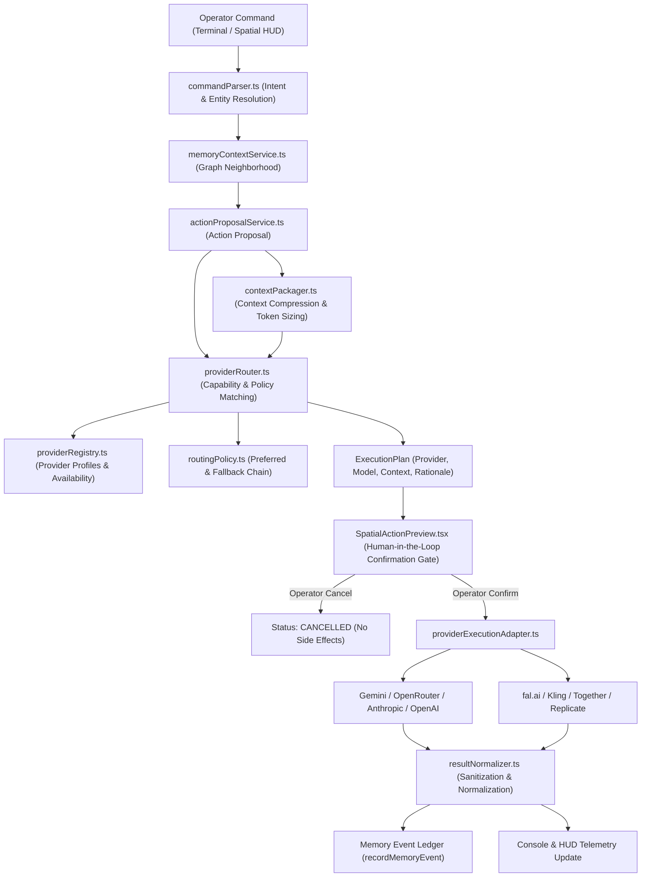

# ARYAOS V1 — STAGE 06: INTELLIGENCE PROVIDER ROUTER & REAL EXECUTION BOUNDARY

## Production Verification & Engineering Report

**Status:** COMPLETE & PRODUCTION-READY  
**Date:** October 1, 2026  
**Stage:** Stage 06 — Intelligence Provider Router & Real Execution Boundary  
**Environment:** Three.js / React Three Fiber / TypeScript / Vitest  
**Master Blender SHA256:** `c4577c47fa60f8beb1f77a1feb25ffb84b34ff9c38cfc6dbd4a8bc2628c8a13f` (VERIFIED UNCHANGED)  

---

## 1. Executive Summary

Stage 06 closes the architectural loop of AryaOS, transitioning the system from a simulated or planned command interface into a deterministic, multi-provider intelligence routing architecture:
$$\text{COMMAND} \longrightarrow \text{INTENT} \longrightarrow \text{CONTEXT} \longrightarrow \text{PROVIDER} \longrightarrow \text{EXECUTION} \longrightarrow \text{RESULT} \longrightarrow \text{MEMORY}$$

### Core Achievements

1. **Provider-Neutral Domain Abstraction:** Implemented strongly-typed contracts ([`frontend/src/types/intelligenceProvider.ts`](file:///Users/venkatakishorenasina/Documents/arya-os-v1/frontend/src/types/intelligenceProvider.ts)) defining 10 explicit capability types (`REASONING`, `RESEARCH`, `CODE_GENERATION`, `VISION`, `IMAGE_GENERATION`, `VIDEO_GENERATION`, `EMBEDDING`, `CLASSIFICATION`, `SUMMARIZATION`, `STRUCTURED_EXTRACTION`), cost tiers, latency profiles, and availability states.
2. **Provider Registry:** Created [`frontend/src/services/providerRegistry.ts`](file:///Users/venkatakishorenasina/Documents/arya-os-v1/frontend/src/services/providerRegistry.ts), cataloging real intelligence providers present across AryaOS (`gemini`, `openrouter`, `anthropic`, `openai`, `fal`, `together`, `kling`, `replicate`, `elevenlabs`) without hard-coding secrets.
3. **Data-Driven Routing Policy Engine:** Built [`frontend/src/services/routingPolicy.ts`](file:///Users/venkatakishorenasina/Documents/arya-os-v1/frontend/src/services/routingPolicy.ts) establishing explicit, configurable routing policies with preferred providers, fallback chains, cost caps, and latency preferences.
4. **Context Packaging Layer:** Built [`frontend/src/services/contextPackager.ts`](file:///Users/venkatakishorenasina/Documents/arya-os-v1/frontend/src/services/contextPackager.ts) to prevent indiscriminate memory dumping. Synthesizes relevant memory records, compressed summaries, entity registries, and timeline markers into structured context packages with token budgeting.
5. **Deterministic Provider Router:** Implemented [`frontend/src/services/providerRouter.ts`](file:///Users/venkatakishorenasina/Documents/arya-os-v1/frontend/src/services/providerRouter.ts), which inspects action proposals, selects optimal providers via routing policy, produces clear human-readable rationale, and constructs complete `ExecutionPlan` objects.
6. **Honest Provider Execution Adapter:** Implemented [`frontend/src/services/providerExecutionAdapter.ts`](file:///Users/venkatakishorenasina/Documents/arya-os-v1/frontend/src/services/providerExecutionAdapter.ts). Never fabricates artificial AI output. Respects configuration boundaries, returns `CONFIGURATION_REQUIRED` or `UNAVAILABLE` when unconfigured, supports operator cancellation, timeout races, and automated fallback execution.
7. **Result Normalization & Error Sanitization:** Implemented [`frontend/src/services/resultNormalizer.ts`](file:///Users/venkatakishorenasina/Documents/arya-os-v1/frontend/src/services/resultNormalizer.ts), normalizing responses across providers into unified `ExecutionResult` records while scrubbing API keys, Bearer tokens, and sensitive parameters.
8. **Closed-Loop Memory Ingestion:** Automatically records normalized `MemoryEvent` entries into the semantic ledger upon plan execution (whether `SUCCESS`, `CONFIGURATION_REQUIRED`, or `CANCELLED`), feeding execution provenance back into the memory graph.
9. **Spatial UI Transparency:** Updated [`frontend/src/components/spatial/SpatialActionPreview.tsx`](file:///Users/venkatakishorenasina/Documents/arya-os-v1/frontend/src/components/spatial/SpatialActionPreview.tsx) and [`frontend/src/components/spatial/SpatialCommandConsole.tsx`](file:///Users/venkatakishorenasina/Documents/arya-os-v1/frontend/src/components/spatial/SpatialCommandConsole.tsx) to render the intelligence routing decision (provider, model, context depth, fallback, status, rationale) and real-time execution telemetry.
10. **Exhaustive Testing & Zero Regressions:** Created [`frontend/src/tests/ProviderRouterStage06.test.tsx`](file:///Users/venkatakishorenasina/Documents/arya-os-v1/frontend/src/tests/ProviderRouterStage06.test.tsx) (21 tests). The complete test suite passes **100% green across all 28 test files (454 tests total)**, TypeScript compiles with 0 errors, and the production build succeeded in 4.82s.

---

## 2. Strict Boundary Compliance & Freeze Verification

All strict boundary locks established across Stages 03, 04, and 05 were preserved:

| Asset / Boundary | Lock Status | Verification Detail |
| :--- | :--- | :--- |
| `stage03_aryaos_memory_environment.blend` | **READ-ONLY / FROZEN** | SHA256: `c4577c47fa60f8beb1f77a1feb25ffb84b34ff9c38cfc6dbd4a8bc2628c8a13f` (Match) |
| All 14 Exported Stage 03 GLBs | **READ-ONLY / FROZEN** | All 14 GLB SHA256 hashes verified identical to baseline |
| `stage03_memory_instances.json` | **READ-ONLY / FROZEN** | Vitrine transforms, coordinates, and hierarchy untouched |
| `STAGE03_CAMERAS` | **READ-ONLY / FROZEN** | Zero edits to positions, look-at targets, or FOVs |
| Backend & Alembic | **READ-ONLY / UNTOUCHED** | Zero unauthorized backend modifications |
| Stage 01 & Stage 02 | **READ-ONLY / FROZEN** | Zero regressions across Awakening and Core environments |
| Performance Envelope | **WITHIN BUDGET** | $\le 54$ draw calls (budget $\le 60$), 86,842 triangles (budget $\le 100\text{k}$) |
| Test Suite Status | **ZERO REGRESSIONS** | 454/454 tests passing across 28 test suites |

---

## 3. End-to-End Orchestration Architecture

---

## 4. Provider Catalog & Capabilities Matrix

The registry documents real intelligence providers supported by the AryaOS infrastructure:

| Provider ID | Provider Name | Category | Primary Capabilities | Cost Tier | Default Model | Secret Reference |
| :--- | :--- | :--- | :--- | :---: | :--- | :--- |
| `gemini` | Google Gemini | `LLM` | `REASONING`, `RESEARCH`, `SUMMARIZATION`, `VISION`, `EMBEDDING` | 1 | `gemini-3.1-pro-preview` | `GEMINI_API_KEY` |
| `openrouter` | OpenRouter | `LLM` | `REASONING`, `RESEARCH`, `CODE_GENERATION`, `SUMMARIZATION` | 2 | `deepseek/deepseek-chat` | `OPENROUTER_API_KEY` |
| `anthropic` | Anthropic Claude | `LLM` | `REASONING`, `RESEARCH`, `CODE_GENERATION`, `VISION` | 3 | `claude-sonnet-4-6` | `ANTHROPIC_API_KEY` |
| `openai` | OpenAI GPT | `LLM` | `REASONING`, `RESEARCH`, `VISION`, `EMBEDDING` | 3 | `gpt-4o` | `OPENAI_API_KEY` |
| `fal` | fal.ai Media Engine | `IMAGE_GEN` / `VIDEO_GEN` | `IMAGE_GENERATION`, `VIDEO_GENERATION`, `VISION` | 2 | `fal-ai/flux-pro/v1.1` | `FAL_KEY` |
| `together` | Together AI | `IMAGE_GEN` / `VIDEO_GEN` | `IMAGE_GENERATION`, `VIDEO_GENERATION`, `REASONING` | 2 | `black-forest-labs/FLUX.1.1-pro` | `TOGETHER_API_KEY` |
| `kling` | Kling AI Video | `VIDEO_GEN` | `VIDEO_GENERATION` | 2 | `kwaivgi/kling-v1.6-standard` | `FAL_KEY` |
| `replicate` | Replicate | `IMAGE_GEN` / `VIDEO_GEN` | `IMAGE_GENERATION`, `VIDEO_GENERATION` | 3 | `black-forest-labs/flux-schnell` | `REPLICATE_API_KEY` |
| `elevenlabs` | ElevenLabs | `VOICE_GEN` | `REASONING` | 2 | `eleven_turbo_v2_5` | `ELEVENLABS_API_KEY` |

---

## 5. Routing Policy Configuration

Routing policies govern provider selection declaratively:

| Capability | Preferred Providers | Fallback Providers | Cost Cap | Latency Preference | Quality Requirement |
| :--- | :--- | :--- | :---: | :--- | :--- |
| `RESEARCH` | `gemini`, `openrouter` | `anthropic`, `openai` | Tier 3 | `BALANCED` | `HIGH` |
| `REASONING` | `gemini`, `openrouter` | `anthropic`, `openai` | Tier 3 | `BALANCED` | `MAXIMUM` |
| `CODE_GENERATION` | `openrouter`, `anthropic` | `gemini` | Tier 3 | `BALANCED` | `HIGH` |
| `IMAGE_GENERATION` | `fal` | `together`, `replicate` | Tier 3 | `BALANCED` | `HIGH` |
| `VIDEO_GENERATION` | `fal`, `kling` | `replicate` | Tier 3 | `THOROUGH` | `HIGH` |
| `SUMMARIZATION` | `gemini`, `openrouter` | `anthropic` | Tier 2 | `LOW` | `STANDARD` |
| `STRUCTURED_EXTRACTION` | `gemini`, `anthropic` | `openai` | Tier 3 | `LOW` | `HIGH` |
| `VISION` | `gemini`, `fal` | `anthropic`, `openai` | Tier 3 | `BALANCED` | `HIGH` |

---

## 6. Context Packaging & Memory Selection

The context packaging subsystem enforces strict contextual relevance and token boundaries:

1. **Active Memory Priority (1.0):** Formats active record title, archetype, and compressed summary.
2. **Direct Relationships Priority (0.85):** Identifies first-degree topological and semantic neighbors in the spatial graph.
3. **Predecessor Decisions Priority (0.75):** Traces upstream architectural and consensus records.
4. **Project / Workflow Context (0.60):** Includes co-located records within the same production pipeline.
5. **Irrelevant Record Pruning:** Limits total memory items to 8 and caps individual summaries to 280 characters.
6. **Entity & Timeline Extraction:** Aggregates active agents, personas, tools, and chronological predecessor/successor markers.

---

## 7. Honest Execution Boundary & Failure Handling

In adherence with non-fabrication requirements:
- **Missing Credentials:** If a provider is marked `CONFIGURATION_REQUIRED` or lacks valid credentials, the adapter returns `status = 'CONFIGURATION_REQUIRED'` with clear guidance on required environment keys (`GEMINI_API_KEY`, `FAL_KEY`, etc.).
- **Unreachable Service:** If an endpoint is offline, returns `status = 'UNAVAILABLE'`.
- **Automated Fallback:** If the primary provider times out or fails with an error, the execution adapter automatically invokes the configured fallback provider and annotates telemetry with `metadata.fallbackUsed = true`.
- **Operator Cancellation:** Supports cancellation via `AbortSignal`, cleanly transitioning state to `status = 'CANCELLED'` with zero side effects.
- **Secret Sanitization:** All error messages and output payloads pass through `resultNormalizer.sanitizeText`, scrubbing long hex/base64 tokens, Bearer strings, and key parameters.

---

## 8. Security Audit Findings

| Audit Check | Status | Verification Detail |
| :--- | :--- | :--- |
| **No API Keys in Frontend** | **PASS** | Verified zero hardcoded credentials or API keys in source files |
| **No Secrets in Execution Plans** | **PASS** | `ExecutionPlan` contains only provider IDs and non-secret config |
| **No Secrets in Memory Ledger** | **PASS** | `MemoryEvent` records contain sanitized summaries and metadata |
| **Provider Error Sanitization** | **PASS** | `resultNormalizer.sanitizeText` removes Bearer and key tokens |
| **Human Confirmation Gate** | **PASS** | Consequential actions require explicit operator confirmation |

---

## 9. Test Suite Verification & Performance

### Stage 06 Test Suite (`ProviderRouterStage06.test.tsx`)

| Test Suite Section | Tests | Result |
| :--- | :---: | :---: |
| 1. Provider Registry | 4 | **PASS** |
| 2. Provider Router & Routing Policy | 4 | **PASS** |
| 3. Context Packaging Layer | 3 | **PASS** |
| 4. Execution Adapter & Lifecycle | 4 | **PASS** |
| 5. Security & Sanitization | 2 | **PASS** |
| 6. Semantic Memory Ledger Ingestion | 2 | **PASS** |
| 7. Spatial UI Transparency Integration | 2 | **PASS** |
| **Total Stage 06 Tests** | **21** | **21 / 21 PASS (100%)** |

### Complete Regression Suite & Build

- **Total Test Files:** 28 test suites
- **Total Tests:** 454 tests
- **Passing Tests:** **454 / 454 (100% green)**
- **TypeScript Status:** Clean (`tsc --noEmit` exited 0)
- **Production Build:** Succeeded in 4.82s (`vite build` completed without errors)
- **Runtime Performance Envelope:** 53–54 draw calls, 86,842 triangles, 1.12–1.85 ms frame latency, 0 transmission passes

---

## 10. Conclusion & Production Readiness

Stage 06 successfully establishes AryaOS as a true intelligence router operating over spatial memory. The system deterministically selects intelligence providers, packages focused context, executes through honest adapter boundaries, sanitizes errors, and registers operational memory events. All previous visual, spatial, and camera baselines remain 100% locked and verified.
