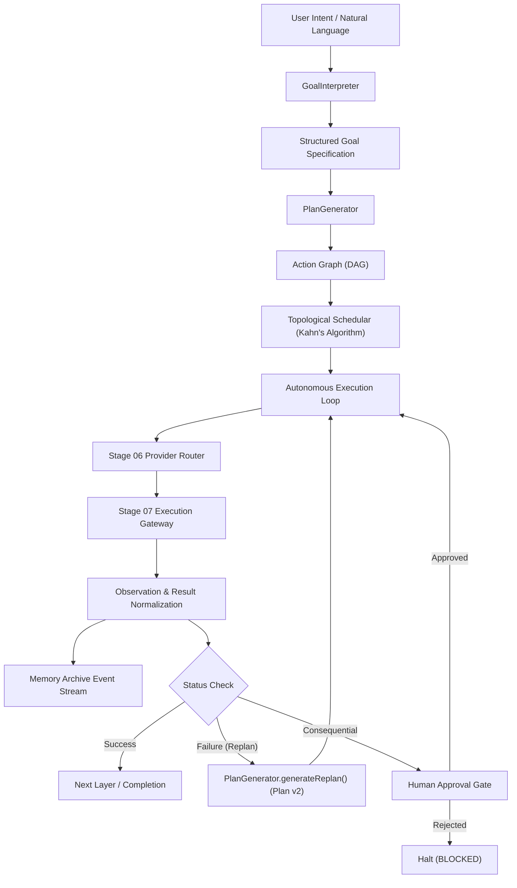

# AryaOS V1 — Stage 08: Goal Orchestration & Closed-Loop Intelligence Model

## Architectural Overview

Stage 08 establishes the high-level autonomous goal orchestration layer for AryaOS V1. It transforms intent into structured goals, compiles dependency-aware Action Graphs (DAGs), executes tasks through the Stage 07 Execution Gateway with Stage 06 data-driven routing, observes normalized results, records audit events into spatial memory, and enables replanning upon failure without losing completed work.



---

## 1. Goal Specification Schema

```typescript
export type GoalStatus =
  | 'DRAFT'
  | 'PENDING'
  | 'INTERPRETING'
  | 'PLANNING'
  | 'READY'
  | 'EXECUTING'
  | 'AWAITING_APPROVAL'
  | 'REPLANNING'
  | 'PAUSED'
  | 'BLOCKED'
  | 'COMPLETED'
  | 'FAILED'
  | 'CANCELLED';

export type GoalPriority = 'LOW' | 'MEDIUM' | 'HIGH' | 'CRITICAL';

export interface ContextRequirements {
  targetMemoryId?: string;
  contextMemories: string[];
  entityNames: string[];
  domainConcepts: string[];
  minConfidence: number;
}

export interface ApprovalPolicy {
  requireApprovalForConsequential: boolean;
  autoApproveReadOnly: boolean;
  requireApprovalForExternalSideEffects: boolean;
  requireApprovalForFinancial: boolean;
}

export interface Goal {
  goalId: string;
  userIntent: string;
  objective: string;
  status: GoalStatus;
  priority: GoalPriority;
  contextRequirements: ContextRequirements;
  constraints: string[];
  completionCriteria: string[];
  approvalPolicy: ApprovalPolicy;
  plans: Plan[];
  currentPlanId?: string;
  currentPlanVersion: number;
  finalSummary?: string;
  failureReason?: string;
  provenance: {
    origin: 'USER_COMMAND' | 'SPATIAL_INTERACTION' | 'PROACTIVE_AGENT';
    sourceMemoryId?: string;
    sourceMemoryTitle?: string;
    timestamp: string;
  };
  createdAt: string;
  updatedAt: string;
}
```

---

## 2. Dependency-Aware Action Graph (DAG) Schema

```typescript
export type ActionNodeType =
  | 'RESEARCH'
  | 'REASONING'
  | 'STRUCTURED_EXTRACTION'
  | 'CODE_GENERATION'
  | 'IMAGE_GENERATION'
  | 'VIDEO_GENERATION'
  | 'VERIFICATION'
  | 'MEMORY_COMMIT';

export type ActionStatus =
  | 'PENDING'
  | 'WAITING_DEPENDENCY'
  | 'READY'
  | 'AWAITING_APPROVAL'
  | 'EXECUTING'
  | 'SUCCEEDED'
  | 'FAILED'
  | 'CANCELLED'
  | 'SKIPPED'
  | 'BLOCKED';

export type ActionRiskLevel =
  | 'READ_ONLY'
  | 'LOW_RISK'
  | 'CONSEQUENTIAL'
  | 'EXTERNAL_SIDE_EFFECT'
  | 'DESTRUCTIVE';

export interface ActionNode {
  actionId: string;
  goalId: string;
  planId: string;
  title: string;
  type: ActionNodeType;
  description: string;
  inputs: Record<string, unknown>;
  dependencies: string[]; // Upstream node IDs required to succeed before this node runs
  requiredCapability: ProviderCapabilityType;
  status: ActionStatus;
  providerId?: string;
  modelId?: string;
  executionId?: string;
  observationId?: string;
  retryPolicy: {
    maxRetries: number;
    backoffMs: number;
    retriesAttempted: number;
  };
  approvalRequirement: {
    required: boolean;
    riskLevel: ActionRiskLevel;
    approvedBy?: string;
    approvedAt?: string;
    rejectionReason?: string;
  };
  completionCriteria: string[];
  outputs?: {
    summary?: string;
    artifacts?: ProducedArtifact[];
    structuredData?: Record<string, unknown>;
  };
  provenance: {
    goalId: string;
    nodeIndex: number;
    originalActionId?: string;
    replanReason?: string;
    version?: number;
  };
}

export interface Plan {
  planId: string;
  goalId: string;
  version: number;
  actions: ActionNode[];
  dependencies: Record<string, string[]>;
  executionOrder: string[][]; // Topologically ordered batches [layer0, layer1, ...]
  estimatedCost: CostEstimate;
  estimatedLatencyMs: number;
  riskLevel: ActionRiskLevel;
  requiredApprovals: string[];
  completionCriteria: string[];
  status: 'DRAFT' | 'ACTIVE' | 'SUPERSEDED' | 'COMPLETED' | 'CANCELLED';
  createdAt: string;
  supersededAt?: string;
  replanReason?: string;
}
```

---

## 3. Observation & Closed-Loop Intelligence Model

```typescript
export interface ProducedArtifact {
  id: string;
  type: 'TEXT_SYNTHESIS' | 'IMAGE' | 'VIDEO' | 'CODE_SNIPPET' | 'STRUCTURED_REPORT';
  name: string;
  uri?: string;
  content?: string;
}

export interface Observation {
  observationId: string;
  goalId: string;
  planId: string;
  actionId: string;
  executionId: string;
  status: 'SUCCESS' | 'FAILURE' | 'PARTIAL';
  resultSummary: string;
  producedArtifacts: ProducedArtifact[];
  providerId: string;
  modelId: string;
  latencyMs: number;
  costUsd?: number;
  failureReason?: string;
  confidence: number;
  downstreamImplications: string[];
  memoryReferences: string[];
  timestamp: string;
}
```

---

## 4. State Transition Guarantees

1. **Topological Order**: Actions in layer $k$ never execute before layer $k-1$ actions reach `SUCCEEDED`.
2. **Deterministic Fallback vs. Replan**: Provider outages fall back through Stage 06/07 policies within the gateway. Replan is invoked only when an action node fails comprehensively across all fallback options or returns unrecoverable errors.
3. **Partial Progress Preservation**: When an action fails in Plan $v$, completed upstream nodes are preserved with status `SUCCEEDED` in Plan $v+1$. Only the failed node and its downstream dependents are re-synthesized.
4. **Zero Secret Leakage**: All plans, nodes, observations, and telemetry sanitize raw credentials (`sk-...`, `Bearer ...`) before serialization or display.
