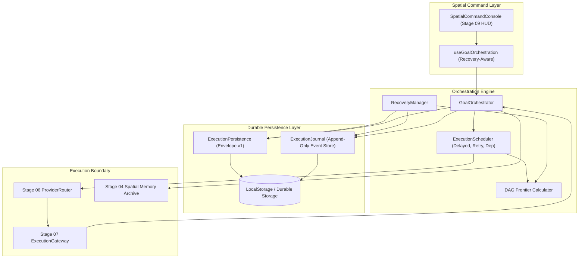

# AryaOS V1 — Stage 09: Pre-Implementation Repository Audit

**Execution Date:** 2026-10-02  
**Scope:** Stage 08 Baseline Inspection, Persistence Systems Analysis, In-Memory State Identification, and Stage 09 Design Strategy  
**Architectural Integrity:** Verified against locked Stage 03 assets, Stage 06/07 execution boundaries, and Stage 08 goal orchestration baseline.

---

## 1. Inspection of Complete Stage 08 Implementation

The Stage 08 baseline provides full closed-loop autonomous intelligence across five core modules:

1. **`src/types/goalOrchestration.ts`**:
   - Contracts for `Goal`, `GoalStatus` (12 lifecycle states), `Plan`, `ActionNode`, `ActionStatus` (10 states), `ActionRiskLevel`, `ActionRetryPolicy`, `ActionApprovalRequirement`, `Observation`, and `GoalExecutionOptions`.
2. **`src/services/goalInterpreter.ts`**:
   - Parses natural-language user commands into structured `Goal` objects grounded in selected spatial memory vitrines (`MEM-0001` through `MEM-0024`), assessing risk, priority, and required approval policies.
3. **`src/services/planGenerator.ts`**:
   - Compiles goals into dependency-aware Directed Acyclic Graphs (DAGs), applies Kahn’s algorithm to generate topological layers for concurrency-safe scheduling, computes cost/latency envelopes, and handles dynamic replanning (`Plan v1` $\rightarrow$ `Plan v2`) upon failure.
4. **`src/services/goalOrchestrator.ts`**:
   - Autonomous scheduler loop evaluating DAG dependencies, dispatching actions exclusively through Stage 07 `executionGateway.execute()`, enforcing approval pauses for consequential actions, and recording audit events into spatial memory.
5. **`src/hooks/useGoalOrchestration.ts` & `SpatialCommandConsole.tsx`**:
   - React hook exposing active goal, plan, action nodes, and operator controls (`startGoal`, `approveAction`, `rejectAction`, `pauseGoal`, `resumeGoal`, `cancelGoal`).
   - Integrated `goal-orchestration-hud` providing inline visibility into plan progress and operator confirmation controls.

---

## 2. In-Memory State Vulnerability Analysis

Currently, all orchestration execution state resides exclusively in volatile runtime memory:

| Subsystem / Field | Current Storage Location | Vulnerability on Refresh / Crash |
| :--- | :--- | :--- |
| **Active Goals (`goals`)** | `GoalOrchestrator.goals: Map<string, Goal>` (in-memory) | **100% LOST**. On browser refresh or process crash, all goals disappear. |
| **Execution Plans (`plans`)** | `Goal.plans: Plan[]` (in-memory) | **100% LOST**. DAG structure, topological layers, and plan versions evaporate. |
| **Action Node Status** | `ActionNode.status: ActionStatus` (in-memory) | **100% LOST**. No record of which actions completed, failed, or were executing. |
| **Observations (`observations`)**| `GoalOrchestrator.observations: Map<string, Observation[]>` | **100% LOST**. Produced artifacts and model responses vanish. |
| **Human Approvals** | `ActionNode.approvalRequirement` (in-memory) | **100% LOST**. Awaiting approvals are dropped; operators must re-enter goals. |
| **Active Execution Pointer** | `GoalOrchestrator.activeGoalId` (in-memory) | **100% LOST**. Session context resets to null. |
| **Abort Controllers** | `GoalOrchestrator.abortControllers: Map<string, AbortController>` | **LEAKED / DROPPED**. Transient in-flight abort handles are orphaned. |
| **Execution Journal** | None (only in-memory `MemoryEvent` array in `actionProposalService`) | **NO EVENT LOG**. Historical state transitions cannot be replayed or recovered. |

---

## 3. Analysis of Existing Persistence Infrastructure

A comprehensive audit of `frontend/src` revealed existing persistence utilities:

1. **`src/utils/projectPersistence.ts`**:
   - Persists Creator/Studio production timeline projects (`Project`, `Sequence`, `Shot`).
   - Storage Key: `arya_persisted_project_envelope`.
   - Schema Version: `CURRENT_SCHEMA_VERSION = 1`.
   - Envelope Pattern: `{ schemaVersion: number, savedAt: string, project: Project }`.
   - Sanitization: Recursively strips API keys, tokens, credentials, and blob URLs.
   - Interrupted State Transition: Converts in-flight shots (`QUEUED`, `GENERATING`) to `RECOVERY_REQUIRED`.
   - **Crucial Distinction**: `projectPersistence.ts` is explicitly designed for timeline video production shots and sequences. It does NOT handle autonomous agent goals, action DAGs, plan versioning, provider routing, execution gateways, or event-sourced orchestration journals.

2. **Existing Memory Services (`memoryArchiveService.ts`, `actionProposalService.ts`)**:
   - Manage spatial vitrine metadata and memory audit events in memory.
   - Events are appended to `actionProposalService.memoryEvents: MemoryEvent[]`.

**Conclusion on Duplication**:
There is **NO existing persistence system** for Autonomous Goal Orchestration, Action Graphs, or Execution Journals in the codebase.
Creating `executionPersistence.ts` does NOT duplicate `projectPersistence.ts`; rather, it establishes a complementary, dedicated persistence layer for autonomous intelligence operations that adheres to the established architectural standards of AryaOS (versioned envelopes, secret stripping, crash handling, and safe deserialization).

---

## 4. Test Conventions in Codebase

The test suite consists of 30 Vitest suites (493 tests):
- Component & hook tests use `@testing-library/react` and Vitest mocks (`vi.fn()`, `vi.clearAllMocks()`).
- In-memory service state is reset in `beforeEach` (`goalOrchestrator.resetState()`, `executionGateway.resetState()`, `providerRegistry.resetToDefaults()`).
- LocalStorage tests mock `window.localStorage` (or jsdom storage) and verify edge cases: malformed JSON, quota exceeded, unexpected schemas, missing keys.
- Real execution boundaries are mocked at `providerExecutionAdapter` level, ensuring tests verify truthful execution pathways without external API calls or network flakiness.

---

## 5. Backend Contracts & Boundaries

- The backend APIs (`backend/**`, `alembic/**`, `docker/**`) are **IMMUTABLE** ground truth for Stage 09.
- No backend schema modifications or backend API endpoint additions are permitted.
- The persistence layer for Stage 09 must operate within the client execution boundary (local durable storage / IndexedDB / localStorage envelope) with zero dependency on backend changes.

---

## 6. Stage 09 Architecture & Design Plan

Stage 09 will introduce four primary architectural components:

### Component Breakdown

1. **`src/types/executionPersistence.ts`**:
   - Type definitions for `PersistedOrchestrationEnvelope`, `JournalEvent`, `ActionRecoveryPolicy` (`SAFE_TO_RETRY`, `IDEMPOTENT_RETRY`, `REQUIRES_REVALIDATION`, `REQUIRES_HUMAN_APPROVAL`, `DO_NOT_RETRY`), `RecoveryDecision`, `SchedulerJob`, and `OperationalTelemetry`.
2. **`src/services/executionPersistence.ts`**:
   - Versioned envelope serialization/deserialization for goals, plans, actions, observations, and approvals.
   - Comprehensive secret scrubbing (stripping `sk-...`, `Bearer ...`, `apiKey`, `password`).
   - Quota exhaustion and corruption resilience.
3. **`src/services/executionJournal.ts`**:
   - Append-only event store recording every orchestration transition with sequential monotonically increasing event IDs, timestamps, previous/new states, and cryptographic schema versioning.
4. **`src/services/recoveryManager.ts`**:
   - Deterministic crash recovery on boot: detects interrupted actions, classifies them against recovery policies, protects against double execution using Stage 07 idempotency checks, and computes the exact DAG execution frontier (`getExecutableFrontier`).
5. **`src/services/executionScheduler.ts`**:
   - Durable scheduling supporting immediate execution, delayed execution, dependency-driven triggering, retry backoff scheduling, and approval continuation.
6. **Hook and Console Integration**:
   - Enhance `useGoalOrchestration` to automatically run boot recovery on mount.
   - Enhance `SpatialCommandConsole` HUD to display persistent recovery status and approval validity.

---

## 7. Audit Sign-Off

All prerequisites for Stage 09 are satisfied. Proceeding to implementation of the Persistent Autonomous Operations & Recovery Layer.
