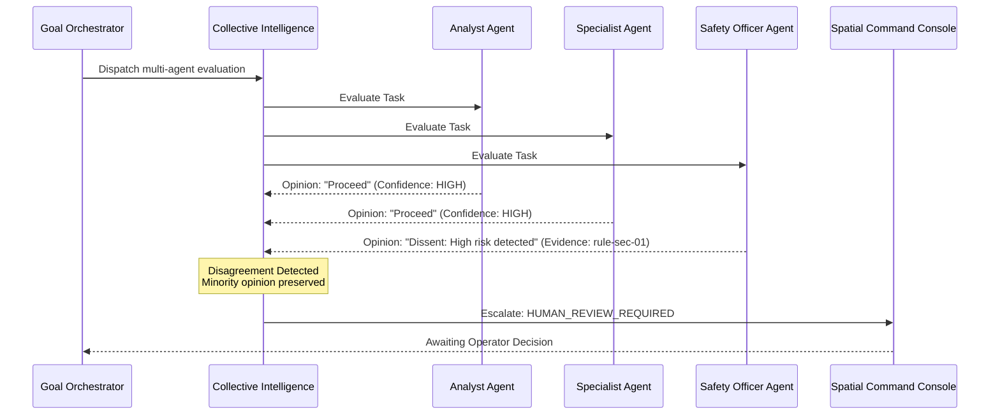

# ARYAOS V1 — STAGE 11: COLLECTIVE INTELLIGENCE DESIGN SPECIFICATION

## 1. Overview

In complex autonomous orchestration, single-agent determinations can suffer from blind spots, hallucinations, or uncalibrated confidence. Stage 11's Collective Intelligence engine allows multiple specialized agents to independently evaluate the same task, aggregate outputs, preserve dissent, and produce evidence-grounded collective decisions.

---

## 2. Aggregation Strategies

| Strategy | Behavior | Disagreement Handling | Final Output Formulation |
| :--- | :--- | :--- | :--- |
| **SINGLE_RESULT** | Selects primary assigned agent's output | Ignored (fast path) | Primary agent output |
| **MERGE** | Combines complementary sections from all agents | Preserved with attributions | Concatenated sections `[Agent X]: ...` |
| **CONSENSUS** | Requires majority alignment across outputs | Flags `REVIEW_REQUIRED` on split | Majority output |
| **EVIDENCE_WEIGHTED_CONSENSUS** | Weights opinions by empirical agent quality & confidence | Dissent preserved in decision record | Highest-weight opinion selected |
| **EXPERT_REVIEW** | Escalates conflicting outputs to lead specialist | Marks `REVIEW_REQUIRED` | Lead reviewer evaluation |
| **HUMAN_REVIEW** | Escalates high-risk disagreements to human operator | Marks `HUMAN_REVIEW_REQUIRED` | Held pending human operator approval |

---

## 3. Evidence-Weighted Consensus Formulation

Each participating agent $i$ produces an opinion $O_i$ with assigned weight $W_i$:

$$W_i = C_i \times Q_i \times R_i$$

Where:
- $C_i$: Confidence multiplier ($\text{HIGH} = 1.5$, $\text{MEDIUM} = 1.0$, $\text{LOW} = 0.5$)
- $Q_i$: Agent empirical quality score on the specific task type ($0.0 \dots 1.0$)
- $R_i$: Agent reliability score ($0.0 \dots 1.0$)

The opinion maximizing $W_i$ is selected as the operational output, while all alternative opinions $O_j$ ($j \neq i$) and their supporting evidence chains are stored within `CollectiveDecision.opinions` to guarantee complete auditability.

---

## 4. Preservation of Dissent & Minority Opinions

AryaOS explicitly rejects naive voting schemes that discard minority opinions. In high-risk decisions (e.g. architectural changes, security constraints, budget adjustments), a single dissenting agent citing verified evidence triggers an escalation:

Minority opinions are linked into the `EvidenceGraph` so operators can inspect the exact reasoning and evidence that prompted the warning.
