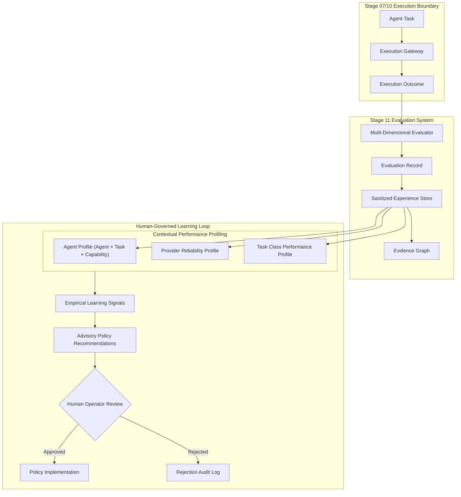

# ARYAOS V1 — STAGE 11: EVALUATION ARCHITECTURE SPECIFICATION

## 1. Executive Summary

Stage 11 establishes a deterministic, multi-dimensional evaluation and profiling layer for AryaOS V1. Building upon Stage 10's Multi-Agent Coordination and Stage 07's Execution Gateway, this layer evaluates agent and provider executions without fabricating metrics or allowing unconstrained self-modification of executable runtime code.

---

## 2. Multi-Dimensional Evaluation Framework

Every executed task is deterministically evaluated across 11 discrete dimensions:

| Dimension | Description | Measurement Source | Truthful Handling |
| :--- | :--- | :--- | :--- |
| **QUALITY** | Completeness, coherence, structural correctness | Output inspection & Quality Gate | 0.0–1.0 score; flag syntax or truncation |
| **CORRECTNESS** | Absence of execution or schema errors | Gateway outcome & error logs | 1.0 (success) or 0.0 (failure) |
| **COMPLETENESS** | Required fields and deliverables generated | Output contract comparison | Scaled based on missing attributes |
| **RELEVANCE** | Alignment with task intent and context | Intent and memory vitrine similarity | 0.0–1.0 contextual relevance |
| **CONSISTENCY** | Stability across repeated or concurrent tasks | Historical variance analysis | Derived from repeated executions |
| **LATENCY** | Duration vs estimated deadline | Gateway execution timestamp diff | 1.0 if within deadline, degrading beyond |
| **COST** | USD cost vs allocated budget | Gateway usage telemetry | Exact USD or truthful `'UNKNOWN'` |
| **RELIABILITY** | Fallback triggering and retry attempts | Gateway reliability telemetry | 1.0 (direct), 0.75 (recovered), 0.0 (fail) |
| **RESOURCE_EFFICIENCY** | Optimal utilization of concurrency/budget | Latency and cost efficiency blend | Scaled composite score |
| **HUMAN_ACCEPTANCE** | Human confirmation status | Action approval records | 1.0 (approved), 0.0 (rejected) |
| **DOWNSTREAM_SUCCESS** | Success of child actions in DAG | Dependent action statuses | Propagated upon goal completion |

---

## 3. Truthful Metric Principles

1. **Zero Metric Fabrication**: If token usage or cost data is omitted by the intelligence provider or execution gateway, the cost field is recorded as `'UNKNOWN'`. AryaOS never guesses or synthesizes fictitious token counts.
2. **Deterministic Confidence Bands**:
   - $N < 3$ samples: `LOW` confidence
   - $3 \le N \le 7$ samples: `MEDIUM` confidence
   - $N \ge 8$ samples: `HIGH` confidence
3. **Evidence Grounding**: Every score must cite concrete evidence references (execution ID, action ID, log references).

---

## 4. Contextual Profiling

Performance is tracked in 3-dimensional contextual coordinates:

$$\text{Profile} = \text{Agent} \times \text{Capability} \times \text{Task Type}$$

This ensures an agent that excels at `CODE_GENERATION` for `AST_AUDIT` is not mischaracterized as equally capable for `SUMMARIZATION` on `SCENARIO_EXPANSION`.

---

## 5. Bidirectional Evidence Graph

The `EvidenceGraph` establishes an immutable, auditable lineage linking all operational entities:

$$\text{Goal} \longrightarrow \text{Action} \longrightarrow \text{Agent} \longrightarrow \text{Provider} \longrightarrow \text{Execution} \longrightarrow \text{Evaluation} \longrightarrow \text{Decision} \longrightarrow \text{Human Approval}$$

Any policy recommendation or collective consensus decision can be traced backwards through the graph to the primary execution artifacts that produced it.
