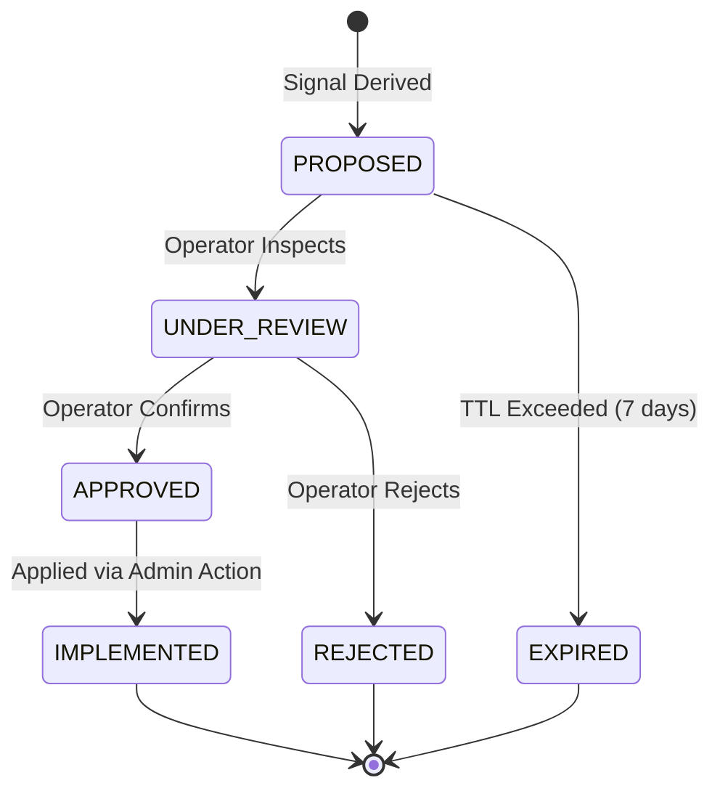

# ARYAOS V1 — STAGE 11: LEARNING LOOP POLICY SPECIFICATION

## 1. Core Principles

The AryaOS Stage 11 Learning Loop exists to improve operational efficiency and plan generation over time. It is governed by four immutable safety policies:

1. **Zero Self-Modifying Code**: The learning loop NEVER rewrites source code, alters executable binaries, or dynamically installs unreviewed libraries.
2. **Zero Silent Policy Mutation**: Neither routing rules, agent capabilities, nor safety constraints may be altered autonomously. All adjustments are formulated as `PolicyRecommendation` proposals requiring operator approval.
3. **Truthful Signal Derivation**: Signals are derived strictly from empirical evidence recorded in the Experience Store. No synthetic or guessed metrics may be used to justify policy adjustments.
4. **Time-Bounded Validity**: Learning signals and policy recommendations expire after their defined Time-to-Live (TTL = 7 days) if not reaffirmed by continuous empirical observations.

---

## 2. Signal Types & Thresholds

| Signal Type | Dimension | Detection Criteria | Default Impact |
| :--- | :--- | :--- | :--- |
| `AGENT_HIGH_QUALITY_FOR_TASK` | QUALITY | Agent achieves $\text{Score} \ge 0.85$ across $\ge 3$ tasks | HIGH |
| `AGENT_LOW_QUALITY_FOR_TASK` | QUALITY | Agent achieves $\text{Score} < 0.60$ across $\ge 3$ tasks | HIGH |
| `PROVIDER_HIGH_LATENCY` | LATENCY | Observed latency $> 1.5\times$ baseline across $\ge 3$ calls | MEDIUM |
| `PROVIDER_HIGH_FAILURE_RATE` | RELIABILITY | Failure rate $\ge 25\%$ across $\ge 3$ calls | HIGH |
| `FALLBACK_FREQUENTLY_TRIGGERED` | RELIABILITY | Fallback rate $\ge 25\%$ across $\ge 3$ calls | MEDIUM |
| `ROUTE_REPEATEDLY_FAILED` | RELIABILITY | Consecutive failures $\ge 2$ on specific Agent-Provider route | HIGH |

---

## 3. Confidence Bands & Recency Weighting

### Confidence Calculation
Confidence bands reflect the statistical significance and consistency of historical observations:

$$\text{Confidence}(N, \sigma) = \begin{cases} 
\text{HIGH} & \text{if } N \ge 8 \text{ and } \sigma \ge 0.80 \\
\text{MEDIUM} & \text{if } 3 \le N < 8 \\
\text{LOW} & \text{if } N < 3 
\end{cases}$$

### Recency Weighting
Recent experiences carry higher significance than historical ones:
- Age $< 1\text{ hour}$: Weight multiplier $= 1.0$
- Age $1\text{ hour} \dots 24\text{ hours}$: Weight multiplier $= 0.75$
- Age $1\text{ day} \dots 7\text{ days}$: Weight multiplier $= 0.50$
- Age $> 7\text{ days}$: Stale (triggering signal expiration)

---

## 4. Human Governance Boundary

Every recommendation produced by `PolicyRecommendationService` begins in status `PROPOSED`.

### Safety Invariant
The method `policyRecommendationService.applyRecommendation(id)` strictly enforces that `rec.status === 'APPROVED'`. If called on a recommendation with status `PROPOSED` or `UNDER_REVIEW`, the service aborts execution and logs a security boundary violation.
