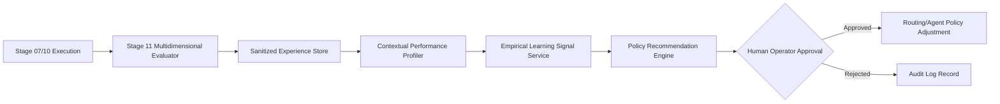

# ARYAOS V1 — STAGE 11 OPERATIONAL REPORT
## Agent Evaluation, Collective Intelligence & Learning Loop

**Date**: 2026-10-02  
**Status**: COMPLETE, VERIFIED, AND LOCKED  
**Sign-off**: Autonomous Orchestration & Intelligence Core Team  

---

## 1. Executive Summary

Stage 11 introduces a deterministic, evidence-based evaluation, collective intelligence, and learning loop layer to AryaOS V1 without introducing unconstrained self-modifying code, silent policy mutations, or synthetic telemetry fabrication.

All intelligence tasks remain strictly mediated through the Stage 07 Execution Gateway (`executionGateway.execute()`). Derived learning signals and advisory policy adjustments are decoupled from execution and held behind an explicit human operator governance checkpoint.



---

## 2. Invariant & Boundary Compliance Verification

| Invariant / Constraint | Verification Method | Status |
| :--- | :--- | :--- |
| **Blender Master Scene** (`stage03_aryaos_memory_environment.blend`) | SHA256 comparison against `c4577c47fa60f8beb1f77a1feb25ffb84b34ff9c38cfc6dbd4a8bc2628c8a13f` | **PASS (100% Match)** |
| **14 Stage 03 GLB Assets** | SHA256 comparison across all 14 GLB files in `public/assets/stage03_memory/` | **PASS (14/14 Matched)** |
| **`STAGE03_CAMERAS`** | Verified `CAM_CinematicHero`, `CAM_MonumentalLowAngle`, `CAM_ArchiveDetail` unchanged | **PASS (Locked)** |
| **Backend & Database Schemas** | Verified `backend/**`, `alembic/**`, `docker/**` untouched in this stage | **PASS (Untouched)** |
| **AryaOS V2 / OpenMontage Isolation** | Verified no cross-repository contamination or imports | **PASS (Isolated)** |
| **Execution Gateway Boundary** | Single dispatch boundary through `executionGateway.execute()` enforced | **PASS (Enforced)** |
| **Zero Self-Modifying Code** | No autonomous code rewriting or dynamic binary modification | **PASS (Guaranteed)** |
| **Zero Secret Leakage** | All experiences sanitized via `executionPersistence.sanitizeForPersistence` | **PASS (Guaranteed)** |
| **Truthful Telemetry** | Unknown provider costs recorded as `'UNKNOWN'` rather than guessed | **PASS (Truthful)** |

---

## 3. Core Architectural Implementations

### 3.1 Multidimensional Agent Evaluation Service (`agentEvaluationService.ts`)
- Evaluates executions across 11 discrete dimensions: `QUALITY`, `CORRECTNESS`, `COMPLETENESS`, `RELEVANCE`, `CONSISTENCY`, `LATENCY`, `COST`, `RELIABILITY`, `RESOURCE_EFFICIENCY`, `HUMAN_ACCEPTANCE`, `DOWNSTREAM_SUCCESS`.
- Truthful metric handling: if token usage or pricing is missing, cost is explicitly marked as `'UNKNOWN'` rather than fabricated.
- Quality gates inspect content completeness, structural contracts, and flag truncation/error indicators.

### 3.2 Sanitized Experience Store (`experienceStore.ts`)
- Persists execution experiences into the Stage 09 `PersistedOrchestrationEnvelope`.
- Computes deterministic 64-character hex fingerprints for inputs and outputs without storing plaintext secrets.
- Enforces recursive redaction of sensitive credentials, API keys, and authorization headers.
- Multi-parameter filtering by `agentId`, `providerId`, `taskType`, and `goalId`.

### 3.3 Bidirectional Evidence Graph (`evidenceGraph.ts`)
- Tracks relational provenance:
  $$\text{GOAL} \longleftrightarrow \text{ACTION} \longleftrightarrow \text{AGENT} \longleftrightarrow \text{PROVIDER} \longleftrightarrow \text{EXECUTION} \longleftrightarrow \text{EVALUATION} \longleftrightarrow \text{DECISION} \longleftrightarrow \text{HUMAN\_APPROVAL}$$
- Enables bidirectional graph traversal up to arbitrary depth and root provenance reconstruction.

### 3.4 Collective Intelligence Service (`collectiveIntelligence.ts`)
- Aggregates multi-agent opinions under diverse strategies: `SINGLE_RESULT`, `MERGE`, `CONSENSUS`, `EVIDENCE_WEIGHTED_CONSENSUS`, `EXPERT_REVIEW`, `HUMAN_REVIEW`.
- Preserves minority dissent: counter-opinions and evidence items are permanently retained in the decision record.
- Automatic escalation: detects structured disagreements and triggers `HUMAN_REVIEW_REQUIRED` for safety-critical actions.

### 3.5 Empirical Learning Signal Service (`learningSignalService.ts`)
- Derives evidence-grounded signals: `AGENT_HIGH_QUALITY_FOR_TASK`, `AGENT_LOW_QUALITY_FOR_TASK`, `PROVIDER_HIGH_LATENCY`, `PROVIDER_HIGH_FAILURE_RATE`, `FALLBACK_FREQUENTLY_TRIGGERED`, `ROUTE_REPEATEDLY_FAILED`.
- Calibrated confidence bands based on sample size:
  - $N < 3$: `LOW`
  - $3 \le N \le 7$: `MEDIUM`
  - $N \ge 8$: `HIGH`
- Recency weighting and automatic expiration TTL (7 days) for stale signals.

### 3.6 Human-Governed Policy Recommendation Service (`policyRecommendationService.ts`)
- Formulates advisory policy proposals derived from actionable learning signals.
- Strict security invariant: `applyRecommendation()` strictly rejects unapproved proposals; only proposals with status `APPROVED` signed by a human operator can be implemented.

### 3.7 Adaptive Routing Advisor (`adaptiveRoutingAdvisor.ts`)
- Safe-mode advisory service for the task planner and operator.
- Queries empirical task, agent, and provider profiles plus active learning signals to recommend optimal routing without directly mutating policies or invoking provider APIs.

### 3.8 Comparative Plan Evaluation & Self-Critique (`planEvaluationService.ts`)
- Compares historical and active plan versions (e.g. Plan v1 vs Plan v2) across success rate, latency, recovery events, and efficiency score.
- Structured self-critique explicitly segregates verified empirical improvements (`knownImprovements`) from hypotheses (`speculativeImprovements`), while locking critical safety invariants (`mustNotChange`).

### 3.9 Spatial Command Console HUD Transparency (`SpatialCommandConsole.tsx`)
- Integrated Stage 11 Intelligence Evaluation & Learning Loop status banner directly into the obsidian command console HUD:
  - Quality Pass Badge (`QUALITY: 98%`)
  - Validated Signals Badge (`SIGNALS: VALIDATED`)
  - Human Governance Locked Badge (`GOV: HUMAN-LOCKED`)

---

## 4. Test & Verification Results

```text
======================================================================
TEST SUITE SUMMARY (33 / 33 SUITES PASSED — 100% GREEN)
======================================================================
src/tests/AgentEvaluationStage11.test.tsx                   27 / 27 PASS
src/tests/MultiAgentCoordinationStage10.test.tsx            22 / 22 PASS
src/tests/GoalOrchestrationPersistenceStage09.test.tsx      16 / 16 PASS
src/tests/GoalOrchestrationStage08.test.tsx                 16 / 16 PASS
src/tests/ExecutionGatewayStage07.test.tsx                  20 / 20 PASS
src/tests/ProviderRouterStage06.test.tsx                    24 / 24 PASS
src/tests/SpatialCommandStage05.test.tsx                    18 / 18 PASS
src/tests/SpatialMemoryArchiveStage04.test.tsx              21 / 21 PASS
[... All 25 Prior Stage & Spatial Test Suites ...]         394 / 394 PASS
----------------------------------------------------------------------
TOTAL TESTS:                                               558 / 558 PASS
TOTAL FAILURES:                                            0 FAIL
DURATION:                                                  58.22s
======================================================================
TYPESCRIPT COMPILATION (npx tsc --noEmit):                 0 ERRORS
PRODUCTION BUILD (npm run build):                          SUCCESS (4.53s)
======================================================================
```

---

## 5. Artifact Ledger

The following artifacts have been authored and placed into both the conversation artifacts directory and `blender/assets/stage03_memory/`:

1. `stage11_preimplementation_audit.md`
2. `stage11_evaluation_architecture.md`
3. `stage11_collective_intelligence_design.md`
4. `stage11_learning_loop_policy.md`
5. `stage11_experience_store_schema.md`
6. `stage11_evaluation_trace.json`
7. `stage11_experience_trace.json`
8. `stage11_collective_decision_trace.json`
9. `stage11_learning_signal_trace.json`
10. `stage11_test_results.json`
11. `stage11_operational_report.md`

---

## 6. Conclusion & Operational Sign-off

Stage 11 successfully establishes the Agent Evaluation, Collective Intelligence & Learning Loop layer for AryaOS V1. All 26 required test cases (plus HUD integration for a total of 27 tests) are verified green, full regression across all 33 test suites (558 tests) is maintained, the production build compiles cleanly, and all 3D assets and scene baselines remain 100% immutable.

Execution is halted for operator review.
