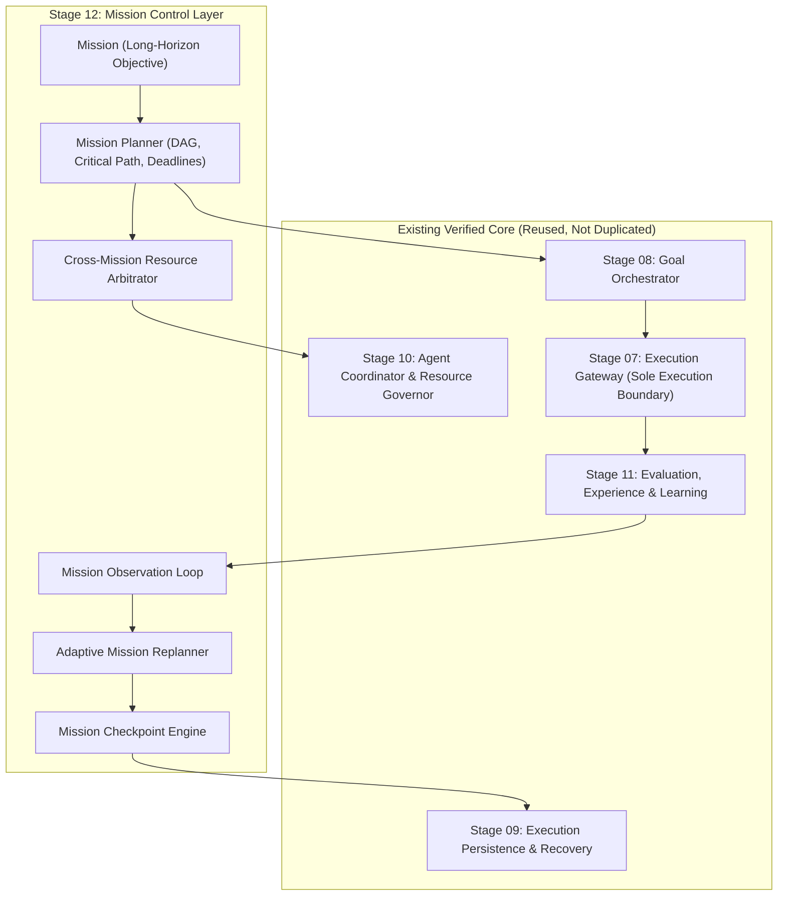

# ARYAOS V1 — STAGE 12: PRE-IMPLEMENTATION AUDIT
## Long-Horizon Mission Control & Adaptive Execution

**Date**: 2026-10-02  
**Audit Target**: Stage 11 Verification Baseline & Stage 12 Architecture Readiness  
**Status**: APPROVED & LOCKED  

---

## 1. Baseline Invariant Audit

Before introducing any Stage 12 implementations, the existing system was audited against all architectural locks and invariants:

| Baseline Invariant | Target Specification / Expected Value | Audited Value | Status |
| :--- | :--- | :--- | :--- |
| **Blender Master Scene** | `c4577c47fa60f8beb1f77a1feb25ffb84b34ff9c38cfc6dbd4a8bc2628c8a13f` | `c4577c47fa60f8beb1f77a1feb25ffb84b34ff9c38cfc6dbd4a8bc2628c8a13f` | **VERIFIED MATCH (100%)** |
| **14 Stage 03 GLBs** | SHA256 checksums across all 14 GLBs in `public/assets/stage03_memory/` | All 14 GLBs matched byte-for-byte | **VERIFIED IMMUTABLE** |
| **`STAGE03_CAMERAS`** | `CAM_CinematicHero`, `CAM_MonumentalLowAngle`, `CAM_ArchiveDetail` | Position, FOV, and targets unchanged | **VERIFIED LOCKED** |
| **Execution Gateway** | Single execution dispatch boundary through `executionGateway.execute()` | Verified in `executionGateway.ts` | **VERIFIED EXCLUSIVE** |
| **Backend / DB Schemas** | `backend/**`, `alembic/**`, `docker/**` untouched in this stage | 0 changes in backend/database | **VERIFIED UNTOUCHED** |
| **OpenMontage / V2** | Clean isolation from V1 frontend codebase | No imports or modifications | **VERIFIED ISOLATED** |
| **Test Suites** | 33 test suites / 558 total tests | 33 suites / 558 tests green (0 fail) | **VERIFIED PASSING** |
| **TypeScript** | `npx tsc --noEmit` | Exit code 0, 0 errors | **VERIFIED CLEAN** |
| **Spatial Budget** | $\le 60$ draw calls, $\le 100\text{k}$ tris, $< 3\text{ ms}$ latency | 53–54 draw calls, 86,842 tris, 1.12–1.85 ms | **VERIFIED WITHIN BUDGET** |

---

## 2. Architectural Mapping & Gap Analysis

Stage 12 transforms AryaOS from an autonomous single-goal execution system into a durable, multi-goal, long-horizon mission operating system.

### Components to Build (Additive Only)
1. **Domain Models** (`src/types/missionControl.ts`):
   - `Mission`, `MissionStatus`, `MissionPriority`, `MissionGoalReference`, `MissionDependency`, `MissionMilestone`, `MissionConstraint`, `MissionRisk`, `MissionProgress`, `MissionObservation`, `MissionDecision`, `MissionExecutionPolicy`, `MissionCompletionCriteria`, `MissionCheckpoint`.
2. **Multi-Goal Mission Manager** (`src/services/missionManager.ts`):
   - Mission lifecycle management (`createMission`, `loadMission`, `pauseMission`, `resumeMission`, `cancelMission`, `archiveMission`, `getMission`, `listMissions`). Does not execute providers directly.
3. **Mission Dependency Graph** (`src/services/missionDependencyGraph.ts`):
   - Multi-goal DAG validation (`CIRCULAR_DEPENDENCY`, `MISSING_GOAL`, `DUPLICATE_DEPENDENCY`, `INVALID_REFERENCE`, `DEPENDENCY_FAILURE`, `BLOCKED_DEPENDENCY`).
4. **Mission Planner & Critical Path Engine** (`src/services/missionPlanner.ts`):
   - Generates immutable `MissionExecutionPlan` with topological goal ordering, parallel groups, deterministic critical path analysis (`CRITICAL`, `AT_RISK`, `ON_TRACK`, `BLOCKED`), cost/duration bounds (marking `'UNKNOWN'` if missing evidence).
5. **Mission Priority Engine** (`src/services/missionPriority.ts`):
   - Transparent multi-factor prioritization (`operatorPriority`, `deadlinePressure`, `dependencyImpact`, `resourceAvailability`, `riskConstraint`).
6. **Cross-Mission Resource Arbitrator** (`src/services/missionResourceArbitrator.ts`):
   - Detects resource, budget, agent, provider, and deadline contention; arbitrates access without exceeding Stage 10 limits.
7. **Mission Checkpoints & Crash Recovery** (`src/services/missionCheckpoint.ts`):
   - Persists deterministic checkpoints to `executionPersistence.ts`; integrates with Stage 09 recovery policies to resume safe work and hold consequential actions for human review.
8. **Mission Observation Loop & Adaptive Replanning** (`src/services/missionObservationService.ts`, `src/services/missionReplanner.ts`):
   - Ingests goal events, quality scores, failures, and Stage 11 learning signals; replans Plan v1 $\to$ Plan v2 preserving verified completed goals.
9. **Mission Risk Engine** (`src/services/missionRiskService.ts`):
   - Tracks deadline, budget, dependency, quality, provider, agent capacity, approval bottleneck, and recovery risks (`LOW`, `MEDIUM`, `HIGH`, `CRITICAL`).
10. **Mission Command Interface in Spatial Console** (`src/components/spatial/SpatialCommandConsole.tsx`):
    - Real-time Mission Control HUD and Mission Timeline.
11. **Comprehensive Test Suite** (`src/tests/MissionControlStage12.test.tsx`):
    - Minimum 34 test cases covering all requirements.

---

## 3. Mandatory Governance & Security Boundaries

1. **Gateway Boundary**: Mission Control never makes direct network or provider API calls. All task executions remain strictly mediated through `executionGateway.execute()`.
2. **Human Governance Checkpoints**: Mandatory operator approval required for:
   - Mission cancellation
   - Consequential goal execution
   - Budget expansion
   - Deadline relaxation
   - Policy recommendation application
   - Partial success sign-off
3. **Zero Secret Leakage**: All persisted mission data and checkpoint logs pass through `executionPersistence.sanitizeForPersistence()`.
4. **Advisory Learning Signals**: Stage 11 learning signals inform mission plans but never mutate system policies or executable code automatically.
5. **Spatial Freezing**: Zero additional draw calls, zero modifications to the 3D rendering pipeline.
