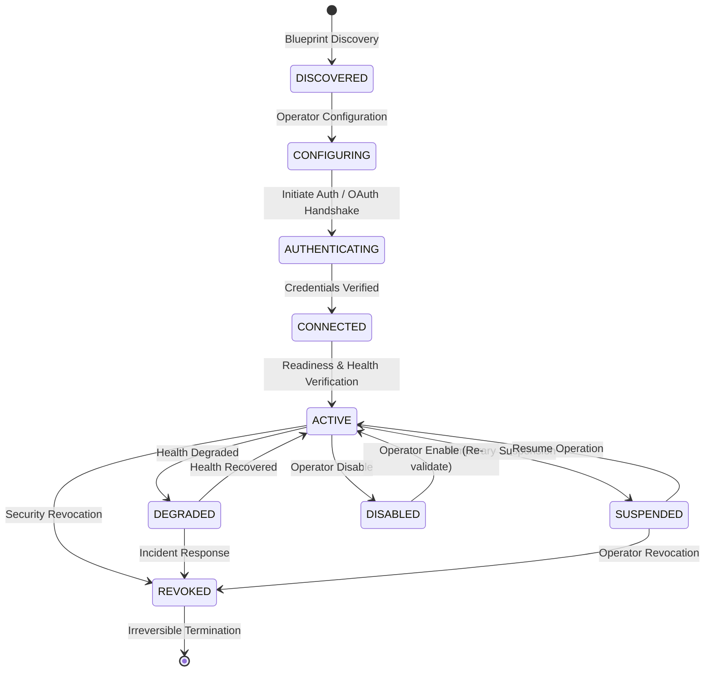

# AryaOS V1 Stage 16 — Connector Lifecycle & State Machine Architecture

## 1. Connector Lifecycle State Machine

AryaOS Connector Fabric implements a strictly validated finite state machine governing external integrations. Every transition is verified, logged, and audited.

---

## 2. Valid Lifecycle Transitions

| From State | To State | Permitted Initiators | Pre-conditions |
|---|---|---|---|
| `DISCOVERED` | `CONFIGURING` | `OPERATOR`, `SYSTEM` | Blueprint registered in catalog |
| `CONFIGURING` | `AUTHENTICATING` | `OPERATOR` | Configuration parameters validated |
| `AUTHENTICATING` | `CONNECTED` | `OPERATOR`, `SYSTEM` | Valid credential reference established |
| `CONNECTED` | `ACTIVE` | `OPERATOR`, `SYSTEM` | Health check passed (`HEALTHY`) |
| `ACTIVE` | `DEGRADED` | `HEALTH_SERVICE`, `SYSTEM` | Health check reports degraded capability |
| `DEGRADED` | `ACTIVE` | `HEALTH_SERVICE`, `OPERATOR` | Health check succeeds |
| `ACTIVE` | `SUSPENDED` | `OPERATOR`, `GOVERNANCE` | Operator paused external traffic |
| `SUSPENDED` | `ACTIVE` | `OPERATOR` | Operator resumes external traffic |
| `ACTIVE` | `DISABLED` | `OPERATOR` | Explicit disable request |
| `DISABLED` | `CONFIGURING` / `ACTIVE`| `OPERATOR` | Re-enablement and credential re-validation |
| `ANY` | `REVOKED` | `SECURITY_OFFICER`, `OPERATOR` | Incident response or decommission |

---

## 3. Revocation & Credential Invalidation

When a connector is revoked via `connectorLifecycleService.revokeConnector(id, actor, reason)`:
1. State is immediately transitioned to `REVOKED`.
2. Associated `CredentialRef.status` is set to `REVOKED`.
3. Health is locked to `OFFLINE`.
4. Any active agent or mission capability grants referencing this connector are revoked (`grantStatus: 'REVOKED'`).
5. An immutable `ConnectorLifecycleEvent` is persisted with actor attribution and rationale.
6. The Universal Action Bus immediately blocks any in-flight or subsequent action requests targeting this connector.

---

## 4. Idempotent Transition Handling & Event Journaling

* Duplicate requests to transition a connector to its existing state are recognized idempotently, returning the existing connector without corrupting state or duplicating audit records.
* Every valid transition appends an immutable `ConnectorLifecycleEvent` into `ExecutionPersistence`:
  * `eventId`: Unique cryptographic ID (`cle_<connectorId>_<timestamp>`)
  * `connectorId`: Affected connector identifier
  * `fromState`: Previous state
  * `toState`: New state
  * `actor`: Identity of operator or subsystem triggering the change
  * `reason`: Justification for transition
  * `timestamp`: ISO-8601 UTC timestamp
