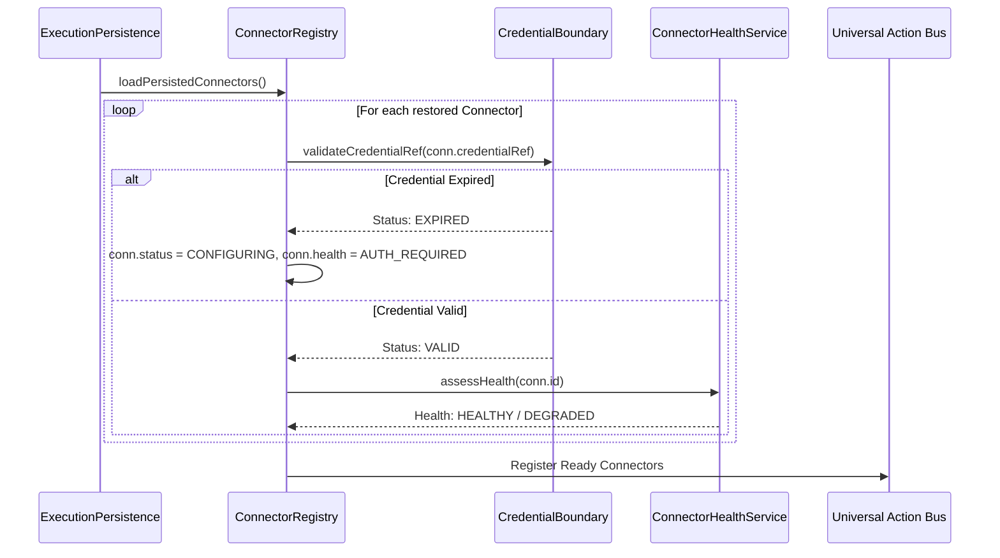

# AryaOS V1 Stage 16 — Connector Recovery & Persistence Design

## 1. Durable Envelope Schema Evolution

Stage 16 extends `OrchestrationPersistenceEnvelope` in an additive, non-breaking manner to preserve connector state, audit journals, and capability grants across browser restarts:

```typescript
export interface OrchestrationPersistenceEnvelope {
  // Stages 08 - 15 Fields
  version: number;
  goals: Goal[];
  plans: Plan[];
  // ...
  actionRequests: ActionRequest[];
  actionResults: ActionResult[];
  actionAuditRecords: ActionAuditRecord[];

  // Stage 16 Additions
  connectors: Connector[];
  connectorAuditEvents: ConnectorAuditEvent[];
  agentCapabilityGrants: AgentCapabilityGrant[];
  missionCapabilityGrants: MissionCapabilityGrant[];
}
```

---

## 2. Boot & Recovery Sequence

Upon application restart, browser refresh, or process recovery, AryaOS initializes the Connector Fabric through a deterministic reconciliation sequence:



---

## 3. Recovery Invariants & State Guarantees

1. **Deterministic Recovery**:
   * If a connector was in `REVOKED` state prior to shutdown, it remains `REVOKED` permanently upon recovery.
   * If a connector was in `DISABLED` state, it remains `DISABLED`.
2. **Credential Expiry Re-evaluation**:
   * Timestamps are evaluated against `Date.now()`. If a token's validity window elapsed during system downtime, its state transitions to `EXPIRED` before any action can be dispatched.
3. **Stale Grant Purging / Invalidation**:
   * Grants whose `expiresAt` is in the past are marked `EXPIRED` and ignored during `evaluateAuthorization()`.
4. **Action Bus Readiness**:
   * The Action Bus evaluates connector readiness dynamically. No action is dispatched to an adapter until the connector's recovered health is verified.
