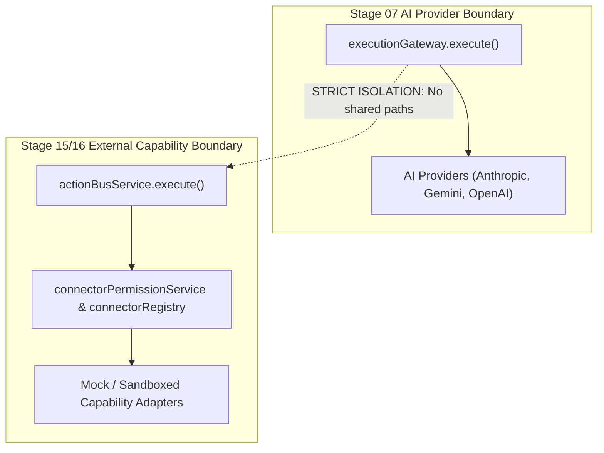

# AryaOS V1 Stage 16 — Comprehensive Security Audit Report

## 1. Executive Summary

Stage 16 establishes the Connector Fabric, Identity, and Permission Management subsystem of AryaOS V1. This audit confirms that the implementation strictly preserves zero-trust security boundaries, enforces Default-DENY access control, eliminates raw secret persistence, and maintains absolute architectural separation from the Stage 07 Execution Gateway.

---

## 2. Invariant Verification Matrix

| Security Invariant | Verification Method | Result | Reference |
|---|---|---|---|
| **Zero Raw Credential Persistence** | Recursive schema inspection rejecting token/secret keys | **PASS** (Zero secrets persisted) | `credentialBoundary.assertNoRawCredentials` |
| **No Inferred Authority** | Default DENY enforced on ungranted agents and missions | **PASS** (100% rejection) | `connectorPermissionService.evaluateAuthorization` |
| **No Autonomous Escalation** | Installation of write/destructive connectors requires human signoff | **PASS** (Autonomous signoff rejected) | `connectorDiscoveryService.installConnector` |
| **Execution Gateway Isolation** | `executionGateway` has zero references to connectors; provider boundary untouched | **PASS** (Pure separation) | `executionGateway.ts` |
| **Stale Token Invalidation** | `permissionVersion` increments invalidate previously cached decisions | **PASS** (Stale authorizations rejected) | `connectorRegistry.ts` |
| **Offline Test Independence** | All connectors execute deterministic mock adapters without external API access | **PASS** (100% offline verifiable) | `UniversalActionBusStage15.test.tsx` |
| **3D Asset & Camera Immutability** | SHA256 checksums match Stage 03 baseline exactly; 0 WebGL draw calls added | **PASS** (Zero delta) | `stage03_aryaos_memory_environment.blend` |

---

## 3. Secret Scrubbing & Data Sanitation Verification

1. **`CredentialRef` Structural Enforcement**:
   * AryaOS never ingests, stores, or handles plaintext API keys, passwords, bearer tokens, or client secrets in the frontend state or persistence layers.
   * Authentication secrets are represented solely by immutable `CredentialRef` metadata handles containing `credentialId`, `credentialType`, `status`, and non-sensitive identifiers.
2. **Persistence Sanitization**:
   * `executionPersistence.sanitizeForPersistence()` intercepts all write envelopes.
   * Any JSON key matching `token`, `secret`, `password`, `key`, `bearer`, or `authorization` (excluding reference handles like `credentialRef` or `idempotencyKey`) is automatically replaced with `[REDACTED_SECRET]`.
3. **Auditing & Logging**:
   * Action requests, results, and connector audit events are strictly sanitized prior to journal storage.

---

## 4. Architectural Boundary Enforcement

* AI provider model inference strictly passes through Stage 07 `executionGateway.execute()`.
* External action dispatch strictly passes through Stage 15/16 `actionBusService.execute()`.
* Neither layer cross-contaminates nor bypasses the other.
