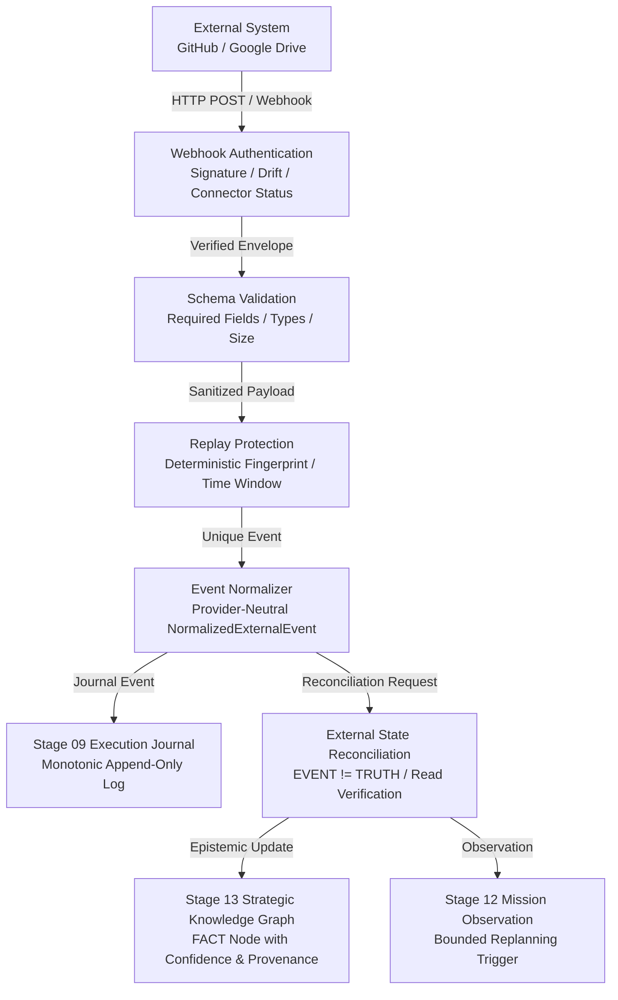

# Stage 18: External Event Ingestion & State Synchronization Architecture

## 1. Overview & System Boundary
Stage 18 establishes the governed inbound boundary for AryaOS V1, complementing Stage 17's outbound capability integration. External systems (e.g., GitHub webhooks, Google Drive push notifications) transmit state change notifications into AryaOS.

### Core Architectural Axioms
1. **EVENT ≠ TRUTH**: An incoming webhook or event notification is evidence that an external event occurred, NOT confirmed truth about state.
2. **EVENT ≠ AUTHORITY**: External events carry zero authority to grant permissions, escalate agent ranks, or mutate policies.
3. **EVENT ≠ AUTOMATIC ACTION**: Events cannot trigger consequential external write operations without operator signoff.
4. **EVENT ≠ REASONING**: Inbound event processing does NOT invoke Stage 07 Execution Gateway (0 LLM inference calls).
5. **EPHEMERAL SECRETS & SCRUBBING**: Webhook secrets and sensitive authorization tokens are strictly scrubbed prior to persistence or journaling.

## 2. Inbound Pipeline Stages
1. **Transport Ingress (`eventIngressService`)**: Accepts raw body and headers. Enforces maximum envelope payload limits (1 MB default) and rate-limiting concurrency bounds.
2. **Webhook Authentication (`webhookAuthenticationService`)**: Resolves connector identity via `connectorRegistry`, checks connector lifecycle state (`REVOKED`, `DISABLED`, `SUSPENDED` are immediately rejected), validates timestamp freshness (drift <= 5 minutes), and verifies HMAC-SHA256 signatures.
3. **Schema Validation (`eventSchemaValidator`)**: Validates against declared event schemas in `eventSourceRegistry`. Verifies required fields and data types.
4. **Payload Sanitization (`eventSanitizer`)**: Recursively scrubs secrets (`Authorization`, `Bearer`, `token`, `password`, `secret`) with `[REDACTED_SECRET]`.
5. **Replay Protection (`eventReplayProtection`)**: Computes deterministic SHA-256 fingerprint from `connectorId + eventType + occurredAt + sanitizedPayload`. Bounded sliding time window (15 minutes) prevents replay attacks and duplicate execution.
6. **Normalization (`eventNormalizer`)**: Maps provider payloads to `NormalizedExternalEvent`, assigning default `epistemicStatus: 'OBSERVED'`.
7. **Journal Logging (`executionJournal`)**: Monotonically appends `EXTERNAL_EVENT_AUTHENTICATED`, `EXTERNAL_EVENT_NORMALIZED`, `EXTERNAL_EVENT_RECONCILED` events.
8. **State Reconciliation (`externalStateReconciliationService`)**: Resolves `OBSERVED` vs `CONFIRMED` state through governed read-back verification over Stage 15 Action Bus (`github.issue_read`) or sandboxed path constraints.
9. **Knowledge Graph Integration (`knowledgeGraph`)**: Creates/updates canonical fact nodes preserving epistemic status, evidence count, and full provenance.
10. **Mission Control Integration (`missionObservationService`, `missionReplanner`)**: Appends structured mission observations and triggers bounded replanning if mission dependencies are removed/deleted.

## 3. Immutability & Separation Guarantees
- **Stage 03 Visual Assets**: Zero modifications to Blender scene (`c4577c47fa60f8beb1f77a1feb25ffb84b34ff9c38cfc6dbd4a8bc2628c8a13f`), 14 GLBs, or reconciled camera baselines.
- **WebGL Draw Calls**: Added DOM-only HUD overlays (`external-event-hud`, `event-ingress-hud`, `event-reconciliation-hud`) introducing 0 additional draw calls.
- **Sole AI Inference Boundary**: Stage 07 Execution Gateway remains untouched (0 LLM inference calls made during event ingestion).
- **Sole Action Boundary**: Stage 15 Universal Action Bus executes read-back reconciliation without bypassing gatekeepers or approval policies.
