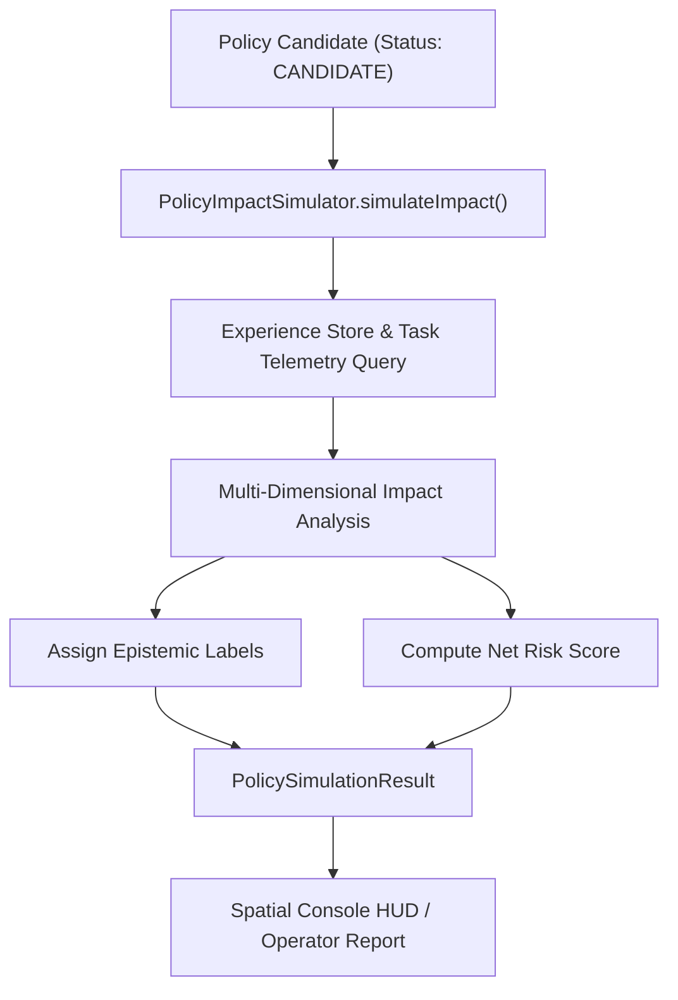

# AryaOS V1 Stage 20 — Policy Impact Simulation & Epistemic Forecasting

## 1. Purpose & Design Principles

Before any policy candidate can be submitted to human operators for review and potential activation, `PolicyImpactSimulator` executes a comprehensive pre-activation impact analysis. The simulator models the hypothetical consequences of enacting the policy across five primary operational dimensions:

1. **Cost Overhead**: Projected token usage, compute consumption, and API expenses.
2. **Execution Latency**: Anticipated delays or optimizations in task dispatch.
3. **Task Quality**: Expected first-pass task success rate and accuracy.
4. **System Reliability**: Resilience against provider outages and retry loops.
5. **Security & Operational Risk**: Risk surface exposure or mitigation.

---

## 2. Epistemic Certainty Classification

AryaOS strictly forbids presenting simulated projections as empirical facts. Every dimension forecasted by the simulation is explicitly tagged with an epistemic certainty label:

| Label | Definition | Basis |
|---|---|---|
| **`OBSERVED`** | Empirically verified historical fact from recorded execution logs. | Measured directly in past runs under identical conditions. |
| **`INFERRED`** | Statistically derived from closely related historical tasks or agent behaviors. | Interpolated with confidence intervals >= 0.80. |
| **`PROJECTED`** | Theoretical mathematical modeling based on constraint bounds. | Model-derived estimate subject to runtime variance. |
| **`UNKNOWN`** | Insufficient telemetry or novel operational conditions. | Explicitly flagged when data points < 5. |

---

## 3. Simulation Workflow



---

## 4. Sample Simulation Scenario: Provider Demotion Policy

### Scenario:
A candidate policy (`pol-demote-flaky-01`) proposes rerouting research summarization tasks away from an unstable provider (`mock-flaky-v1`) to a high-reliability fallback (`mock-reliable-v1`).

### Simulation Output (`PolicySimulationResult`):

```json
{
  "policyId": "pol-demote-flaky-01",
  "simulatedAt": "2026-10-02T21:40:00.000Z",
  "baseline": {
    "costPerTask": 0.0042,
    "avgLatencyMs": 1420,
    "successRate": 0.68,
    "epistemicStatus": "OBSERVED"
  },
  "projected": {
    "costDeltaPercent": 12.5,
    "costCertainty": "INFERRED",
    "latencyDeltaMs": -180,
    "latencyCertainty": "PROJECTED",
    "qualityDeltaPercent": 24.0,
    "qualityCertainty": "INFERRED",
    "reliabilityImprovement": 0.31,
    "reliabilityCertainty": "INFERRED",
    "riskLevel": "LOW",
    "riskCertainty": "PROJECTED"
  },
  "warnings": [
    "Projected 12.5% increase in compute cost due to premium provider routing.",
    "Data points for task type 'research_summary' on target provider: 42 (INFERRED confidence = 0.88)."
  ],
  "recommendationForOperator": "ACCEPT_WITH_RESOURCE_BUDGET_CAP"
}
```

---

## 5. Non-Fabrication Guarantee

In strict accordance with Step 10 of Stage 20 specifications:
- The simulation engine **never fabricates empirical outcomes**.
- Where historical observations do not exist, metrics are tagged as **`PROJECTED`** or **`UNKNOWN`**.
- Simulation results are strictly advisory and provide decision support to human operators without automatically enacting policy modifications.
