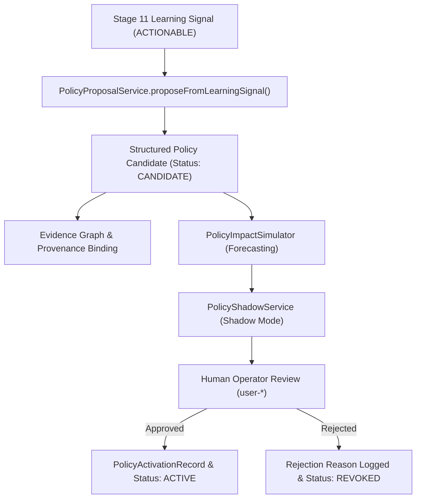

# AryaOS V1 Stage 20 — Policy Learning Loop & Governed Candidate Derivation

## 1. Overview & Architectural Boundaries

In AryaOS V1, the Policy Learning Loop establishes a governed pathway for translating empirical runtime experience into structured, proposed policy candidates. Governed adaptation is fundamentally distinct from autonomous self-modification.

### Core Architectural Invariants:
```
LEARNING ≠ AUTHORITY
EXPERIENCE ≠ PERMISSION
RECOMMENDATION ≠ POLICY
POLICY ≠ APPROVAL
APPROVAL ≠ EXECUTION
```

At no point in the lifecycle may runtime learning feedback, agent evaluations, or statistical telemetry automatically alter, activate, or mutate an executable policy. 

---

## 2. Learning Signal Ingestion & Candidate Derivation

Candidate policies originate from Stage 11 learning signals (`LearningSignal`) emitted by `AgentEvaluationService`, `TaskPerformanceService`, and `LearningSignalService`.

### Candidate Derivation Pipeline:


### Supported Signal Types to Policy Candidates:
1. **`PROVIDER_HIGH_FAILURE_RATE`**:
   - Synthesizes candidate restricting or demoting provider traffic.
   - Effect: `ROUTE` or `DENY` for flaky endpoint.
   - Priority: `SECURITY` (90) or `RESOURCE_LIMITS` (70).
2. **`AGENT_LOW_SUCCESS_RATE`**:
   - Synthesizes candidate placing concurrency constraints or requiring operator approval for sensitive tasks.
   - Effect: `LIMIT` or `REQUIRE_APPROVAL`.
   - Priority: `AGENT_POLICY` (50).
3. **`ROUTE_REPEATEDLY_FAILED`**:
   - Synthesizes candidate re-routing or pausing fragile agent-to-provider paths.
   - Effect: `ROUTE` or `PAUSE`.
   - Priority: `OPTIMIZATION_POLICY` (30).

---

## 3. Knowledge Graph & Evidence Provenance

Every derived candidate policy maintains strict, immutable provenance links back to the originating empirical observations:

- **`PolicyProvenance` Contract**:
  - `sourceSignalIds`: Array of unique Stage 11 signal IDs.
  - `sourceObservation`: Exact textual and factual observation from runtime logs.
  - `confidence`: Bounded empirical confidence score (`0.00 – 1.00`).
  - `derivedAt`: ISO 8601 timestamp of derivation.
  - `generatorService`: `'PolicyProposalService'`.

In `EvidenceGraph`, derivation creates an evidence node (`'POLICY_PROPOSAL'`) linked to the underlying `LearningSignal` with edge type `'DERIVED_POLICY_CANDIDATE'`.

---

## 4. Post-Execution Observation & Feedback

Once a policy is formally approved and activated by an operator, `PolicyEvaluationService` and `PolicyRegistry` record all execution outcomes into `ExecutionPersistence`:

- **Journal Events**:
  - `POLICY_EVALUATED`: Recorded on every scoped request check.
  - `POLICY_DECISION_RECORDED`: Captures winning policy, applied effect, and constraint enforcement.
  - `POLICY_EXECUTION_OBSERVED`: Records empirical outcome (`success: boolean`, `executionTimeMs`, `errorCode`).

### Strict Invariant on Outcome Feedback:
Under no circumstances does an observed execution failure directly mutate the policy conditions or constraints. All deviations are routed to the **Policy Drift Detection** system.

---

## 5. Policy Drift Detection (`PolicyDriftService`)

Policy drift occurs when the empirical operational metrics of an active policy deviate beyond pre-configured acceptable tolerance boundaries.

### Drift Evaluation Metrics:
- **Error Rate Tolerance**: Maximum allowable ratio of failures (default: 15%).
- **Latency Tolerance**: Maximum allowable increase in execution overhead (default: 25%).
- **Volume Shift**: Sudden anomalies in evaluation frequency.

### Drift Response Protocol:
```
Observed Metric Variance > Tolerance
  ↓
Drift Record Created (PolicyDriftRecord)
  ↓
Status Assigned: REVIEW_REQUIRED (Never Auto-Modified)
  ↓
Telemetry Emitted to Spatial Command Console HUD
  ↓
Human Operator Intervention Required (Rollback, Reconfigure, or Revoke)
```

No automated relaxation or tightening of security rules is permitted. The system fails closed.
