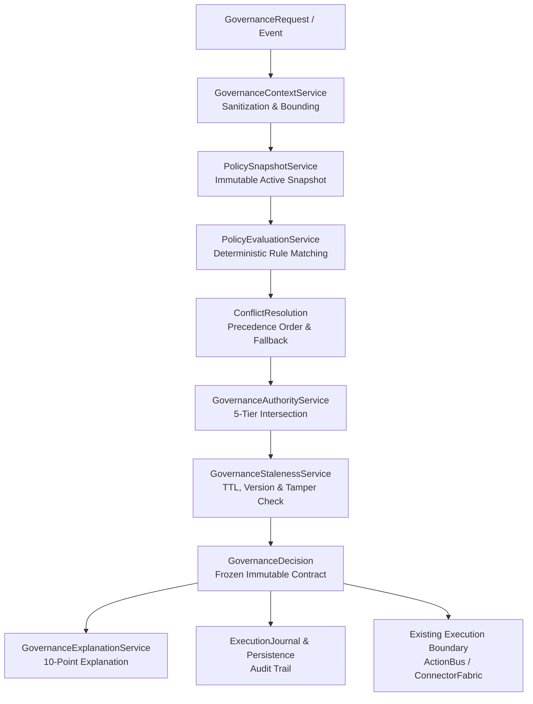

# AryaOS V1 Stage 21 — Governed Policy Control Plane Architecture

## 1. System Overview

The Stage 21 Governed Policy Control Plane acts as the authoritative coordination and governance surface across all operational dimensions in AryaOS V1. It does not replace or duplicate any execution or authorization engine; instead, it coordinates existing boundaries through a deterministic, single-pipeline lifecycle.

---

## 2. Core Architectural Pipelines

### Pipeline A: Request-Time Evaluation (`evaluateGovernance`)
1. **Context Construction**: Receives `GovernanceRequest`, sanitizes secret keys (`apiKey`, `password`, `token`), strips prototype pollution (`__proto__`, `constructor`), and bounds object depth to <= 5 levels and <= 50 keys.
2. **Snapshot Capture**: Obtains an immutable, deep-frozen snapshot of all `ACTIVE` policies from `policyRegistry`.
3. **Deterministic Evaluation**: Evaluates conditions using pure boolean logic (no LLM inference).
4. **Precedence Hierarchy**: Resolves conflicts via strict deterministic priority order:
   `SYSTEM_SAFETY > SECURITY > RESOURCE_LIMITS > DATA_INTEGRITY > WORKFLOW > COST_OPTIMIZATION > CONVENIENCE`
5. **Authority Intersection**: Evaluates the 5-tier fail-closed formula.
6. **Explanation & Provenance**: Attaches complete 10-point transparent metadata and epistemic certainty tag (`OBSERVED`, `INFERRED`, `PROJECTED`, or `UNKNOWN`).
7. **Cache & Persistence**: Records decision in volatile replay cache and permanent `executionPersistence` store.

### Pipeline B: Pre-Execution Verification (`verifyPreExecution`)
Executed immediately prior to action dispatch to catch in-flight invalidations:
- Verifies decision existence and TTL freshness (default 5-minute TTL).
- Validates that the current `policyRegistry.getRegistryVersion()` matches the decision snapshot.
- Compares request parameters against evaluated parameters to detect payload tampering.
- Fails closed if any invalidation trigger is detected.

### Pipeline C: Governed Action Execution (`executeGovernedAction`)
Connects the Governance Control Plane to Stage 15 `actionBusService`:
- Resolves capability metadata and determines effective risk tier.
- Evaluates governance.
- If `DENY`, aborts execution and records audit event.
- If `REQUIRE_APPROVAL`, halts until explicit valid operator approval token is supplied.
- If `ALLOW`, dispatches directly to `actionBusService.execute()` with preserved correlation ID and idempotency key.

---

## 3. Epistemic Certainty Model

Stage 21 models the epistemic certainty of every decision:
- **`OBSERVED`**: Decision is based purely on verified empirical context and confirmed active policies.
- **`INFERRED`**: Decision relies on contextual deductions or inferred agent capabilities.
- **`PROJECTED`**: Decision evaluated within a simulation or speculative long-horizon projection.
- **`UNKNOWN`**: Insufficient context or telemetry to guarantee deterministic bounds; fails closed.

---

## 4. Preservation of Architectural Invariants

- **Zero LLM Token Usage**: 0 inference calls inside the control plane.
- **No Second Execution Engine**: `actionBusService.execute` remains the sole outbound dispatch vector.
- **No Ambient Authority**: Explicit capability grants required for all autonomous agents.
