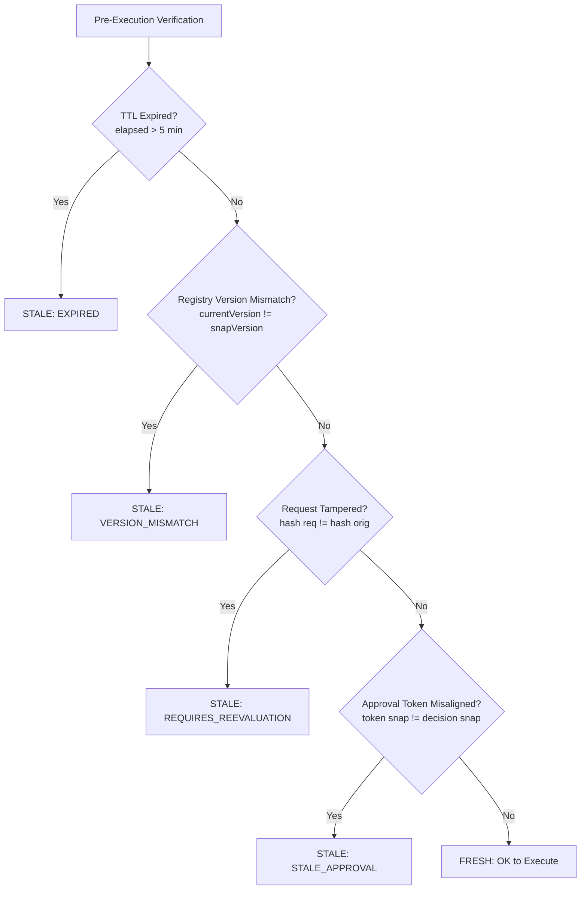

# AryaOS V1 Stage 21 — Staleness Detection, In-Flight Invalidation & Safe Recovery

## 1. The Time-of-Check to Time-of-Use (TOCTOU) Challenge

In autonomous agent operations, latency between governance evaluation and actual action dispatch creates a risk of state skew:
- Policies may be revoked or modified while an action is queued.
- Connector permissions or access tokens may change.
- Request payloads may be mutated or tampered with in-flight.
- Operator approval tokens may expire.

The `GovernanceStalenessService` enforces strict pre-execution verification immediately prior to dispatching any governed action to `actionBusService`.

---

## 2. Staleness Invalidation Triggers

A decision is invalidated if **any** of the following conditions hold:

### 2.1 Decision Time-To-Live (TTL)
- Default TTL: **300,000 ms (5 minutes)**.
- If `Date.now() - decision.timestamp > TTL`, the decision transitions to `EXPIRED`.

### 2.2 Policy Registry Version Mismatch
- If `policyRegistry.getRegistryVersion() !== decision.policyRegistryVersion`, active rules have changed.
- The decision transitions to `VERSION_MISMATCH`.

### 2.3 Parameter Tampering Detection
- Request parameters at pre-execution verification are checked against the sanitized parameters recorded during initial evaluation.
- Any discrepancy (e.g. modified target repo, mutated command string) triggers `REQUIRES_REEVALUATION`.

### 2.4 Approval Token Misalignment
- If an operator approval token was generated against an older snapshot than the current decision, it is marked `STALE_APPROVAL`.

---

## 3. Safe Recovery Pipeline

When an in-flight staleness condition is detected:
1. **Immediate Execution Halt**: `verifyPreExecution()` returns `{ valid: false, reason: '...' }`, preventing `actionBusService.execute()`.
2. **Audit Logging**: The staleness event is recorded in `executionJournal` and `executionPersistence`.
3. **Transparent Re-Evaluation**: The caller or scheduler initiates an explicit re-evaluation:
   - A fresh snapshot is captured from `policySnapshotService`.
   - The current registry version is bound to the new decision.
   - Fresh authority intersection is executed.
4. **Deterministic Continuation**: If the fresh decision allows the action, it receives a new `decisionId` and execution proceeds safely under verified, current governance.
