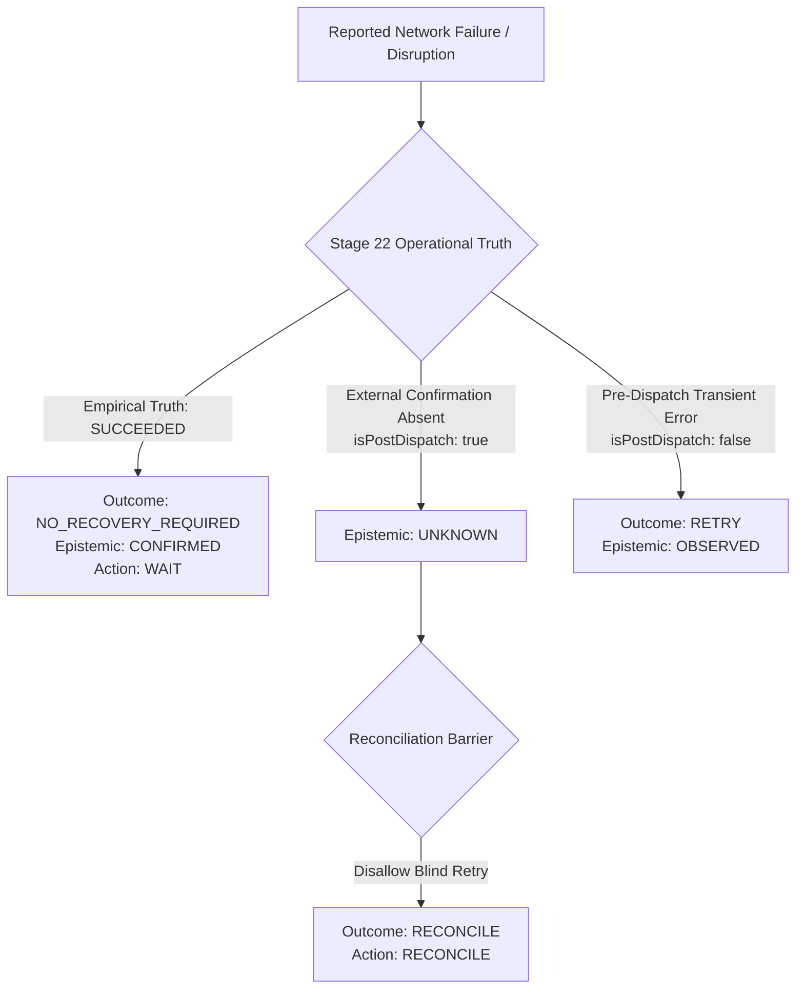
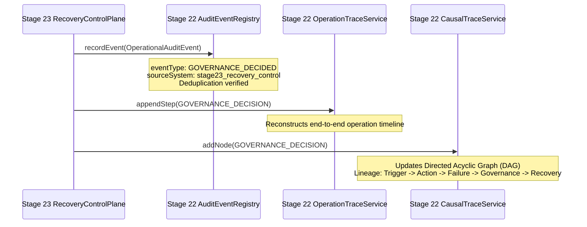

# ARYAOS V1 — STAGE 23: OPERATIONAL TRUTH FEEDBACK & AUDIT INTEGRATION

**STATUS:** AUTHORITATIVE SPECIFICATION & MAPPING REFERENCE  
**STAGE:** STAGE 23 — RESILIENT AUTONOMOUS OPERATIONS & RECOVERY CONTROL  
**PHASE:** PHASE 10 — GOVERNED RECOVERY INTEGRATION & OPERATIONAL-TRUTH FEEDBACK  
**INTEGRATION BOUNDARY:** STAGE 22 OPERATIONAL TRUTH & CAUSAL AUDIT  

---

### 1. Executive Summary

This document specifies the bidirectional integration between Stage 23 Recovery Control and Stage 22 Operational Truth. The fundamental architectural tenet is:

$$\text{DISPATCHED} \neq \text{SUCCEEDED}$$
$$\text{INTENT} \neq \text{REALITY}$$

Stage 22 provides empirical truth regarding external state, preventing blind retry loops and ensuring that recovery decisions feed back directly into the immutable causal audit graph.

---

### 2. Operational Truth Precedence & Epistemic Barrier

**Key Epistemic Rules**:
1. **Empirical Truth Supersedes Inferred Failure**:
   - If an operation reported a timeout or network drop, but Stage 22 empirical probes verify that the side effect completed (`operationalTruth === 'SUCCEEDED'` or `confirmedSuccess === true`), the control plane immediately halts recovery with `NO_RECOVERY_REQUIRED`.
2. **Epistemic Status Preservation**:
   - If an operation was dispatched and external confirmation is missing, its epistemic status is strictly `UNKNOWN`.
   - `UNKNOWN` is NEVER promoted to `CONFIRMED` or `OBSERVED` without fresh empirical evidence from Stage 22.
3. **Reconciliation Barrier**:
   - If `epistemicStatus === 'UNKNOWN'` after dispatch, ANY attempt to perform a blind `RETRY` is overridden to `RECONCILE`.
4. **Discrepancy Non-Fabrication**:
   - Environmental reconciliation discrepancies preserve `UNKNOWN` without fabricating synthetic failures.

---

### 3. Stage 22 Causal Audit Feedback Loop

Every recovery control decision is finalized through Stage 22 audit registration:

**Audit Event Contract**:
- `eventType`: `GOVERNANCE_DECIDED`
- `sourceSystem`: `stage23_recovery_control`
- `operationId`: Root operation identifier
- `causationId`: Upstream causal triggering event
- `correlationId`: Distributed correlation context
- `parentOperationId`: Original operation if compensating/recovering
- `policySnapshotId`: Stage 20 immutable snapshot ID evaluated
- `metadata`: Contains `recoveryOutcome`, `recommendedAction`, `decisionId`, `epistemicStatus`, `winningPolicyId`, `reasonCodes`

**Integrity & Deduplication**:
- Identical replay requests re-evaluating the same decision are deduplicated by `auditEventRegistry`, preventing log bloat.
- Lineage reconstruction via `operationTraceService.getOperationTrace()` and `causalTraceService.buildCausalGraph()` contains deterministic `GOVERNANCE_DECISION` nodes.
