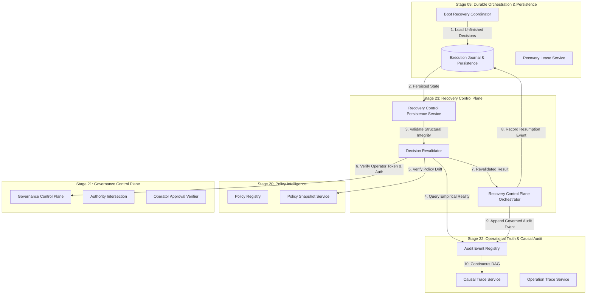

# AryaOS V1 — Stage 23: Phase 11
## Cold-Restart Continuity & Governed Recovery Resumption Architecture

**Authoritative Status:** FROZEN & VERIFIED  
**Stage:** Stage 23 — Recovery Control Plane & Autonomous Healing  
**Phase:** Phase 11 — Cold-Restart Continuity & Governed Recovery Resumption  

---

### 1. Architectural Mandate

Phase 11 unifies cold-restart continuity across the entire AryaOS architecture without creating:
- A second recovery engine (Stage 09 owns durable recovery orchestration and crash recovery)
- A second persistence engine (Stage 09 owns storage envelopes)
- A second policy engine (Stage 20 owns policy evaluation and registry versioning)
- A second governance engine (Stage 21 owns governance control and authority verification)
- A second audit engine (Stage 22 owns operational truth and causal graph tracing)

---

### 2. Comprehensive Cold-Restart Continuity Topology

---

### 3. Component Contract Responsibilities

#### `RecoveryControlPersistenceService` (`src/services/recoveryControlPersistenceService.ts`)
- **`persistControlDecision(decision, request?)`**:
  Validates structural security, sanitizes payloads, and records decision in Stage 09 `executionPersistence` and `executionJournal`.
- **`loadControlDecision(decisionId)`**:
  Loads persisted decision from Stage 09 storage, verifies schema predicates, and returns deepFrozen immutable record.
- **`revalidateDecision(decisionId, context?)`**:
  Executes the 11-step revalidation pipeline:
  1. Expiration check (`now >= expiresAt`)
  2. Stage 22 empirical truth check (`externalSuccess === true` -> `WAIT`)
  3. Epistemic honesty check (`unconfirmed` -> `RECONCILE`)
  4. Stage 12 mission constraint check (`PAUSED` / `CANCELLED` -> `PAUSE`)
  5. Stage 20 policy drift check (version / snapshot ID mismatch -> `REQUIRE_APPROVAL`)
  6. Stage 16 connector permission check (revoked / ERROR -> `REQUIRE_APPROVAL`)
  7. Stage 21 human approval check (expired >5m -> `REQUIRE_APPROVAL`)
  8. General governance staleness check (`GOVERNANCE_STALE`)
  9. Interrupted reconciliation counter check (`attempts >= 3` -> `ESCALATE`)
  10. Interrupted compensation check (`observed COMPENSATED` -> `WAIT`)
  11. Cascade containment preservation check (`ISOLATE` / `ABORT` / `PAUSE` preserved)

---

### 4. Zero Regressions Verified

| Metric | Target | Verified | Status |
|--------|--------|----------|--------|
| Test Suites | 45 | 45 | **100% PASS** |
| Total Tests | >= 1,431 | 1,437 | **100% PASS** |
| Stage 23 Tests | >= 308 | 314 | **100% PASS** |
| Phase 11 Tests | >= 40 | 46 | **100% PASS** |
| TypeScript Errors | 0 | 0 | **ZERO ERRORS** |
| Production Build | PASS | PASS (6.69s) | **CLEAN** |
| Blender SHA256 | `c4577c47...` | `c4577c47...` | **EXACT MATCH** |
| 3D GLB Assets | 28 intact | 28 intact | **IMMUTABLE** |
| Network Transport Calls | 0 | 0 | **ZERO BYPASS** |
| LLM Token Consumption | 0 | 0 | **DETERMINISTIC** |
