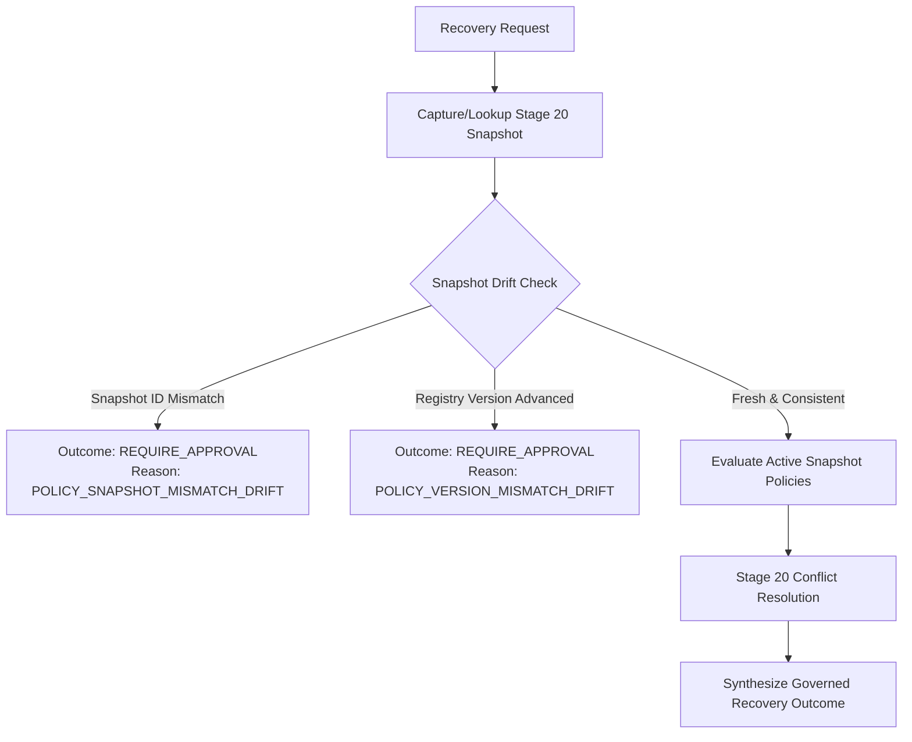

# ARYAOS V1 — STAGE 23: STAGE 20 POLICY RECOVERY MATRIX

**STATUS:** AUTHORITATIVE SPECIFICATION & MAPPING REFERENCE  
**STAGE:** STAGE 23 — RESILIENT AUTONOMOUS OPERATIONS & RECOVERY CONTROL  
**PHASE:** PHASE 10 — GOVERNED RECOVERY INTEGRATION & OPERATIONAL-TRUTH FEEDBACK  
**INTEGRATION BOUNDARY:** STAGE 20 POLICY INTELLIGENCE  

---

### 1. Executive Summary

This matrix establishes the deterministic mapping between Stage 20 Active Policy definitions and Stage 23 Recovery Control decisions. Stage 23 operates strictly as a governed recovery decision consumer and DOES NOT instantiate a duplicate policy engine, rules evaluator, or precedence arbiter.

**Core Invariants**:
- `POLICY ALLOW ≠ ACTION AUTHORIZATION ≠ CONNECTOR PERMISSION ≠ HUMAN APPROVAL`
- `LEARNING ≠ AUTHORITY` (Learning signals and recommendations cannot mutate or assume policy authority)
- `IMMUTABLE SNAPSHOT EVALUATION` (All recovery decisions evaluate against an immutable Stage 20 `PolicySnapshot`)
- `FAIL-CLOSED ON DRIFT` (Any detected policy registry version advancement or snapshot mismatch fails closed to `REQUIRE_APPROVAL`)

---

### 2. Policy Effect to Recovery Outcome Mapping

| Stage 20 Policy Effect (`PolicyEffectType`) | Stage 23 Recovery Outcome (`RecoveryControlOutcome`) | Recommended Action | Human Operator Required | Governance Required | Primary Reason Code | Description |
| :--- | :--- | :--- | :--- | :--- | :--- | :--- |
| **`ALLOW`** | `RETRY` / `RESUME` / `RECONCILE` | `RETRY` / `RESUME` / `RECONCILE` | `false` | `false` | `GOVERNANCE_POLICY_ALLOWED` | Policy permits automated execution. Outcome determined by downstream failure classification and safety assessment. |
| **`DENY`** | `ABORT` | `ABORT` | `true` | `true` | `GOVERNANCE_POLICY_DENIED` | Policy prohibits operation. Recovery immediately halts. Retries, resumption, or compensation blocked. |
| **`REQUIRE_APPROVAL`** | `REQUIRE_APPROVAL` | `REQUIRE_APPROVAL` | `true` | `true` | `GOVERNANCE_APPROVAL_REQUIRED` | Policy mandates explicit human operator signoff prior to any recovery action. |
| **`REQUIRE_REVIEW`** | `REQUIRE_APPROVAL` | `REQUIRE_APPROVAL` | `true` | `true` | `GOVERNANCE_APPROVAL_REQUIRED` | Policy requires supervisory review before recovery progression. |
| **`PAUSE`** | `PAUSE` | `PAUSE` | `true` | `true` | `GOVERNANCE_PAUSE_REQUIRED` | Infrastructure or mission freeze. Recovery execution paused until operator unfreezes or policy changes. |
| **`LIMIT`** | `WAIT` / `RETRY` | `WAIT` / `RETRY` | Conditional | `true` | `GOVERNANCE_RATE_LIMITED` | Concurrency or rate limit policy matched. Defers execution or applies backoff. |
| **`DEFER`** | `WAIT` | `WAIT` | `false` | `false` | `GOVERNANCE_EXECUTION_DEFERRED` | Policy instructs delayed execution window. |
| **`ROUTE`** | `RETRY` (routed) | `RETRY` | `false` | `false` | `GOVERNANCE_ROUTED_PROVIDER` | Policy redirects recovery probe/dispatch to alternative preferred provider/agent. |

---

### 3. Policy Priority Hierarchy & Conflict Precedence

When multiple Stage 20 policies match the recovery context, the Stage 20 Conflict Service resolves precedence according to strict hierarchical weights:

| Priority Level | Weight | Resolution Priority | Effect Precedence in Conflict |
| :--- | :--- | :--- | :--- |
| **`SYSTEM_SAFETY`** | 100 | Highest | Strict fail-closed: `DENY` > `PAUSE` > `REQUIRE_APPROVAL` > `ALLOW` |
| **`SECURITY`** | 90 | High | Security lockdown overrides mission and optimization objectives |
| **`HUMAN_GOVERNANCE`** | 80 | High | Human mandates override autonomous agent policies |
| **`RESOURCE_LIMITS`** | 70 | Medium-High | Quota exhaustion and rate-limit constraints |
| **`MISSION_POLICY`** | 60 | Medium | Mission-specific constraints and deadlines |
| **`AGENT_POLICY`** | 50 | Medium-Low | Agent concurrency and specialization rules |
| **`TRIGGER_POLICY`** | 40 | Low | Reaction depth and trigger cycle protections |
| **`OPTIMIZATION_POLICY`** | 30 | Lowest | Cost/latency routing; never overrides safety or security |

---

### 4. Policy Snapshot Drift Detection & Fail-Closed Behavior

Stage 23 verifies the freshness of the evaluated policy snapshot:

1. **Snapshot ID Mismatch**:
   - Condition: `request.policySnapshotId !== activeSnapshot.snapshotId`
   - Outcome: `REQUIRE_APPROVAL`
   - Reason Code: `POLICY_SNAPSHOT_MISMATCH_DRIFT`
2. **Registry Version Advancement**:
   - Condition: `request.policyVersion !== activeSnapshot.registryVersion`
   - Outcome: `REQUIRE_APPROVAL`
   - Reason Code: `POLICY_VERSION_MISMATCH_DRIFT`
3. **Immutability Guarantee**:
   - Once a snapshot is captured, entries are deeply frozen (`Object.freeze`).
   - Decisions record `policySnapshotId` and `policyVersion` for cryptographic auditability.
