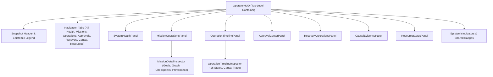

# Stage 24 — Phase 7: Operator HUD Component Integration
## Authoritative UI Source Map & Architectural Boundaries

**Status:** APPROVED & AUTHORIZED  
**Phase:** Stage 24 — Phase 7: Operator HUD Component Integration ONLY  
**Architectural Role:** Pure DOM Observational Presentation of Existing Control Plane Projections  
**Execution Authority:** NONE (Zero Execution, Zero Scheduling, Zero Mutation, Zero Action Bus Dispatch)

---

### 1. Architectural Boundaries & Non-Negotiable Invariants

1. **Observational HUD Only**:
   - The HUD displays what AryaOS currently knows across existing authorities.
   - Zero execution, zero goal scheduling, zero plan generation, zero resource allocation, zero Action Bus dispatch, zero policy/governance mutation, zero recovery execution.
   - Zero consequential action buttons: no "Execute", "Approve", "Retry", "Compensate", "Reconcile", "Dispatch", or "Mutate" controls exist anywhere in this layer.

2. **Single Projection Facade**:
   - All operational state is sourced exclusively via `controlPlaneSnapshotService`.
   - Coherent snapshot reads ensure all panels reflect a uniform temporal snapshot without cross-panel race conditions.
   - Refresh interaction is strictly local and observational: re-reading `controlPlaneSnapshotService.getSnapshot()` without triggering backend or network side effects.

3. **Epistemic Truthfulness**:
   - Distinct badges for `OBSERVED`, `CONFIRMED`, `INFERRED`, `PROJECTED`, and `UNKNOWN`.
   - `UNKNOWN` is never rendered as `SUCCESS` or hidden.
   - Derived progress is explicitly marked as derived and shows its underlying calculation basis.
   - Resource allocation (limits) is strictly separated from verified utilization (`utilized: 'UNKNOWN'` when not verified).
   - Approval requirements are strictly separated from granted approvals.
   - Recovery proposals are strictly separated from executed recovery actions.
   - Operation events are strictly separated from external confirmed success.

4. **Security & Sanitization**:
   - All secret patterns (`Bearer`, `api_key`, tokens, credentials) are sanitized and never rendered.
   - No `dangerouslySetInnerHTML` is used.
   - Prototype pollution blocked on all inputs.
   - Deep immutability: incoming projections remain frozen.

5. **Visual & Performance Boundaries**:
   - Pure DOM overlay: 0 added Three.js / WebGL draw calls, 0 added 3D polygons or geometry.
   - Master Blender scene SHA256 preserved: `c4577c47fa60f8beb1f77a1feb25ffb84b34ff9c38cfc6dbd4a8bc2628c8a13f`.
   - 28 GLB assets remain 100% intact.
   - Cinematic obsidian, graphite, charcoal, steel-blue surfaces with amber accents.

---

### 2. Subsystem & Component Source Mapping

| UI Panel / Component | Authoritative Projection Method | Source Domain Types | Epistemic / Invariant Requirements |
| :--- | :--- | :--- | :--- |
| **`OperatorHUD`** (Master Container) | `controlPlaneSnapshotService.getSnapshot()` | `ControlPlaneSnapshot` | Single temporal snapshot; tabbed / sectioned navigation; manual observational refresh; bounded error boundary; zero action buttons. |
| **`SystemHealthPanel`** | `snapshot.systemHealth` / `projectSystemHealth()` | `SystemHealthSummary`, `SubsystemHealthRecord` | Displays 9 subsystem records (`HEALTHY`, `DEGRADED`, `FAILED`, `UNKNOWN`); reflects `isDurableStorage` truthfully. |
| **`MissionOperationsPanel`** | `snapshot.missions` / `projectMissions()`, `projectMissionDetail()` | `MissionSummary`, `MissionDetailProjection`, `MissionGoalSummary` | Canonical statuses only; selected mission inspector; dependency satisfaction states (`SATISFIED`, `PENDING`, `BLOCKED`, `MISSING_EVIDENCE`, `UNKNOWN`); cycle detection warnings; checkpoints vs terminal status; progress provenance. |
| **`OperationTimelinePanel`** | `snapshot.operations`, `projectOperationTimeline()` | `OperationSummary`, `OperationTimeline`, `TimelineEntry` | 16 canonical states; chronological timeline entries; epistemic status per transition; contradiction flags; causal references. |
| **`ApprovalCenterPanel`** | `snapshot.approvals` / `projectApprovals()` | `ApprovalSummary`, `ApprovalProjectionState` | Distinguishes approval requirement from granted token; displays risk level, policy snapshot, expiry, actor ID; explicit states: `PENDING`, `APPROVED`, `REJECTED`, `EXPIRED`, `CANCELLED`, `UNKNOWN`. |
| **`RecoveryOperationsPanel`** | `snapshot.recovery` / `projectRecovery()` | `RecoverySummary`, `FailureClassification` | Distinguishes proposed recovery action from executed action; displays failure classification, idempotency, safety assessment, recursion depth, retry count, reconciliation requirement. |
| **`CausalEvidencePanel`** | `snapshot.causalTraces` / `projectCausalTraces()` | `CausalTraceSummary`, `CausalTraceNodeSummary` | Nodes and causal edges; displays evidence states (`VERIFIED`, `PENDING`, `MISSING_EVIDENCE`, `UNKNOWN`); cycle and truncation warnings. |
| **`ResourceStatusPanel`** | Sourced from `MissionDetailProjection.resourceAllocations` | `MissionResourceSummary` | Segregates allocation limits from actual telemetry consumption; displays `utilized: 'UNKNOWN'` and `status: 'ALLOCATED'` when consumption unrecorded; no fabricated budgets. |
| **`EpistemicIndicators`** | Reusable indicator primitives | `EpistemicStatus`, `SourceIntegrityStatus` | Distinct color/badge tokens for `OBSERVED`, `CONFIRMED`, `INFERRED`, `PROJECTED`, `UNKNOWN`; integrity badges for `VERIFIED`, `INCOMPLETE`, `STALE`, `CONFLICTING`. |

---

### 3. Component Hierarchy

---

### 4. Verification Plan

1. **Unit & Component Integration Tests** (`src/tests/OperatorHUDStage24.test.tsx`):
   - Initial empty-state render.
   - Loading and bounded error states.
   - Canonical mission summaries and detail drill-down.
   - Derived progress identified with provenance basis.
   - 16-state operation timeline ordering and contradiction display.
   - Epistemic status badges (`UNKNOWN`, `OBSERVED`, `CONFIRMED`, `INFERRED`, `PROJECTED`).
   - Source integrity badges (`VERIFIED`, `INCOMPLETE`, `STALE`, `CONFLICTING`).
   - Approval requirements never shown as granted approvals.
   - Recovery proposals never shown as executed actions.
   - Resource allocation vs verified utilization separation.
   - Secret redaction in UI.
   - XSS / script injection prevention.
   - Zero consequential action buttons.
   - Snapshot refresh without mutation.
   - Deep immutability of displayed data.
   - Keyboard accessibility and screen reader labels.
2. **TypeScript & Build Certification**: `npx tsc --noEmit && npm run build`.
3. **Stage 24 & Stage 23 Regression**: All existing 196 Stage 24 tests and 392 Stage 23 tests passing.
4. **Blender SHA256 & 28 GLB Check**: Strict preservation of 3D assets and 0 added draw calls.
