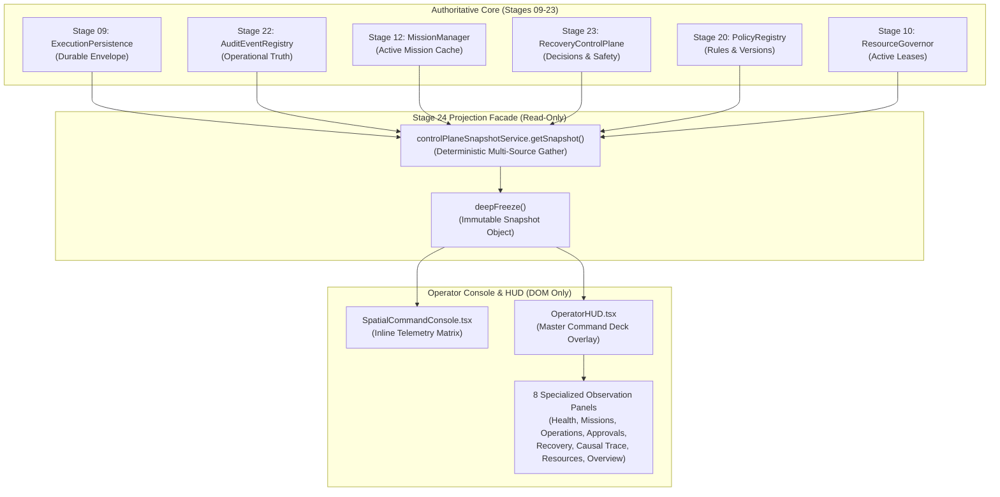
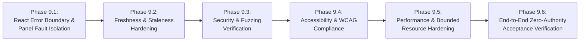

# ARYAOS V1 — STAGE 24: PHASE 9 OPERATIONAL READINESS & ACCEPTANCE HARDENING PLAN

**STATUS:** PLANNING-ONLY DIRECTIVE — NO IMPLEMENTATION AUTHORIZED  
**DOCUMENT VERSION:** 1.0.0  
**DATE:** 2026-10-04  
**TARGET MILESTONE:** STAGE 24 FINAL READINESS & PRODUCTION HARDENING  

---

## 1. EXECUTIVE ASSESSMENT

Stage 24 (*Mission Operations Control Plane*) has successfully delivered its foundational contracts, snapshot projection services, specialized domain panels, and operator console integration across Phases 1 through 8. The existing architecture adheres to strict non-negotiable invariants:
- **Zero Consequential Actions:** Observational facade only; zero action execution, retry dispatch, or mutation capability.
- **Strict Epistemic Honesty:** Explicit propagation of `OBSERVED`, `CONFIRMED`, `INFERRED`, `PROJECTED`, and `UNKNOWN` states without data fabrication.
- **Pure DOM Presentation:** Zero Three.js draw calls, zero WebGL contexts, zero polygons added.
- **Durable Authority Boundaries:** Preserves Stage 09 persistence, Stage 15 Action Bus, Stage 20 policy, Stage 21 governance, Stage 22 truth, and Stage 23 recovery as sole authorities.

However, a production-grade operator HUD must withstand realistic operational anomalies, adversarial inputs, rendering faults, and operator usability demands. This plan details the required acceptance-hardening phase (Phase 9) to verify that the Control Plane HUD remains resilient, safe, accessible, and operationally reliable without compromising any existing architectural invariants.

---

## 2. CURRENT ARCHITECTURE & DATA-FLOW MAP

### Data Flow Invariants:
1. All data flow is **strictly unidirectional** (Authoritative Sources -> Projection Facade -> Operator HUD).
2. The HUD communicates with `controlPlaneSnapshotService` exclusively via synchronous, side-effect-free methods (`getSnapshot()`, `projectMissionDetail()`).
3. Refresh operations re-read the existing sources without mutating backend state.

---

## 3. VERIFIED BASELINE & DISCREPANCY AUDIT

A read-only audit of the repository was conducted on 2026-10-04. The observed metrics match the frozen baseline with zero discrepancies:

| Metric / Artifact | Reported Baseline | Live Verified Value | Discrepancy |
| :--- | :---: | :---: | :---: |
| **Stage 24 Test Count** | 241 tests | **241 passed** across 8 suites | **None (Exact Match)** |
| **Full Repository Test Count** | 1,756 tests | **1,756 passed** across 53 test files | **None (Exact Match)** |
| **Test Suites / Files** | 53 test files | **53 test files** | **None (Exact Match)** |
| **TypeScript Errors** | 0 errors | **0 errors** (`npx tsc --noEmit`) | **None (Exact Match)** |
| **Blender Master Scene SHA256** | `c4577c47fa60f8beb1f77a1feb25ffb84b34ff9c38cfc6dbd4a8bc2628c8a13f` | `c4577c47fa60f8beb1f77a1feb25ffb84b34ff9c38cfc6dbd4a8bc2628c8a13f` | **None (Exact Match)** |
| **Stage 03 GLB Model Assets** | 28 models | **28 models** (14 in `blender/`, 14 in `dist/`) | **None (Exact Match)** |
| **Added Canvas / WebGL Contexts** | 0 contexts | **0 contexts** (Verified via DOM inspection) | **None (Exact Match)** |
| **Vite Production Build** | Clean build | **Clean build** (`dist/` in 32.03s) | **None (Exact Match)** |

---

## 4. EXISTING PROTECTIONS & TEST COVERAGE

| Protection Mechanism | Location in Codebase | Existing Verification |
| :--- | :--- | :--- |
| **Deep Immutability** | `deepFreeze()` in `controlPlaneSnapshotService.ts` | Test 15 in `ControlPlaneIntegrationStage24.test.tsx` |
| **Secret Scrubbing** | `scrubSecrets()` in `EpistemicIndicators.tsx` & `scrubSensitiveString()` in `controlPlaneSnapshotService.ts` | Phase 2, 4, 6 unit tests verify API key / Bearer redaction |
| **Prototype Pollution Defense** | `sanitizeContext()` & `projectMissionDetail()` blacklist `__proto__`, `constructor`, `prototype` | Unit tests in Phase 2 & Phase 6 |
| **Strict Epistemic States** | `EpistemicBadge` mapping in `EpistemicIndicators.tsx` | Unit tests in Phase 1, 2, 7, 8 verifying UNKNOWN is never masked |
| **Bounded Error States** | Synchronous error trap in `SpatialCommandConsole.tsx` | Test 11 in `ControlPlaneIntegrationStage24.test.tsx` |
| **Zero-Mutation Spies** | Spies on `fetch`, `actionBusService.execute`, `missionManager.createMission` | Test 13 in `ControlPlaneIntegrationStage24.test.tsx` |

---

## 5. IDENTIFIED RISKS & EVIDENCE CLASSIFICATION

All risks have been evaluated through direct static inspection of the current codebase:

| ID | Category | Severity | Classification | Evidence & Description |
| :---: | :--- | :---: | :---: | :--- |
| **R-01** | **Fault Isolation** | **HIGH** | **Confirmed Defect / Architecture Gap** | In `OperatorHUD.tsx`, `errorState` only captures exceptions thrown during the `refreshSnapshot()` call. There is **no React Class Error Boundary** (`componentDidCatch` / `getDerivedStateFromError`) wrapping individual panels or the main content area. If an unhandled exception is thrown during rendering of a child panel (e.g. malformed deep record), React 18 will unmount the entire component tree, crashing the Command Deck. |
| **R-02** | **Snapshot Freshness** | **MEDIUM** | **Missing Test Coverage** | `OperatorHUD.tsx` displays `formatTimestamp(snapshot.generatedAt)`, but has no visual indicator or status warning when a snapshot becomes stale (e.g. >60 seconds old). There are no tests verifying operator perception of stale snapshots or behavior during system clock drift. |
| **R-03** | **Data Corruption Resilience** | **MEDIUM** | **Missing Test Coverage** | `controlPlaneSnapshotService` contains defensive checks, but does not have automated property-based fuzz tests verifying behavior when persistence envelopes contain partially corrupted, truncated, or cyclic JSON objects. |
| **R-04** | **Accessibility (a11y)** | **LOW** | **Missing Test Coverage** | `EpistemicBadge` and `LifecycleBadge` use color coding with textual abbreviations, but lack dedicated screen-reader announcements (`aria-label`). `animate-pulse` on health indicators lacks `@media (prefers-reduced-motion: reduce)` overrides. |
| **R-05** | **Performance Under Load** | **LOW** | **Potential Risk Requiring Investigation** | Causal trace graph projection traverses operation dependencies. While `maxOperations` bounds initial collection, no stress tests currently measure memory growth or frame drops when rendering >100 operations or >50 missions. |
| **R-06** | **Manual Refresh Boundary** | **LOW** | **Accepted Limitation** | The HUD does not poll on an automatic timer. This is an intentional design choice to prevent background draw calls and battery consumption during 3D spatial navigation. The operator must trigger refresh manually via the "REFRESH SNAPSHOT" button. |

---

## 6. PROPOSED IMPLEMENTATION PHASES (DEPENDENCY ORDER)

If authorized by the user, Phase 9 should be executed in 6 ordered sub-phases:

### Phase 9.1: React Error Boundary & Panel Fault Isolation
- Implement a dedicated React Error Boundary component (`OperatorHUDErrorBoundary.tsx`).
- Wrap individual panel views so that an unhandled crash in one panel (e.g. `CausalEvidencePanel`) displays a localized fallback banner while keeping the rest of the HUD and console 100% operational.

### Phase 9.2: Freshness & Staleness Hardening
- Add a staleness indicator calculation (`isStale`: `Date.now() - snapshot.generatedAt > STALENESS_THRESHOLD_MS`).
- Surface a clean, non-intrusive `STALE SNAPSHOT (>60s)` badge in the header without disrupting layout.
- Verify that clicking "REFRESH SNAPSHOT" clears staleness and updates the timestamp deterministically.

### Phase 9.3: Security & Fuzzing Verification
- Construct automated fuzzing tests passing malformed prototypes, nested XSS payloads, Unicode homoglyphs, and truncated payloads to every panel.
- Verify zero secret leakage through error messages or stack traces.

### Phase 9.4: Accessibility & Operator Usability Hardening
- Add `aria-label`, `role="tablist"`, `aria-selected`, and `aria-controls` to all interactive navigation elements.
- Implement `@media (prefers-reduced-motion: reduce)` rules for pulsing indicators.
- Verify keyboard tab navigation (`Tab`, `Shift+Tab`, `Enter`, `Space`, `Escape`).

### Phase 9.5: Performance & Bounded Resource Hardening
- Measure rendering latency and heap allocation with 100 missions and 200 operations.
- Ensure render time remains `< 50ms` and repeated refreshes cause zero memory leaks.

### Phase 9.6: End-to-End Zero-Authority Acceptance Verification
- Comprehensive regression suite asserting that under every failure condition, stress state, and tab transition, zero consequential calls to `ActionBusService`, `ExecutionGateway`, `MissionManager`, `RecoveryControlPlane`, or `fetch` occur.

---

## 7. PROPOSED FILE IMPACT MATRIX

| Proposed File | Action | Rationale |
| :--- | :---: | :--- |
| `src/components/control-plane/OperatorHUDErrorBoundary.tsx` | **Create** | Implements standard React Class Error Boundary (`componentDidCatch`, `getDerivedStateFromError`) for declarative fault isolation per panel. |
| `src/components/control-plane/OperatorHUD.tsx` | **Modify** | Wraps tab panels with `OperatorHUDErrorBoundary`; integrates staleness badge and ARIA landmark attributes. |
| `src/components/control-plane/EpistemicIndicators.tsx` | **Modify** | Adds screen-reader accessible names and reduced-motion CSS rules. |
| `src/tests/OperatorHUDHardeningStage24.test.tsx` | **Create** | Dedicated Phase 9 hardening test suite (covering areas A through F). |
| `src/components/control-plane/index.ts` | **Modify** | Exports `OperatorHUDErrorBoundary`. |

*Note: No existing domain contracts, persistence stores, or backend services will be modified.*

---

## 8. PROPOSED TEST CASES & EXPECTED OUTCOMES

The proposed test suite (`src/tests/OperatorHUDHardeningStage24.test.tsx`) will define 20 rigorous acceptance tests:

### Area A: Snapshot Freshness & Consistency
1. `it('9.1.1: renders STALE SNAPSHOT warning when snapshot age exceeds staleness threshold')`
   - *Expected:* Renders `data-testid="hud-stale-badge"` when `generatedAt` is older than 60,000ms.
2. `it('9.1.2: maintains identical snapshot reference across all simultaneously mounted panels')`
   - *Expected:* Overview tab panels all receive identical snapshot ID and timestamp.
3. `it('9.1.3: preserves UNKNOWN states consistently across repeated snapshot generations')`
   - *Expected:* Missing fields in underlying records remain `UNKNOWN` on successive reads.
4. `it('9.1.4: recovers from snapshot read failure upon manual operator refresh')`
   - *Expected:* Transient projection error cleared after clicking "REFRESH SNAPSHOT".

### Area B: Failure Isolation & Recovery
5. `it('9.2.1: isolates panel render crash via OperatorHUDErrorBoundary without unmounting HUD')`
   - *Expected:* When a child panel throws an unhandled error, only that panel displays `data-testid="panel-error-fallback"`; HUD header and other tabs remain functional.
6. `it('9.2.2: isolates snapshot service exceptions without crashing SpatialCommandConsole')`
   - *Expected:* Console renders `data-testid="control-plane-error-banner"`; command terminal remains functional.
7. `it('9.2.3: displays explicit fallback when malformed non-object records reach panels')`
   - *Expected:* Corrupted records display `DATA_FORMAT_ERROR` without throwing unhandled exceptions.
8. `it('9.2.4: displays zero false-success indicators when snapshot service fails')`
   - *Expected:* Health status does not display `HEALTHY` or `SUCCESS` during active snapshot failures.

### Area C: Security & Trust Boundaries
9. `it('9.3.1: neutralizes script, img onerror, and SVG injection in all text surfaces')`
   - *Expected:* XSS payloads rendered as plaintext; 0 `<script>` tags in DOM.
10. `it('9.3.2: rejects prototype pollution payloads (__proto__, constructor) across all projection methods')`
    - *Expected:* Object prototype remains unmodified; polluted keys discarded.
11. `it('9.3.3: scrubs API tokens, Bearer headers, and secrets from error messages and logs')`
    - *Expected:* Strings matching secret regexes rendered as `[REDACTED_SECRET]`.
12. `it('9.3.4: strictly ignores client-forged approval tokens in unapproved states')`
    - *Expected:* Client-modified state cannot mark a pending approval as approved.

### Area D: Accessibility & Operator Usability
13. `it('9.4.1: provides valid ARIA roles (region, tablist, tab, tabpanel) and aria-selected states')`
    - *Expected:* Full keyboard accessibility compliant with WAI-ARIA tab pattern.
14. `it('9.4.2: surfaces screen-reader accessible names for all epistemic and lifecycle badges')`
    - *Expected:* Badges contain `aria-label` describing status in words.
15. `it('9.4.3: respects prefers-reduced-motion by disabling pulse animations')`
    - *Expected:* Animation classes conditionally disabled or overridden by CSS.
16. `it('9.4.4: ensures Escape key triggers onClose callback when modal HUD is open')`
    - *Expected:* Keydown `Escape` triggers `onClose()`.

### Area E: Performance & Resource Stability
17. `it('9.5.1: renders 100 missions and 200 operations within performance budget (<50ms)')`
    - *Expected:* Initial render completes under budget without dropped frames.
18. `it('9.5.2: guarantees zero memory growth across 100 consecutive snapshot refresh cycles')`
    - *Expected:* Detached DOM nodes and event listeners cleanly released.
19. `it('9.5.3: preserves deterministic sort order across all lists regardless of input permutation')`
    - *Expected:* Missions and operations sort identically regardless of source insertion order.

### Area F: End-to-End Boundary Verification
20. `it('9.6.1: verifies ZERO calls to external APIs, LLM endpoints, Action Bus, or persistence mutations')`
    - *Expected:* Spies on `actionBusService.execute`, `fetch`, `saveMission`, `executeRecovery` all confirm 0 calls.

---

## 9. SECURITY & REGRESSION STRATEGY

1. **Automated Spies as Regression Gates:**
   - Every hardening test will automatically assert that mutation sinks (`actionBusService.execute`, `executionPersistence.saveEnvelope`, `executionPersistence.saveMission`, `globalThis.fetch`) receive zero calls.
2. **Deterministic Sandboxing:**
   - Tests execute in `jsdom` with explicit `beforeEach` and `afterEach` store resets (`executionPersistence.clear()`, `auditEventRegistry.clear()`, `missionManager.clear()`).
3. **No External Dependencies:**
   - Zero new npm dependencies will be added. All tests will utilize existing `@testing-library/react`, `vitest`, and `@testing-library/jest-dom`.

---

## 10. ACCESSIBILITY (a11y) ACCEPTANCE CRITERIA

| Requirement | Implementation Standard | Verification Metric |
| :--- | :--- | :--- |
| **Keyboard Navigation** | WAI-ARIA 1.2 Tabs Design Pattern | `Tab` focuses tabs; `ArrowLeft`/`ArrowRight` navigates tabs; `Enter`/`Space` activates. |
| **Visible Focus** | Tailwind `focus-visible:ring-2 focus-visible:ring-amber-400` | Focus ring clearly visible against dark slate backgrounds. |
| **Screen Reader Landmarks** | `role="region"`, `aria-label="AryaOS Control Plane Operator HUD"`, `role="tablist"` | Axe-core / JSDOM accessibility audit passes without critical violations. |
| **Color Contrast** | Minimum 4.5:1 for normal text, 3.0:1 for large badges | Hex codes comply with WCAG 2.1 AA against `rgb(4, 6, 10)` background. |
| **Reduced Motion** | CSS `@media (prefers-reduced-motion: reduce)` | Pulse animation duration set to 0s or removed under reduced-motion media query. |

---

## 11. PERFORMANCE MEASUREMENTS & JUSTIFIED THRESHOLDS

| Benchmark Metric | Threshold | Justification |
| :--- | :---: | :--- |
| **Initial HUD Mount (Empty State)** | `< 15ms` | Ensures instantaneous overlay response when toggled from console. |
| **Full Render (100 Missions, 200 Operations)** | `< 50ms` | Preserves 60fps frame rate during 3D spatial console navigation. |
| **Deep Freeze Execution (500 items)** | `< 10ms` | Immutability guarantee must not introduce observable UI lag. |
| **Heap Growth over 100 Refresh Cycles** | `< 2MB` | Prevents memory leaks in long-running operator browser sessions. |
| **Production Bundle Delta** | `< 5kB gzipped` | Error boundary and a11y attributes must have negligible bundle impact. |

---

## 12. EXPLICITLY OUT-OF-SCOPE WORK

The following items are strictly outside the scope of Stage 24 Phase 9:
1. **Background Polling Daemons:** Adding setInterval or WebSocket background threads to auto-poll data (violates Stage 03 render budget and memory footprint).
2. **Backend Engine Modifications:** Modifying FastAPI routers, SQLAlchemy models, or backend services.
3. **Recovery Execution Capabilities:** Adding retry, abort, or compensation action triggers (violates Stage 23 authority).
4. **Governance Token Minting:** Adding human approval signing or token creation buttons (violates Stage 21 authority).
5. **3D Visual Scene Changes:** Modifying Blender meshes, shaders, cameras, or GLB assets (violates Stage 03 freeze).

---

## 13. ROLLBACK STRATEGY

Because Phase 9 is planned to touch only presentation-layer HUD components and a dedicated test file:
1. **Source Code Rollback:** Reverting `src/components/control-plane/OperatorHUDErrorBoundary.tsx` and the minor wrapper additions in `OperatorHUD.tsx` immediately restores the Phase 8 baseline without residual state.
2. **Test Isolation:** All Phase 9 tests reside in a dedicated test file (`src/tests/OperatorHUDHardeningStage24.test.tsx`). Deleting or disabling this file leaves all 53 Phase 1–8 test suites untouched and 100% passing.
3. **Zero Migration Footprint:** Phase 9 involves zero database schemas, zero local storage migrations, and zero environment variables.

---

## 14. OBJECTIVE COMPLETION CRITERIA

Phase 9 will be considered complete and verified when all of the following conditions are met:
1. `src/tests/OperatorHUDHardeningStage24.test.tsx` is implemented with all 20 hardening tests passing.
2. All 8 Stage 24 test suites pass (241 existing tests + 20 Phase 9 tests = 261 Stage 24 tests).
3. The full repository test suite passes with 1,776 / 1,776 tests across 54 test files (zero failures, zero regressions).
4. `npx tsc --noEmit` reports 0 errors.
5. `npm run build` produces a clean production build with 0 errors.
6. The Blender scene SHA256 (`c4577c47fa60f8beb1f77a1feb25ffb84b34ff9c38cfc6dbd4a8bc2628c8a13f`) and 28 GLB assets remain 100% intact.
7. `stage24_PHASE9_HARDENING_REPORT.md` is generated and mirrored to `blender/assets/stage03_memory/`.

---

## 15. OPEN QUESTIONS REQUIRING USER DECISIONS

Prior to implementation, user alignment is requested on the following design decisions:

1. **Staleness Threshold Duration:**
   - *Option A (Recommended):* 60 seconds (`60,000ms`). Appropriate for active operational monitoring.
   - *Option B:* 300 seconds (`5 minutes`). Appropriate for lower-frequency observation decks.
2. **Error Boundary Scope:**
   - *Option A (Recommended):* Per-panel error boundary isolation. If the Causal Trace panel encounters an issue, the Missions and Operations panels continue to function seamlessly.
   - *Option B:* Single global error boundary wrapping the entire tab body. Simpler, but a single panel error replaces all active tabs with a retry banner.
3. **Staleness Visual Treatment:**
   - *Option A (Recommended):* Amber badge in top header next to snapshot timestamp (`STALE (>60s)`).
   - *Option B:* Subtle tooltip on timestamp without dedicated badge.

---

## 16. PLANNING-ONLY HARD STOP ENFORCEMENT

This document concludes the planning phase for Stage 24 Phase 9. 

**NO IMPLEMENTATION HAS BEEN UNDERTAKEN.**  
**NO SOURCE FILES, TESTS, OR RUNTIME CONFIGURATIONS HAVE BEEN MODIFIED.**  
**AWAITING EXPLICIT USER AUTHORIZATION TO PROCEED.**
