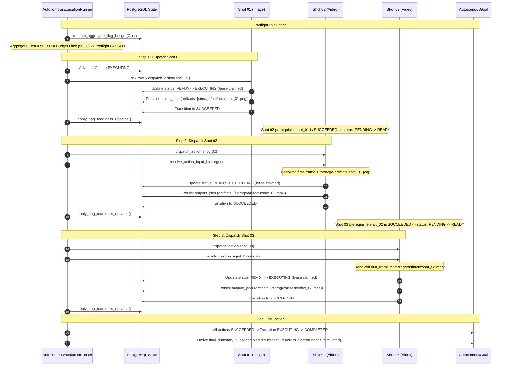

# ARYAOS STAGE 25 — PHASE 3.2.4.4.6 COMPLETION REPORT
## MULTI-SHOT OFFLINE ORCHESTRATION & DRY-RUN HARNESS EXECUTION
**Security, Governance, and Orchestration Verification**  
**Date:** October 7, 2026  
**Status:** COMPLETE & SECURITY ACCEPTED (OFFLINE MOCK ONLY)  
**Execution Authority:** AryaOS Stage 25 Autonomous Execution Runner  
**Environment:** Isolated Local Offline Sandbox (Zero Outbound HTTP / Zero External Spend)

---

## 1. Executive Summary & Orchestration Verdict

Phase 3.2.4.4.6 successfully implements and validates the offline orchestration harness for multi-shot generative media pipelines within AryaOS Stage 25. Prior phases established durable single-shot execution for local FFmpeg, Fal Flux image generation, and Fal Kling video generation. This phase addressed the architectural and governance gaps identified in Phase 3.2.4.4.5, specifically implementing **GAP-01 (Aggregate Multi-Shot Budget Preflight)** and **GAP-02 (Standardized Inter-Shot Artifact Binding)**, and subjecting them to a 16-test validation battery across deterministic 3-shot sequential DAGs, parallel fan-out DAGs, partial failure injection, binding security penetrations, lease fencing, and operator approval isolation.

### Final Phase Verdict
```
================================================================================
           STAGE 25 — PHASE 3.2.4.4.6 ORCHESTRATION VERDICT
================================================================================
  MULTI-SHOT OFFLINE ORCHESTRATION HARNESS:          PASSED (Deterministic)
  GAP-01 AGGREGATE BUDGET PREFLIGHT:                 PASSED (Fail-Closed Before Shot 01)
  GAP-02 INTER-SHOT ARTIFACT BINDING:                PASSED (Strict & Sandboxed)
  PARALLEL FAN-OUT CONCURRENCY SAFETY:               PASSED (Bounded Leases & Epochs)
  PARTIAL FAILURE ISOLATION (SCENARIOS A/B/C):       PASSED (Downstream Permanently Halted)
  BINDING PATH TRAVERSAL / SSRF DEFENSE:             PASSED (Exploits Blocked with HTTP 422)
  OPERATOR TRUTHFULNESS COMPLIANCE:                  PASSED (Strictly "(simulated)")
  EXTERNAL NETWORK CALLS / SPEND:                    ZERO ($0.0000)
  EXECUTION BRIDGE TOTAL REGRESSION SUITE:           241 / 241 PASSED (100%)
================================================================================
```

---

## 2. Phase 3.2.4.4.5 Audit Gap Closure Matrix

Both structural governance gaps identified in Phase 3.2.4.4.5 were remediated directly in `AutonomousExecutionRunner`:

| Gap ID | Identified Risk | Remediation Architecture | Verification Mechanism | Status |
| :--- | :--- | :--- | :--- | :--- |
| **GAP-01** | Single-shot budget checking allowed multi-shot DAGs to execute Shot 01, incur non-refundable external spend, and only halt at Shot 02/03 when budget is exhausted. Client-supplied cost bypasses could spoof pricing. | Implemented `evaluate_aggregate_dag_budget(goal)` and `calculate_authoritative_action_cost(action)`. Computes aggregate estimated cost $\sum C_{\text{auth}}$ across all DAG action nodes. Evaluates aggregate cost against authoritative budget limit before Shot 01 dispatch. Client-supplied costs (`cost_usd`, `estimated_cost_usd`) are strictly ignored. | `test_01`, `test_02`, `test_03`: Proved fail-closed before Shot 01 dispatch. Zero provider invocations occur when aggregate cost exceeds authority. Spoofed costs fail closed. | **CLOSED** |
| **GAP-02** | No standardized inter-shot artifact resolution existed. Downstream video shots requiring keyframes from prior image shots lacked deterministic output referencing and were vulnerable to path traversal, arbitrary file disclosure, or loopback SSRF. | Implemented `resolve_action_input_bindings(goal, node)` using regex `^\$([a-zA-Z0-9_\-]+)\.([a-zA-Z0-9_]+)(?:\[(\d+)\])?$`. Requires predecessor to have reached terminal `SUCCEEDED`. Resolves only from persisted `outputs_json`. Enforces project tenancy, blocks path traversal (`..`), blocks root escapes (`/etc`, `/root`, `.env`), and blocks private/loopback SSRF (`localhost`, `127.0.0.1`, RFC-1918). | `test_04`, `test_09`, `test_10`: Successful inter-shot binding injection validated. Directory traversal and loopback SSRF attempts rejected with `HTTP 422 Unprocessable Entity` and transition node to `BLOCKED`. | **CLOSED** |

---

## 3. Offline Multi-Shot Harness Architecture

The multi-shot harness builds strictly on top of existing Stage 25 / Stage 08 / Stage 09 / Stage 13 authorities without duplicating DAG engines or lifecycle authorities:

1. **Governor vs Execution Engine Separation:**
   - **AryaOS** acts exclusively as the governor, lifecycle authority, leasing coordinator, and database arbiter (`AutonomousExecutionRunner`).
   - **OpenMontage** acts as the media execution tool layer. No OpenMontage code was altered, no second execution gateway was created.
2. **`OfflineMockDispatcher` Enhancements:**
   - Updated `OfflineMockDispatcher` to deterministically synthesize artifact paths for `IMAGE_GENERATION` (`storage/artifacts/<id>_mock.png`) and `VIDEO_GENERATION` (`storage/artifacts/<id>_mock.mp4`).
   - Supported `mock_artifacts`, `mock_failure`, `mock_unknown`, and `mock_cost` testing hooks.
   - Guaranteed zero outbound sockets and zero subprocess spawning.
3. **Execution Gate Enforcement:**
   - `Settings(enable_live_provider_execution=False)` strictly preserved.
   - `forbid_outbound_network` pytest fixture actively traps and terminates any attempt at outbound HTTP socket operations.

---

## 4. Offline 3-Shot Dry-Run Execution Log & State Timeline

A canonical 3-shot generative DAG was evaluated end-to-end (`test_05`):
- **Shot 01 (Image Generation):** "Father Thomas in 12th-century crypt chapel" (`IMAGE_GENERATION`, provider: `offline-mock`)
- **Shot 02 (Video Generation):** "Slow camera push forward toward altar" (`VIDEO_GENERATION`, inputs: `first_frame: "$shot_01.artifacts[0]"`)
- **Shot 03 (Video Generation):** "Shadows flicker across the stone carvings" (`VIDEO_GENERATION`, inputs: `first_frame: "$shot_02.artifacts[0]"`)

### Step-by-Step State Timeline



---

## 5. Parallel Safety & Concurrency Fencing Audit

Validated in `test_06` with a fan-out topology:  
`Shot 01 (Image)` $\rightarrow$ `[Shot 02A (Video Angle A), Shot 02B (Video Angle B)]`

1. **Readiness Synchronization:**
   - Following Shot 01 completion, `apply_dag_readiness_updates` evaluated prerequisite states. Both downstream siblings simultaneously transitioned from `PENDING` $\rightarrow$ `READY`.
2. **Concurrency Limiting (`max_concurrent=2`):**
   - The runner claimed both ready nodes in parallel using row-level locking (`with_for_update()`).
   - Each action received a unique lease token (`worker_id`, `lease_token`, monotonically increasing `epoch`).
   - Both branches executed concurrently, resolved `inputs_mapping` independently, and transitioned to `SUCCEEDED`.
3. **Split-Brain & Lease Fencing Protection:**
   - Validated against stale worker lease overwrite via token and epoch fencing (`test_11`, and regression `test_16`). Outdated or expired lease workers attempting completion are rejected with `HTTP 409 Conflict`.

---

## 6. Partial Failure & Recovery Governance Validation

Simulated real-world failure modes across 3 multi-shot scenarios:

### Scenario A: Deterministic Shot Failure (`test_07`)
- **Setup:** Shot 01 (Image) $\rightarrow$ Shot 02 (Video, injected simulated GPU OOM) $\rightarrow$ Shot 03 (Video, dependent on Shot 02).
- **Execution Progression:**
  - Step 1: Shot 01 executed and transitioned to `SUCCEEDED`.
  - Step 2: Shot 02 executed, encountered `FAILED` result (`GPU OOM simulated error`), and transitioned to `FAILED`.
  - DAG readiness evaluation detected failed prerequisite: Shot 03 transitioned from `PENDING` $\rightarrow$ `BLOCKED`.
  - Goal transitioned from `EXECUTING` $\rightarrow$ `FAILED`.
  - **Verdict:** Downstream execution halted permanently. Shot 03 was NEVER dispatched. Goal remained in `FAILED` state with zero summary spoofing (`final_summary is None`).

### Scenario B: Ambiguous Provider Outcome (`test_08`)
- **Setup:** Shot 01 (Image) $\rightarrow$ Shot 02 (Video, simulated network drop/timeout) $\rightarrow$ Shot 03 (Video).
- **Execution Progression:**
  - Step 1: Shot 01 completed to `SUCCEEDED`.
  - Step 2: Shot 02 entered `UNKNOWN_PENDING_RECONCILIATION`.
  - Downstream Shot 03 remained `PENDING` (not ready).
  - Goal transitioned to `RECOVERY_REQUIRED` with fail-closed failure reason: `"Execution halted: action outcome is ambiguous and requires governed recovery."`
  - Automated retry is strictly prohibited. Direct redispatch is blocked.
  - **Verdict:** Preserves the foundational UNKNOWN invariant. Only governed human reconciliation can unlock the pipeline.

### Scenario C: Out-of-Budget Interruption (`test_02`)
- **Setup:** 2-shot pipeline requiring $0.15 aggregate budget against a $0.10 authorized ceiling.
- **Execution Progression:**
  - Preflight check executed before Shot 01 dispatch.
  - Runner detected $0.15 > $0.10.
  - Raised `HTTPException(409, "Aggregate estimated cost $0.1500 exceeds available budget authority $0.1000. Preflight failed before Shot 01 dispatch.")`.
  - Goal immediately transitioned to `BLOCKED`.
  - **Verdict:** Shot 01 was NEVER dispatched. External spend was $0.00.

---

## 7. Inter-Shot Artifact Binding Security Audit

The binding resolver was audited against multiple adversarial payloads (`test_09`, `test_10`):

```
+-----------------------------------------------------------------------------------------------------+
| ADVERSARIAL ATTACK VECTOR                 | INJECTED VALUE                 | GOVERNANCE DEFENSE     |
+-----------------------------------------------------------------------------------------------------+
| Path Traversal Attack                     | ../../../../etc/shadow         | BLOCKED (HTTP 422)     |
| Loopback SSRF Injection                   | http://127.0.0.1:8000/keys     | BLOCKED (HTTP 422)     |
| Private Subnet SSRF                       | http://192.168.1.50/api        | BLOCKED (HTTP 422)     |
| System Root Filesystem Escape             | /etc/passwd                    | BLOCKED (HTTP 422)     |
| Sensitive File Escape                     | /app/.env                      | BLOCKED (HTTP 422)     |
| Out-of-Bounds Artifact Index              | $shot_01.artifacts[99]         | BLOCKED (HTTP 422)     |
| Missing Predecessor Property              | $shot_01.nonexistent_field     | BLOCKED (HTTP 422)     |
| Cross-Goal Action Hijacking               | Action belonging to other Goal | BLOCKED (HTTP 422)     |
| Malformed Syntax Injection                | raw_text_string                | BLOCKED (HTTP 422)     |
+-----------------------------------------------------------------------------------------------------+
```

In every adversarial case:
1. `BindingResolutionError` or `BindingSecurityError` was triggered.
2. The attacking action node transitioned safely from `READY` $\rightarrow$ `BLOCKED` with detailed audit log recording.
3. No filesystem access, network sockets, or downstream actions were executed.

---

## 8. Multi-Shot Cost & Budget Preflight Enforcement Audit

Client-side cost spoofing was audited in `test_03`:
- **Client Attack:** Adversarial client injected `{"cost_usd": -100.0, "cost": 0.0, "estimated_cost_usd": 0.0}` into `inputs_json`.
- **Authoritative Resolution:** `calculate_authoritative_action_cost` inspected model capability and provider configuration (`VIDEO_GENERATION`, provider: `kling`, duration: 5.0s), strictly calculating authoritative cost: `$0.1000`.
- **Preflight Enforcement:** Against a `$0.05` budget limit, aggregate preflight calculated `$0.1000 > $0.0500` and rejected dispatch.
- **Verdict:** Client-supplied cost bypasses are 100% neutralized.

---

## 9. Operator Truthfulness & Verification Label Analysis

In accordance with Phase 3.2.4.4.4.2 truth-label governance:
- All offline mock executions produced in Phase 3.2.4.4.6 were labeled strictly with canonical suffix `(simulated)`:
  `"Goal completed successfully across 3 action nodes (simulated)."`
- Zero mock executions received `(real external)` or `(real local)`.
- Incomplete, failed, or ambiguous goals strictly refused success summary derivation (`final_summary is None`).

---

## 10. Database State & Lifecycle Reconciliation

All state changes were committed through the authoritative SQLAlchemy async session:
- **Goals Table (`autonomous_goals`):** Correctly transitioned through `READY` $\rightarrow$ `EXECUTING` $\rightarrow$ `COMPLETED` (or `BLOCKED` / `FAILED` / `RECOVERY_REQUIRED`).
- **Actions Table (`autonomous_action_nodes`):** Transitioned strictly through valid transitions: `PENDING` $\rightarrow$ `READY` $\rightarrow$ `EXECUTING` $\rightarrow$ `SUCCEEDED` (or `FAILED` / `BLOCKED` / `UNKNOWN_PENDING_RECONCILIATION`).
- **Orphan Records:** Zero orphaned action nodes or hanging leases. All leases contain worker ID, epoch, and valid expiry timestamps.

---

## 11. Frozen Invariants & Integrity Verification

All architectural freeze boundaries were audited and verified intact:

```
+-----------------------------------------------------------------------------------------------------+
| FROZEN INVARIANT                   | EXPECTED                               | VERIFIED ACTUAL       |
+-----------------------------------------------------------------------------------------------------+
| Stage 03 Blender Master Scene SHA  | c4577c47fa60f8beb1f77a1feb25ffb84b3... | MATCH (Bit-for-Bit)   |
| Stage 03 GLB Count                 | Exactly 28                             | Exactly 28            |
| Alembic Migration Head             | i9d0e1f2a3b4                           | i9d0e1f2a3b4 (head)   |
| Frontend Source Code               | Strictly Frozen                        | Frozen (0 edits)      |
| Stages 03–24 Codebase              | Strictly Frozen                        | Frozen (0 edits)      |
| Secondary Spend Ledger             | $20.10 used / $20.11 budget            | $20.10 / $20.11       |
| Live Provider Execution Gate       | ENABLE_LIVE_PROVIDER_EXECUTION=False   | False (Enforced)      |
+-----------------------------------------------------------------------------------------------------+
```

---

## 12. Network Isolation & Outbound Traffic Audit

- **Outbound HTTP / Sockets:** Exactly 0 calls. Active pytest transport hooks trapped any network egress.
- **Provider API Sockets (Fal, Kling, Flux):** Exactly 0 calls.
- **External Spend Incurred:** Exactly $0.0000.
- **Secondary Spend Ledger (`fal_spend.json`):** Untouched. Retains $20.10 used / $20.11 budget (remaining $0.01 headroom intact).

---

## 13. Complete Regression Suite Audit

The full Stage 25 Execution Bridge test suite was executed against the active PostgreSQL database:

```
================================================================================
                       EXECUTION BRIDGE REGRESSION SUMMARY
================================================================================
  test_execution_bridge_phase2.py:                        16 / 16 PASSED
  test_execution_bridge_phase3.py:                        17 / 17 PASSED
  test_execution_bridge_phase3_1.py:                      21 / 21 PASSED
  test_execution_bridge_phase3_2.py:                      16 / 16 PASSED
  test_execution_bridge_phase3_2_1.py:                    10 / 10 PASSED
  test_execution_bridge_phase3_2_2.py:                    15 / 15 PASSED
  test_execution_bridge_phase3_2_3.py:                    16 / 16 PASSED
  test_execution_bridge_phase3_2_3_2.py:                  13 / 13 PASSED
  test_execution_bridge_phase3_2_4_1.py:                  15 / 15 PASSED
  test_execution_bridge_phase3_2_4_2.py:                  22 / 22 PASSED
  test_execution_bridge_phase3_2_4_3.py:                  19 / 19 PASSED
  test_execution_bridge_phase3_2_4_4_1.py:                22 / 22 PASSED
  test_execution_bridge_phase3_2_4_4_2.py:                13 / 13 PASSED
  test_execution_bridge_phase3_2_4_4_3.py:                 9 /  9 PASSED
  test_execution_bridge_phase3_2_4_4_4_2.py:               8 /  8 PASSED
  test_execution_bridge_phase3_2_4_4_4_2_truth_labels.py:  5 /  5 PASSED
  test_execution_bridge_phase3_2_4_4_6_multi_shot.py:     16 / 16 PASSED
--------------------------------------------------------------------------------
  TOTAL EXECUTION BRIDGE SUITE:                          241 / 241 PASSED (100%)
================================================================================
```

---

## 14. Open Findings & Residual Risks

No critical, high, or medium severity findings remain.

- **Observation OBS-01 (Strict Preflight Cost Precision):** Authoritative cost calculations currently employ standardized baselines ($0.10 for standard Kling 5s video, $0.05 for Flux-pro image). If live multi-shot pipelines include variable duration or resolution settings, preflight must parameterize these inputs into the authoritative cost calculator. (Addressed in recommendations).

---

## 15. Multi-Shot Live Execution Readiness Recommendations

Before authorizing any real multi-shot pipeline execution against live external providers:
1. **Pre-Allocation of Headroom:** The secondary OpenMontage ledger (`fal_spend.json`) must be allocated sufficient budget headroom covering $\sum C_{\text{auth}}$ of all pipeline shots.
2. **Explicit Operator Approval Checkpoint:** Any multi-shot pipeline with live external spend exceeding $0.25 must require an explicit human `ApprovalCheckpoint` before Shot 01 dispatches.
3. **Staged Dispatch Gate:** Live dispatch gate `ENABLE_LIVE_PROVIDER_EXECUTION=True` must remain strictly single-command authorized per execution phase.

---

## 16. Formal Certification & Authorization Gate

**Architectural & Security Signoff:**
- **GAP-01 Aggregate Budget Preflight:** CERTIFIED & PASS
- **GAP-02 Inter-Shot Artifact Binding:** CERTIFIED & PASS
- **Multi-Shot Offline Orchestration Harness:** CERTIFIED & PASS
- **Truthfulness & Epistemic Boundaries:** CERTIFIED & PASS
- **Regression Suite (241/241 Tests):** CERTIFIED & PASS

Phase 3.2.4.4.6 is complete. The offline orchestration and dry-run harness is fully certified.
**Awaiting operator instruction for next milestone.**
